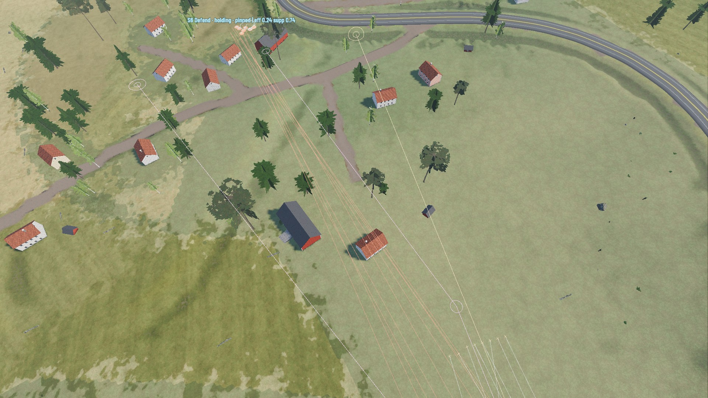
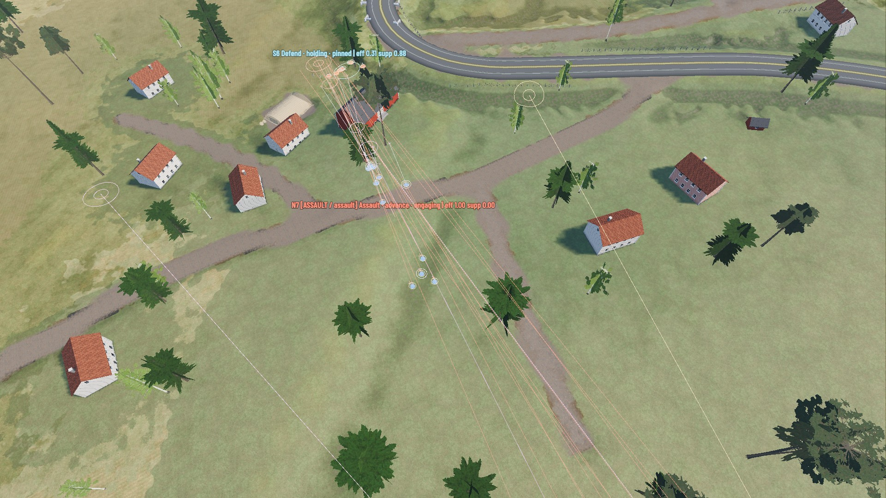
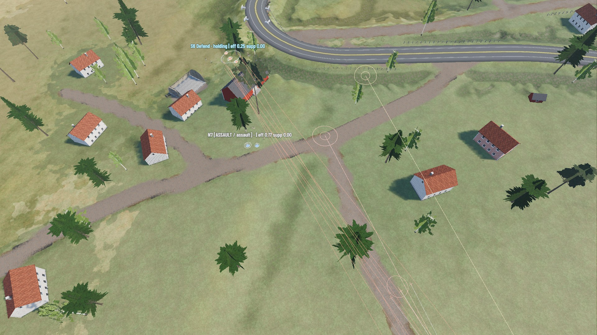
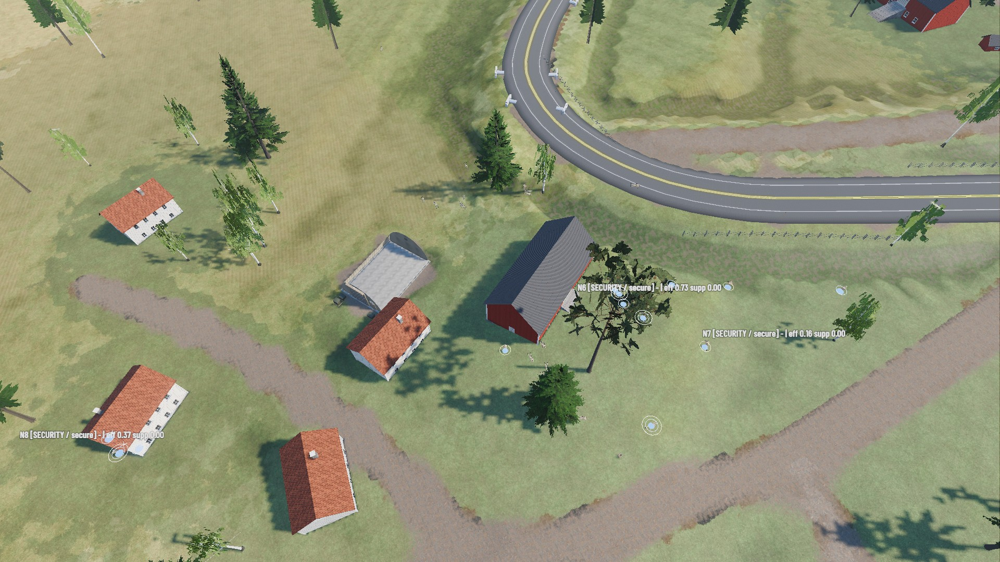

# AI-ASSAULT-01 — Coordinated infantry assaults

Status: done on `develop` (not pushed). Research: [AI-ASSAULT-01_RESEARCH.md](AI-ASSAULT-01_RESEARCH.md).

## 1. What the research said
Arma, F.E.A.R., Killzone, Company of Heroes and Brothers in Arms agree on one shape: one combat model for every side, a squad
layer that decides **who moves and who fires**, suppression as *area fire at a rate* at where the enemy is believed to be, firing
positions scored for protection *and* line of fire, and elements that **arrive together** (CoH3's AI was reworked from feeding squads
in to "wave attacks"). FRACTURED NATIONS already has that architecture (WarSim → `OpCoordination` → `SquadTactics` →
`CombatBrain`). Its failures were timing and fire control, not structure. No planner or new system was added.

## 2. Why `a_assault` failed (measured, unchanged HEAD)
`--ai-strat-test --only a_assault` with `CombatDiag` (new: a per-hit log and aimed shots by range and movement, flag `--diag`):

| Measure | HEAD |
|---|---|
| Result | 8 of 24 attackers left, withdrawal, 3 of 8 defenders left |
| Attackers' rounds / of which fire missions | 1831 / 1347 |
| Attackers' accuracy / defenders' | 1.2 % / 12.9 % |
| Aimed shots < 100 m by walking attackers | 248, 5 hits (2 %) |
| Aimed shots < 100 m by halted attackers | 20, 16 hits (80 %) |
| When each assault squad reached the defenders | N8 128 s, N7 176 s, N6 197 s |

Causes, in order of weight:
1. **Piecemeal assault.** Squads reached the defenders 50 s apart, so 8 defenders beat 24 attackers one squad at a time
   (11 hits on N8 in 11 s, 9 hits on N7 in 2 s).
2. **The halted team could not shoot.** Bound posts were chosen for protection only, so the team that stopped to cover had no line to
   the enemy. Only 20 aimed shots came from halted attackers in the whole attack.
3. **Covering fire went to the objective's map point**, not to where defenders had been reported. 1347 rounds produced a mean
   suppression on the defenders of 0.06.
4. **Ammunition.** Rifle fire missions ran at ~140 rounds a minute per soldier, so the support and the assault squads were
   "ineffective" (an ammunition factor below 50 %) before the last 100 m. One full-strength squad then stood idle for 90 s,
   because a squad that was unfit but not depleted fell through both of the operation's re-tasking branches.
5. Attackers fired on the move at 300+ m (143 shots, 0 hits) and stood upright in cover (AWARE posture).

The defenders had no unfair advantage: they were crouched, static, in a village, and they hit what stood in the open.

## 3. What changed
| Where | Change |
|---|---|
| `OpCoordination` | **Phase line**: within 170 m of the objective, no assault / maneuver squad's next bound may end more than 30 m ahead of the rearmost *other* squad still attacking. A squad behind the line closes up to it. A squad at the line waits at most 40 s, and a squad that has gained nothing for 35 s does not hold the others (`line_step`, derived each second, never saved). Staggered starts 14 → 6 s. |
| `OpCoordination` | A fire support that has seen nothing and taken no fire for 30 s during the assault **moves up** to 65 % of its distance (not closer than 100 m, at most twice). |
| `OpCoordination` | An unfit (not depleted) assault squad is handled like a depleted one: it becomes fire support, or the reserve. |
| `SquadTactics` | **Covering fire at reports** (`_cover_fire`): at the freshest reported contacts near the target. While the other team is moving, every soldier fires at reports up to 25 s old; while nobody moves, half the team fires at reports up to 8 s old. Used by ASSAULT and FLANK. |
| `SquadTactics` / `SquadPositions` | Bounds within 300 m of the enemy choose **cover the team can fire from** (`find_posts` mode `cover_fire`, from the same spot evaluation, no extra sight lines). Posts are judged against the believed enemy, not the objective's map point. |
| `SquadTactics` | Last 120 m under fire: **short rushes** (legs ≤ 22 m instead of 42 m). |
| `SquadTactics` | An AWARE squad under an **operation's** command acts as COMBAT once in contact (Arma: AWARE → COMBAT): low behind cover. The player's chosen modes are untouched. |
| `SquadTactics` | Effectiveness counts ammunition from 35 % down instead of from 50 %, so a squad carrying 50 rounds per rifleman still counts as fit to fight. |
| `CombatBrain` | **Target spreading**: a newly seen enemy that 3 soldiers already have in their sights is passed over for the next visible one up to 1.6× as far. An enemy shooting at this soldier is never passed over. |
| `CombatBrain` | A moving soldier holds aimed fire beyond 120 m (unless just hit), on both sides. Rifle fire missions are sustained fire (2 rounds every ~2 s); machine guns and marksman rifles keep their bursts. |

All of this applies to friend and foe alike: the same records, the same `CombatBrain`, the operation layer for whoever commands it.
Player authority is unchanged. `on_order` still takes a squad out of an operation, and a possessed soldier is skipped by `CombatBrain`.
A player-ordered ASSAULT / FLANK also uses `_cover_fire`: its covering team fires at reported enemies, and within 130 m of the
clicked point it fires at that point.

## 4. Results
Haugen attack, 3 squads against 1, same harness, run one at a time (never in parallel):

| Series | HEAD | AI-ASSAULT-01 |
|---|---|---|
| `--ai-strat-test a_assault` | FAIL: 8/24 left, withdrew | **PASS: 19/24 left, objective taken** |
| `--combat02-test a_haugen --seeds=1,2,3` (riflemen) | 1 of 3 taken, 9.0/24 left on average | **3 of 3 taken, 14.7/24** |
| `--combat02-test e_haugen --seeds=1,2,3` (MG + grenadier squads) | 3 of 3, 17.0/24 | 3 of 3, 15.7/24 |
| Attackers' rounds per attack (a_haugen) | 1839 | 1580 |
| Defenders' accuracy (a_haugen) | 19.6 % | 15.7 % |

Outcomes are stochastic: an intermediate build lost one `a_haugen` seed that won on a rerun. Judge on the series, not one run.
The `e_haugen` difference (17.0 → 15.7 left) is within that spread.

Other checks (one run each):
- **Defence**: `--combat03-test d_village` (3 seeds) passes. The garrison keeps its posts and falls back lines; the attackers win as before.
- **Friend vs enemy**: `--ai-squad-test a_engagement` passes.
- **RTS order during an operation**: `--ai-strat-test i_player` passes. The player's DEFEND takes the squad out, and the rest captures Haugen.
- **FPS possession during an operation**: `--combat02-test e_fps_operation` passes. The test's "loaded gun" precondition now reloads
  a magazine with fewer than 30 rounds; before, a gunner who arrived with 14 rounds could not fire the 15-round burst the check asks for.
- **Visual**: `--ai-strat-test --shots --only z_visual --fullscreen` took Haugen with 13/24 left. Frames in `docs/ai_assault01/`:
  1.  the support's fire lines on S6 ("pinned, supp 0.74") before the assault.
  2.  N7 advances in short bounds while S6 is pinned (0.88).
  3.  the last defenders, suppression broken, the assault on the houses.
  4.  the squads in security posts round the objective.

Performance: no new per-frame searches. The aimer count rides on the existing once-per-frame grid rebuild. The phase line is
one pass over an operation's squads per second, and `_cover_fire` is one contact query per assaulting squad per tactics step.
No profiling was needed.

## 5. Limitations and follow-ups
- Losses are still high when a squad is caught in the open at 100–150 m. The defenders hit 15 % from crouched cover. Better
  covered approach routes into the last 150 m (the flank planner refused the only flank here: exposure 71 %) would help most.
- The `e_haugen` series shows no gain. Its machine guns already suppressed well before.
- The named weapons (`assets/combat/weapons/`) with role `rifle` get the sustained mission rate through the role. Machine-gun and
  marksman pacing is unchanged.
- Not re-measured: the other combat02 scenarios (`a_three`, `a_unfavourable`, `a_fortified`, ...), the `l_war` autonomous
  war, combat03 `d_open` / `d_forest` / `d_reverse`.
