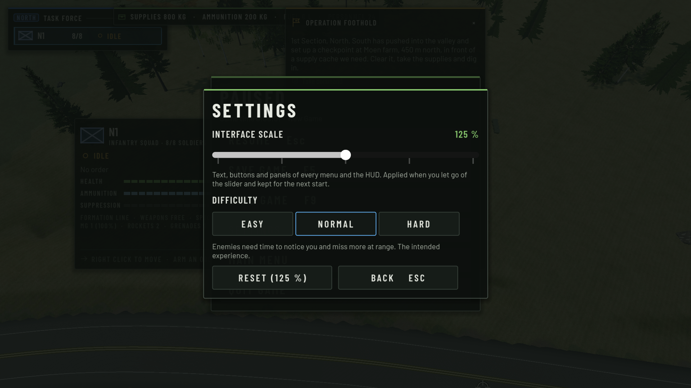

# AI-COMBAT-02 — Dynamic combat, realistic perception, difficulty

Status: done on `develop` (not pushed). Built on AI-ASSAULT-01, COMBAT-01, WORLD-COVER-01/01.1, WORLD-DETAIL-02 and
GAMEPLAY-02 (controls). No new combat system was added. The changes sit in the existing owners: `CombatBrain` (perception, cover
reactions, aim), `IntelSim` (reports), `SquadTactics` (defence, stalemate, flank planning) and `UISettings` / `SettingsPanel`.
There is one new data table, `Difficulty`.

## 1. Root causes (read from the code, then measured)

| Player feedback | Cause in the code |
|---|---|
| Enemies spot you almost at once | `CombatBrain.acquire_delay` delayed noticing only for **grass** at the target. The shape terms were `[0, 0.25, 0.8]` s per 100 m (standing / crouched / prone). A man **standing still on bare ground was noticed at once at any range up to 400 m** in the 150° field of view, and a crouched one at 150 m in 0.4 s. Position in the field of view, foliage the sight line passes, and the observer's own movement or suppression did not count. |
| Gunfire gives you away exactly | A heard shot turned listeners to the shooter's **exact** origin. Being hit turned the soldier to the shooter's exact position. Being "told" sped up noticing everywhere, not only in the direction told. A target seen once was picked up again **instantly for 12 s wherever it had moved**. |
| Shared contacts are exact | `IntelSim` sighting reports carried the target's exact position. Every squad's fire missions and "threat" used that point. |
| Too accurate | The COMBAT-01 aim profile `c01` gives a settled rifleman 0.16° + 0.035°/100 m (1 σ). That is fine for trained soldiers, but there was no difficulty setting. Combined with instant spotting, the player was hit before he could react. |
| Static firefights | An uncommanded squad in contact can only DEFEND, SUPPRESS or WITHDRAW. Its DEFEND re-plans its posts only when it is **blind under fire for 10 s** or the threat swings 55°. If posts protect but most soldiers cannot see the enemy, the squad stays there indefinitely. A single soldier's reaction keeps a spot while it **protects**, and never asks whether he can **fire** from it. The cover score even preferred "stay here, full cover" (9) over a firing spot a few metres off (≈ 8). |
| Flanks rarely happen | `_plan` tried one 75 m flank per side. On small ground or tight terrain both failed exposure or walkability, and the cover waiting at the staging point counted for nothing. |
| Player placement overridden (found here) | A squad placed with GAMEPLAY-02's right-drag is an arrived Move, so on contact `_consider` → DEFEND **sent every soldier to new posts** and could withdraw it. That broke the brief's player-authority rule. |
| New cover (WORLD-DETAIL-02) | It was already used. `cover_spots._box_candidates` sees every solid detail object (walls, bales, containers, HESCO, sandbags). Fences and guardrails are drawn only, so they are never cover. Nothing was missing in the data path. What was missing was choosing a **firing** position among those spots. |

## 2. Perception (`CombatBrain`, the same rules for every soldier)

Noticing is still the COMBAT-01 accumulation, which is the lightweight confidence the brief asks for. Every perception update
(3 Hz) that sees a candidate adds the time since the last look. The target is noticed once that total reaches `acquire_delay`, and
the count resets after 6 s out of view. The delay now depends on:

- **Shape and distance**: `[0.55, 1.2, 2.6]` s per 100 m standing / crouched / prone, plus the grass term as before.
- **Field of view**: ×1 within 25° of where the soldier is looking, rising to ×2.2 at the edge of the 150° FOV (beyond the 25 m
  awareness ring).
- **Foliage**: ×(1 + 0.6 per tree crown) the sight line passes. The count comes from the sight check already made, so no extra
  ray is cast.
- **Target movement**: ×0.4 at walking speed or faster (×0.45 before, and it was all-or-nothing).
- **Muzzle signature**: a target that fired in the last 2.5 s counts ×0.15 within 80 m, rising to ×0.45 at 300 m (×0.15 at every
  range before).
- **Told / heard / suspected**: ×0.6, but only within 20° of the direction the soldier was told to watch.
- **Observer**: ×1.3 while he walks, up to ×1.5 when he is fully suppressed, and the difficulty's `spot` factor.

New progression steps:

- **Suspicious**: at 40 % of the needed time the soldier turns to look at a blurred place (6 % of the distance sideways) before he
  has seen anyone. The player sees enemies turn towards him before they fire.
- **Recall**: a target lost from sight is picked up again at once only near where it was last seen (6 m + 2 m/s of absence,
  within 12 s ÷ the difficulty's `regain` factor). A soldier who moved has to be found again.
- **Hearing**: gunfire turns listeners to a bearing that is off by up to 12 % of the distance, not to the shooter.
- **Hits**: a soldier who is hit looks towards the blurred threat (`threat_pos`), not the shooter.
- **Squad sharing**: squad mates are told roughly where to look (6 % blur), and they must still notice the enemy themselves.
- **Faction reports**: `IntelSim` sighting reports are off by up to 3 % of the observer's distance per axis, inside the report's
  existing uncertainty. Fire missions and the squads' "threat" now aim at a place, not a grid point.

Unchanged rules: no sight through terrain, structures or solid cover (LineOfFire), and aimed fire still needs a sighting within
1.2 s. A hidden target's true position never reaches the soldier (checked in `l_track`).
`--legacy-perception` restores the COMBAT-01 rule for comparisons.

## 3. Dynamic combat and flanking

**Individual, firing positions.** A soldier in cover that protects him but has **no line of fire** looks for a short move to
nearby cover he *can* fire from (`CombatBrain._wants_firing_spot`). This happens after 12 s in cover with no enemy in sight for
10 s, when he is not suppressed and his squad is not on hold fire, at most every 25 s. The search reuses the reaction's own cover
search and radius, but excludes his own spot and accepts only spots with `can_fire`. If there is none, he keeps his cover. The
WORLD-DETAIL-02 walls, bales and containers are part of those candidates.

**Squad, stalemate.** A DEFEND tracks the share of its soldiers engaging a seen enemy, averaged over 15 s (`_track_fire_share`). In
contact with a believed enemy at 25–350 m, holding 25 s, below 25 % and not pinned, the defence is a stalemate (`_stalemate`). The
squad then:

1. **Takes the initiative (AI factions only)**: an AI squad on its own command that is clearly stronger (effectiveness ≥ 0.6,
   believed enemy ≤ 0.75 × its size, a contact of confidence ≥ 0.5 at 70–300 m) tries a **limited flank** (`_initiative`). If no
   flank is safe enough, it does not try again for 60 s.
2. **Otherwise shifts sideways**: it moves its centre 20 m (or 12 m) to the side that has a sight line to the threat
   (`_shift_centre`) and re-plans posts there. The soldiers who can fire now keep their posts, and the old posts are avoided. This
   is the existing REPOSITION with its 25 s cooldown and limit of 3 per 2 minutes.

A garrison or a stationed defence (a prepared position, where holding is the job) shifts only when almost nobody can fire (12 %)
for 40 s, and it stays inside its objective's area. A defence the player ordered, holds or placed is never touched. Player squads
never attack on their own. `--no-stalemate` switches both the individual and the squad moves off for comparisons.

**Flank planning.** `_plan` tries a wide (75 m) and a tight (45 m) flank on each side. Each is credited with the protected cover
spots at its staging point (`_stage_cover`, one cover search). With three or more spots, a flank may be a little more exposed on the
way (62 % instead of 55 %, and a smaller margin over going straight in). The team then arrives into firing positions beside the
enemy, not onto open ground. AI-ASSAULT-01's phase line, covering fire and rushes are unchanged.

**Player authority.** `SquadTactics.player_placed` (a right-drag placement still in force) counts as a hold, so the squad never
withdraws on its own. Its DEFEND uses the given places as posts, each soldier his own (`_plan` / `_enter`). Its posts are not
re-planned (`_bad_posts` and stalemate skip it). Each soldier's own cover reaction stays within 3.5 m of his place (CombatBrain
post mode, as before). Any new order clears the placement as before.

## 4. Difficulty

`Difficulty` (`scripts/combat/difficulty.gd`) is a table of multipliers that `CombatBrain` applies to soldiers **hostile to the
player**. The player's own faction gets a quarter of the step. Individual proficiency (recruit ↔ veteran) still applies on top.

| Level | Noticing time | Reaction to first shot | Aim error (σ) | Instant re-pick-up window | Suppression taken |
|---|---|---|---|---|---|
| Easy | ×1.8 | ×1.7 | ×2.0 | ÷1.7 | ×1.3 |
| **Normal** (default) | ×1.3 | ×1.3 | ×1.45 | ÷1.3 | ×1.12 |
| Hard | ×1.0 | ×1.0 | ×1.0 (the COMBAT-01 aim) | ×1.0 | ×1.0 |

Normal is more forgiving than before in two ways: the new perception (§2), and 1.45× the aim error. The first balance run used
×1.35 / ×1.75; Normal still hit a man standing in the open at 150 m with a third of its rounds, so it was raised (§6). Hard keeps the old aim but uses the new perception. Nothing in the table touches what a
soldier can see, the damage, the ammunition, the bullet physics or the tactics.

How to set it: Settings screen (start screen and Esc menu) → **Difficulty**: Easy / Normal / Hard. It applies at once, also in a
running game, and is saved in `user://settings.cfg` (section `game`). `--difficulty=easy|normal|hard` overrides it. Scripted
test runs use Normal unless they are told otherwise, so their results never depend on the tester's own setting.

## 5. Readability

The squad panel and the tactics overlay (`SquadTactics.short_text` / `status_tag`) now also say:

- **"shifting for a line of fire"**: a stalemate reposition.
- **"flanking on its own initiative"**.
- **"lost contact - watching (Ns)"**: a contact not seen for 8–90 s.
- **"pinned - cannot advance"**: a pinned squad in a moving tactic.

The soldier inspector's cover note says when a soldier moves to a firing position, or stays because there is none. No new HUD
element was added.

## 6. Checks

New targeted check `--scenario=dev --ai-combat02-test [--only d_detect,l_track,k_levels,p_placed,b_firefight]`
(`scripts/debug/ai_combat02_selftest.gd`, results in `benchmarks/raw/ai_combat02_test.json`). Each check was run once, one Godot
at a time. The first runs found three bugs in the test itself, which were fixed: a cleanup that hung, targets whose own AI stood
them up, and a "hidden" spot that did not hide a crouched head. The numbers below are from the fixed runs. Everything in this
section passes except `a_assault` (Scenario C, below).

**A - Detection** (`d_detect`, observer on the open test site; noticing time looking straight at the target / measured with
the observer's idle scan sweeping past):

| Target | COMBAT-01 rule | AI-COMBAT-02, Normal |
|---|---|---|
| standing still, 150 m | 0.0 s / 0.6 s | 0.63 s / 1.25 s |
| crouched still, 150 m | 0.27 s / (scan) | 1.42 s / 1.95 s |
| prone still, 200 m | 1.7 s / 2.3 s | 4.97 s / 5.3 s |
| walking across, 70 m | 0.0 s / 0.55 s | 0.12 s / 0.95 s |

At Normal, a crouched man at 150 m takes 2.45 s (`k_levels`: Easy 3.4 s, Hard 1.89 s). A walking man in the open is still seen at
once, which is intended.

`l_track` (a target beside a cover object ducks behind it):
- sight lost in 0.35 s, target dropped after 6.35 s;
- the observer never got the hidden position;
- the target shows again 15 m away and is noticed after **2.95 s** (before: at once, anywhere within 12 s).

**B - Firefight** (`b_firefight`, 8 against 8 on open ground with a cover object near, uncommanded squads, 100 simulated s):
- 645 shots, 498 suppression events, nobody died (soldiers have 400 HP in the test).
- **2 stalemate breaks.** The player-side squad FA sat at "Defend · holding" with nobody able to fire for 25 s, then shifted
  ("Reposition · shifting for a line of fire"). The AI squad FB then went on its own initiative into a **flank**: support set-up →
  maneuver → closing.
- Both squads showed "lost contact - watching" while the enemy was out of sight, instead of firing blind.
- No firing-position moves: the site was open ground, so no soldier had protecting cover to leave (the protected share was 0).
  The site picker gave a poor cover test case: the move between cover objects is not proven in this run. See §7.

**C - Assault** (`--ai-strat-test --only a_assault`, Haugen, 3 squads against 1, one run each, on today's world):

| Build | Result |
|---|---|
| AI-COMBAT-02 (Normal) | **Haugen captured**, all 8 defenders down, 11 of 24 attackers left. The assault went in together behind support overwatch, longest stall 10 s. The check FAILS on its losses limit (≥ 12 left) by one soldier. |
| Old behaviour on the same world (`--legacy-perception --no-stalemate --difficulty=hard`) | **Lost**: withdrew with 7 of 24, 5 defenders left, the assault stalled 110 s. |

AI-ASSAULT-01's 19/24 was measured before WORLD-DETAIL-02 put cover on the approaches. On today's world the old behaviour loses
outright. The AI-ASSAULT-01 coordination still works: phase line, support overwatch, assault and secure stages. Outcomes are
stochastic, so judge a series, not one run. The AI was not tuned to pass this check.

**D - Difficulty** (`k_levels`, 4 riflemen against one soldier standing still in the open at 150 m, 30 s; hit rate per shot):

| | Easy | Normal | Hard |
|---|---|---|---|
| Enemy riflemen vs the player's soldier | 14 % (16/111) | 22 % (24/108) | 33 % (37/111) |
| Player-side riflemen vs an enemy | 27 % | 31 % | 35 % |
| First enemy hit | 5.1 s | 6.9 s | 4.8 s |

The first balance pass (×1.35 / ×1.75 aim) gave 41 / 33 / 25 %. Normal was then raised to ×1.45 and Easy to ×2.0. Run-to-run noise
is a few points (Hard 41 % and 33 % in two runs). The order held in both runs.

**E - Player authority** (`p_placed`): a squad placed with right-drag (`order_place`) fought an enemy squad 140 m ahead for 45 s
(326 shots). Every soldier stayed within **1.0 m** of his place, the squad ran "Defend · holding · engaging" from the given
places, and the placement was kept. Before this change, its DEFEND would have sent the soldiers to new posts.

**Settings screen**: `--scenario=new_game --controls-test --shots --only u_scale --fullscreen` passes; the panel with the new row is
in .

All 205 scripts compile (`tools/check_scripts.gd`). No regression suites or seed series were run (brief).
Not re-run: COMBAT-01 `v_detect` / `s_visibility` and AI-INTEL-01 checks. They measure the old noticing times and may need new
expectations.

## 7. Limitations and next steps

- **Not proven in a run: the move from full cover to a firing position.** The firefight site had no protecting cover. A firefight
  at a settlement edge (garden walls, bales) should show it. `cover_note` in the soldier inspector says when it happens.
- **`a_assault` misses its losses limit by one** (11/24), and the 3-seed series `--combat02-test --only a_haugen,e_haugen` was not
  run. With WORLD-DETAIL-02 cover the defenders hold better, so the series should be re-measured and the limit revisited with the
  product owner.
- Detection has no light or time-of-day term (there is no night yet) and no contrast against the background.
- No suppressor or optics glint signature.
- Corner peeking is not modelled: a soldier fires from his centre, so a tall container gives cover or a firing position, never
  both. Low walls work, as the eye clears them.
- The stalemate response is lateral or a flank. Defences never advance on their own, by design: only operations and the player
  attack, and player squads never act on their own initiative.
- Difficulty is global, not stored in the save. A loaded game uses the current setting.
- The older checks that measure noticing times (COMBAT-01 `v_detect`, `g_grass`, `s_visibility`; AI-INTEL-01) were not re-run.
  Their expected numbers predate this rule.

## Files

`scripts/combat/combat_brain.gd`, `scripts/combat/difficulty.gd` (new), `scripts/strategy/intel_sim.gd`,
`scripts/core/squad_tactics.gd`, `scripts/ui/ui_settings.gd`, `scripts/ui/settings_panel.gd`, `scripts/game/core_demo.gd`
(`--ai-combat02-test`), `scripts/debug/ai_combat02_selftest.gd` (new), `README.md`, `CLAUDE.md`, this report.
