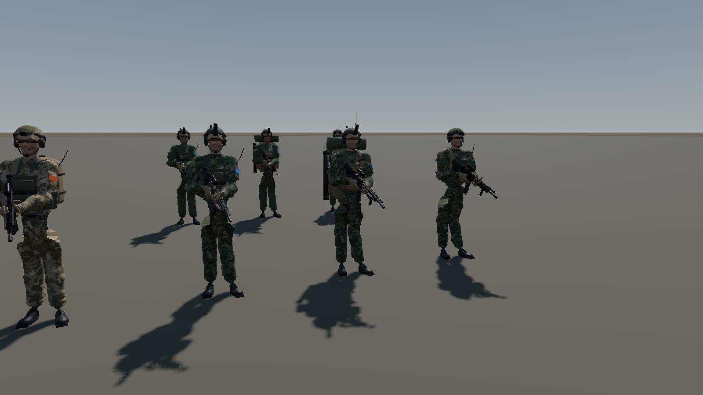

# CHARACTER-01: Modular modern infantry soldier

Branch `feature/character-01` (from `feature/world-core-02`). Godot 4.7.2 (Vulkan, Forward+),
Blender 5.2.2 LTS. Reference machine: RTX 3070 8 GB, 1600×900 window.

The placeholder soldier is replaced by one shared, rigged and animated infantry character that
is dressed by data: three loadouts (A standard, B heavy, C recon as a data-only demonstration)
use the same body, skeleton, animation set and materials, in the lab and in the real
WORLD-CORE game on both the 2 km and the 20 km world. The asset standard is in
[CHARACTER_STANDARD.md](CHARACTER_STANDARD.md); sources in [character01/REFERENCES.md](character01/REFERENCES.md).



## 1. What was built

| Deliverable | Where |
|---|---|
| Blender generation scripts (one command rebuilds everything, ~2 min) | `tools/blender/character/*.py`, entry `build_infantry.py` |
| Editable Blender source | `assets/characters/infantry/blender/infantry.blend` |
| Rig + base body + 15 clips | `assets/characters/infantry/rig/infantry_rig.glb` |
| 13 equipment pieces + carbine + 3 weapon accessories, each with LOD0/1/2 | `assets/characters/infantry/parts/`, `.../weapons/` |
| Procedural tileable textures (camo M23 + arid, ripstop, PALS webbing, cordura, leather, polymer, face) | `assets/characters/infantry/textures/` |
| Equipment and loadout resources | `assets/characters/infantry/equipment/*.tres`, `.../loadouts/{A_standard,B_heavy,C_recon}.tres` |
| Runtime: character assembly, materials, LOD merge, far proxy | `scripts/characters/` |
| Gameplay integration | `scripts/units/soldier_body.gd`, `unit_proxy.gd`, `scripts/core/unit_state.gd` |
| Lab scene, checks, screenshots, perf | `scenes/characters/character_lab.tscn`, `scripts/debug/character_lab.gd`, `benchmarks/char01/` |
| Blender renders / Godot screenshots | `docs/character01/blender/`, `docs/character01/godot/` |

### Configurations

| | A_standard (rifleman) | B_heavy (patrol load) | C_recon (data only) |
|---|---|---|---|
| Uniform | M23-style jacket/trousers, coyote gloves, black boots | same | same |
| Head | high-cut helmet, **camo cover**, headset, eye protection | **bare ranger-green shell, NVG mount + monocular, counterweight, IR strobe**, headset, eye protection | B helmet |
| Chest | ranger-green plate carrier, triple M4 shingle, admin pouch, side radio + whip, IFAK | **coyote** carrier, **double-stack 6-mag shingle**, grenade and side pouches, **chest radio**, bigger admin | A carrier |
| Belt | buckle, IFAK, dump pouch, canteen, multitool | + 2 mag pouches, **entrenching tool** | B belt |
| Back | 25 l coyote assault pack | **60 l rucksack**, sleeping mat, **M72**, long antenna | none |
| Weapon | carbine, red dot, fore grip | + laser module | red dot + laser |

## 2. Visual reference research

Primary inspiration is the Norwegian Army as fielded 2019–2025 (Telemark Battalion photos from
Noble Jump 2019, Saber Strike 2015, room-clearing training) and the 2025 **M23 / Nordic Combat
Uniform** (Forsvaret's official photo set: front, details of knee protectors, sleeve and leg
pockets), cross-checked with Danish/Swedish (Aurora 23) and Finnish M23/M17 sources and HK416N
photographs. All URLs and what each was used for: [REFERENCES.md](character01/REFERENCES.md).

Decisions taken from the photos: loose two-piece combat uniform with stand-up collar, upper-arm
velcro pockets, integrated knee protectors and thigh/lower-leg pockets, worn bloused over black
leather boots; high-cut helmet (FAST/Caiman class) with cover, rails, headset and NVG shroud;
ranger green + coyote load-bearing kit; low-ready carry with the stock collapsed against the
armour; eye protection and headset worn as standard. The camouflage is an original pattern
with the M23 structure (mid-green field, large khaki shapes, dark-green dot clusters with
broken edges, sparse near-black dots). Proportions: 1.80 m, helmet 21 × 26 cm outer, carbine
0.84 m with stock collapsed, plate bags ~25 × 30 cm.

## 3. Blender pipeline and iteration history

Everything is generated by script in background Blender (`blender -b --factory-startup
--python tools/blender/character/build_infantry.py -- --export --previews DIR`), so the
assets are reproducible bit-for-bit from the repository. Organic parts (body, head, garments,
soft pouches, packs, helmet shell) are **signed distance fields** evaluated with numpy on the
skeleton's joints, meshed through Blender's bundled OpenVDB (`Volume to Mesh`) and decimated;
hard parts (weapon, rails, buckles, mags) are bmesh primitives with bevels. Garments are offsets
of the body field, vests and belts offsets of the jacket surface, so every layer fits the one
below by construction.

| Iteration | Result in the renders | Change |
|---|---|---|
| 1 | Skin-modifier body: flaps at the pelvis, boxy torso, egg-shaped head with bulging eyes | Switched organic modelling to SDF + OpenVDB ([iter1_body_sdf_sheet](character01/blender/iter1_body_sdf_sheet.jpg), [head](character01/blender/iter1_head_sheet.jpg)) |
| 2 | First uniform: camo too small and uniform (read as M84), washed-out colours, gloves white, hourglass jacket, puffy shoulders, shapeless boots | sRGB→linear for material colours, larger camo shapes, straight jacket hull, smaller deltoids, modelled heel/toe/sole boots ([iter2](character01/blender/iter2_uniform_sheet.jpg)) |
| 3 | Gear on the A-pose: good fit, but goggle-like eye protection, M72 and mat forming an "L" on the ruck | Slimmer amber lenses, M72 vertical on the side, thicker mat ([iter3 A](character01/blender/iter3_gear_A_restpose_sheet.jpg), [B](character01/blender/iter3_gear_B_restpose_sheet.jpg)) |
| 4 | First clips: arms straight out, rifle 30 cm in front of the chest ("zombie carry") | Measured: support hand 0.73 m from the shoulder, out of reach. Longer humerus/forearm (0.305/0.266 m), stock collapsed, support grip moved back, torso bladed, support shoulder protracted ([iter4](character01/blender/iter4_poses_A_before_reach_fix.jpg)) |
| 5 | Elbows folding across the chest | IK pole angle +90° for arms (tested −90/0/90/180 numerically) |
| 6 | Crouch rifle pointing up; support hand 15–30 mm off in moving clips | Butt anchored to the posed chest, aim kept in world space; weapon follows chest yaw; reach margin ≥ 4 % → 0.0 mm |
| 7 | Run stance foot slipping (IK clamping at the end of stance) | Shorter run/sprint ground contact (duty 0.22 / 0.16), lower pelvis; slip measured per clip |
| 8 | Godot: fused "paddle" glove fingers in close-up; too many draw calls | Finger spread and slimmer finger SDF; LOD budgets and runtime LOD merge (section 6) |

Final Blender renders: [A idle sheet](character01/blender/final_A_standard_idle_sheet.jpg),
[B idle sheet](character01/blender/final_B_heavy_idle_sheet.jpg),
[A close-ups](character01/blender/final_A_standard_closeups.jpg),
[B close-ups](character01/blender/final_B_heavy_closeups.jpg),
[A poses](character01/blender/final_A_standard_poses.jpg),
[B poses](character01/blender/final_B_heavy_poses.jpg).

Blender vs Godot: the same loadouts and clips in Godot are in `docs/character01/godot/`
(`lineup_*`, `fps_close_*`, `clip_*` = every clip played directly, `closeup_weapon_hands_*`,
`rts_*`, and the in-game `core01_*` / `core02_*`). Shapes, poses and attachment positions
match; Godot renders the camo slightly darker/greener under its sky light, and the far LOD is
vertex-coloured (it reads as the same soldier at 25 m+, see `rts_25m.jpg`, back row = proxies).

## 4. Rigging and animation

* **Skeleton**: 60 bones, Godot `SkeletonProfileHumanoid` names (53/56 profile bones; eyes and
  jaw omitted), full fingers for weapon grips, 7 `ATT_*` attachment bones. A-pose rest,
  1.80 m, faces +Y in Blender = −Z in Godot (project convention).
* **Skinning**: automatic (bone heat) weights on the SDF body; every garment and the vests get
  weights transferred from that body (nearest surface, interpolated), smoothed, max 4
  influences, so cloth and body deform identically and cannot separate. Rigid kit (helmet,
  packs, weapon) rides on attachment bones.
* **Clips** (15): Idle, Crouch_Idle, Walk/Run/CrouchWalk × F/B/L/R, Sprint_F. Generated by a
  gait model with IK (feet planted at the clip's ground speed, pelvis bob/sway/twist, chest
  counter-rotation, head stabilisation, toe roll) and a weapon control bone: the firing hand
  is solved onto the carbine grip and the support hand onto the carbine's `GRIP_Support`, then
  everything is baked to FK keys and the IK rig is deleted. In place, no root motion.
* **Why procedural**: exact hand-on-weapon and foot-on-ground contact by construction,
  measurable (`build_log.json`), and regenerated when a weapon or proportions change.
* **Godot AnimationTree** (built in code, shared tree resource): Idle ↔ BlendSpace2D
  (walk 1.4 / run 4.5 / sprint 7.5 m/s in four directions) ↔ crouch blend. Driven by the body's
  velocity in local space; locomotion playback rate = speed / stride(speed), so feet match any
  speed between the authored ones. All locomotion clips are one gait cycle with the left foot
  striking at frame 0, so blends stay in phase. Turning on the spot steps sideways.
  Characters farther than 45 m update their animation every third frame.

## 5. Modular equipment architecture

```
InfantryLoadout (.tres)  ── items ──▶ InfantryEquipment (.tres): id, glTF, SKINNED|RIGID, attach, slot, hides_body
        │
InfantryCharacter.setup(loadout, faction)
   rig glb (Skeleton3D + body regions + AnimationPlayer)
   ├─ SKINNED pieces: meshes moved onto the Skeleton3D (skin binds by bone name)
   ├─ RIGID pieces: BoneAttachment3D(ATT_*) or a mount node of another piece (weapon:ATT_Optic)
   ├─ body regions hidden by hides_body (no body under clothes, no poke-through)
   ├─ materials → InfantryMaterials (shared by name; faction camo + patch colour)
   ├─ LOD0 pieces + merged LOD1/LOD2 (InfantryLodMerge, cached per loadout/faction)
   └─ AnimationTree driven by `body.velocity`
```

* A loadout swap at runtime is `setup()` again (2.5 ms measured); nothing is rebuilt in
  Blender. `C_recon` is a third configuration made only of a `.tres` file.
* Adding a new piece or a third uniform without touching the core: section 10 of the standard.

## 6. LOD and performance

| Level | Distance | A_standard | B_heavy |
|---|---|---|---|
| LOD0 (pieces) | 0–12 m | 61.1k tris | 65.1k tris |
| LOD1 (merged, 1 surface per material) | 12–28 m | 18.5k | 19.8k |
| LOD2 (merged, 1 vertex-colour surface) | 28 m → demotion (150 m) | 3.9k | 4.2k |
| Proxy (abstract tier, static Idle pose, no skeleton) | beyond the detail radius | 3.9k | 4.2k |

Materials: 24 shared materials for all loadouts and both factions; textures 4.4 MB on disk
(119 MB texture memory in the lab including Godot's own). Per-piece budgets and file sizes are
in `benchmarks/char01/blender_build_log.json`.

**Group test** (`run_char_lab.sh "--perf N"`, soldiers walking/running in a grid, three
camera stations; `benchmarks/char01/character_perf_*.json`):

| | close (6 m) | mid (30 m) | RTS (90 m) |
|---|---|---|---|
| 60 old placeholders (static) | 0.88 ms, 81 draws | 0.78 ms, 53 | 0.72 ms, 21 |
| 60 new soldiers, A/B mixed, animated | 7.24 ms, 1256 draws, anim 1.57 ms, GPU 1.84 ms | 5.74 ms, 417 draws, anim 1.52, GPU 1.40 | 2.42 ms, 125 draws, anim 0.51, GPU 0.51 |
| 150 new soldiers | 17.4 ms, 2485 draws | 16.0 ms, 1668 | 6.3 ms, 305 |

Memory for 60 soldiers: +30 MB static RAM, +76 MB video memory (mostly Godot's per-instance
skinned vertex buffers). The run-time LOD merge cut the mid-distance cost from 2555 to 417 draw
calls (7.7 → 5.7 ms). "anim" is the AnimationTree update; the remaining CPU time is skeleton
and bone-attachment updates.

**In the game** (same scripted tests as WORLD-CORE-01/02):

| | Baseline (placeholder) | CHARACTER-01 |
|---|---|---|
| Core demo, FPS, 16 soldiers | 1.53 ms, 580 draws | 1.65 ms, 521 draws |
| Core demo, RTS 140 m | 1.81 ms, 317 draws | 1.84 ms, 232 draws |
| 20 km world, FPS site A | 1.33 ms, 520 draws | 1.45 ms, 485 draws |
| 20 km world, RTS 160 m / 1500 m | 1.94 / 1.76 ms | 1.84 / 1.77 ms |
| Far possession jump | 642–772 ms | 696–812 ms |
| Static memory (20 km world) | 1535 MB | 1563 MB |

No new character streaming system: bodies appear and disappear with the existing
DetailManager promotion/demotion; proxies use the cached static mesh.

## 7. Integration with WORLD-CORE

* `UnitState.loadout` (persisted in `to_dict`/`from_dict`): empty until a unit is first shown,
  then a deterministic default (every third soldier B_heavy) is stored, so a unit keeps its
  kit through possession, demotion/promotion and saves.
* `SoldierBody.bind()` builds `InfantryCharacter` under `Visual` (driven by the body's
  velocity) instead of applying faction colours to the placeholder. Possession still switches
  the visual to shadows-only, so the first-person view is unchanged; collision capsule, head
  camera height, speeds, navigation and controls are untouched.
* `UnitProxy` shows the loadout's posed proxy mesh instead of the capsule (selection ring kept).
* Switch back to the placeholder: project setting
  `fractured_nations/characters/use_infantry_character = false` or `-- --old-soldier`.
* Both WORLD-CORE self tests now also run `CharacterIntegrationCheck` and accept
  `--shot-dir=` so their screenshots do not overwrite the WORLD-CORE evidence.

## 8. Test results

| # | Requirement | Evidence | Result |
|---|---|---|---|
| 1 | Both loadouts share one skeleton and animation system | lab `shared_rig`: 60 bones in every loadout, identical 15 clips | PASS |
| 2 | Equipment swap without rebuilding | lab `swap`: A→B→A at runtime in 2.5 ms; `C_recon` is data only | PASS |
| 3 | Idle/walk/run work | `clip_*.jpg`, `lineup_*` shots; Blender `stance_slip`: walk 0.08, run 0.29, sprint 0.45, crouch walk 0.12 m/s mean (≈6 % of ground speed); Godot walk 0.11 m/s | PASS |
| 4 | Weapon and equipment stay aligned | lab `alignment`, all four soldiers × 6 states: support hand ≤ 3.0 mm from the handguard grip, weapon 0 mm from the firing-hand grip, helmet 0 mm from the head point; Blender 0.0 mm for all 15 clips | PASS |
| 5 | No major clipping/deformation | Blender and Godot close-ups (`fps_close_*`, `final_*_closeups`), layers built as offsets of the layer below, body hidden under clothing | PASS (see limitations) |
| 6 | Both configurations in FPS and RTS | core test: 16 bodies (10 A, 6 B) with full loadouts, 10/10 moving soldiers animating, possession of A and B soldiers, RTS selection/orders; `core01_*` shots | PASS |
| 7 | Persistence and detail transitions | 20 km test: 100 promotions / 78 demotions, identity and orders kept, tier changes at 150.5 m out / 119.9 m in, every body with its full persisted loadout afterwards, 16/16 proxies with the loadout mesh | PASS |
| 8 | Many soldiers at acceptable performance | 60 soldiers 2.4–7.2 ms, 150 soldiers 6–17 ms (section 6); in-game frame times within 0.1–0.3 ms of the placeholder | PASS |
| 9 | Reproducible from Blender sources | one command rebuilds all GLBs and the `.blend` (126 s); repeated builds during this milestone produced identical triangle counts | PASS |

Commands (each 1–3 minutes):

```
benchmarks/char01/run_char_lab.sh --checks      # alignment, sharing, swap, LOD, proxy
benchmarks/char01/run_char_lab.sh --shots       # docs/character01/godot/*
benchmarks/char01/run_char_lab.sh --perf 60     # [--old] for the placeholder baseline
benchmarks/char01/run_core.sh --shots           # WORLD-CORE-01 checks + character01
benchmarks/char01/run_large.sh --shots          # WORLD-CORE-02 checks on the 20 km world (needs worlds/real_20km)
```

## 9. Known limitations

* **Hands and face** are the weakest close-up elements: finger curls are a static grip pose
  (the support hand looks slightly open), the face is a generic SDF sculpt kept simple behind
  eye protection and headset. A hand-sculpted head/hands replacement fits the same rig.
* **Shoulder deformation** with the rifle raised is acceptable under the vest straps but the
  jacket sleeve bunches at the deltoid; no corrective/twist bones were added (out of scope).
* **Locomotion blending** between walk (1.4 m/s) and run (4.5 m/s) mixes gaits with different
  ground-contact times, so feet slide visibly between ~2 and ~4 m/s. AI soldiers move at the run
  speed (4.5 m/s, the existing gameplay "walk"), where the clip matches exactly.
* No turn-in-place clip (sideways steps are used), no aim/lean/prone/jump/landing clips, no
  weapon-up (aiming) pose; the possessed soldier has no first-person arms (unchanged).
* Crouch is supported by the character (`crouched`) but no gameplay input sets it yet.
* At 150 detailed soldiers the CPU side (skeleton + attachments + AnimationTree, ~50 µs per
  soldier) dominates; a further step would be animation sharing or reduced bone counts at LOD2.
* Large rucksack straps are rigid (attached to the upper chest), so they can slide slightly
  over the shoulders in extreme poses.
* The 20 km world data is not in git; the large test needs `worlds/real_20km` copied or rebuilt.
