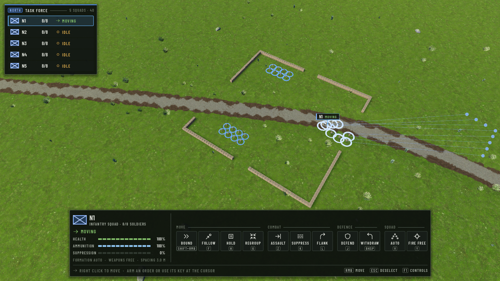
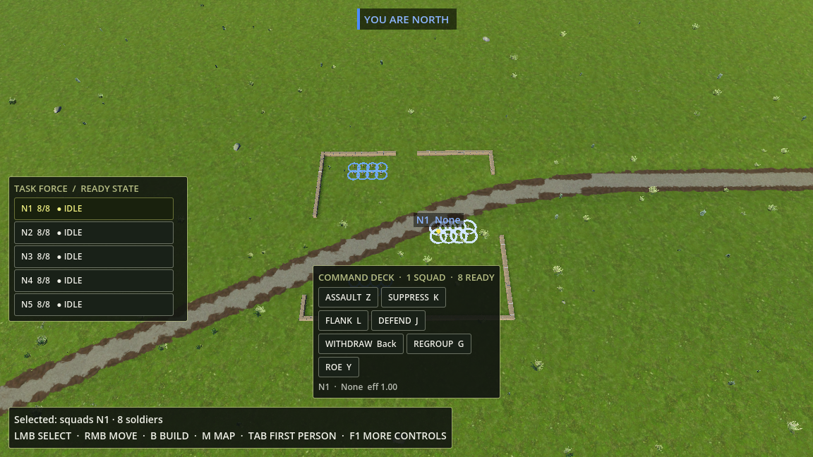
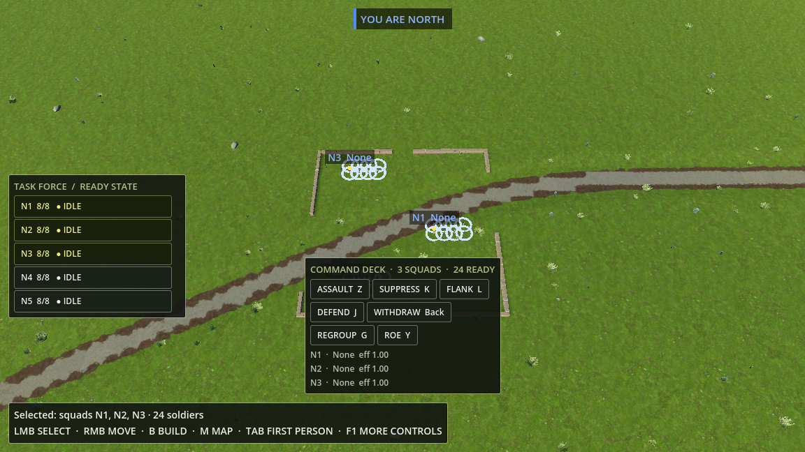
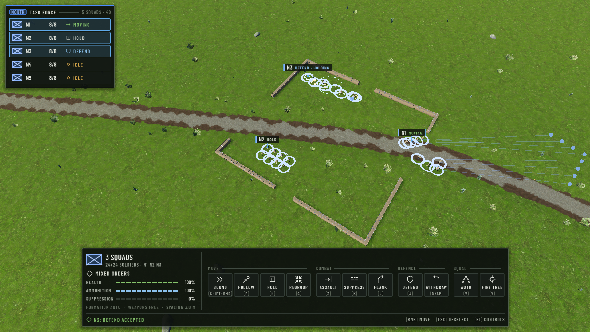
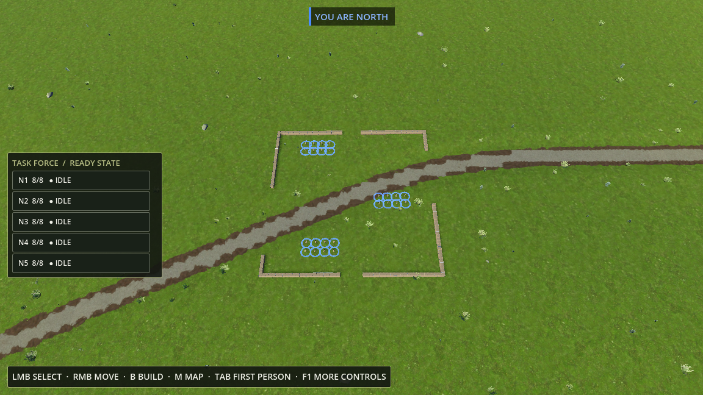
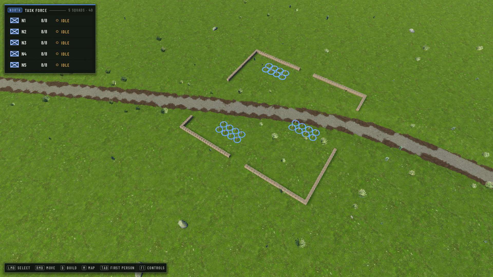

# FRACTURED NATIONS — UI-01C Phase 1

## Custom UI Kit & RTS Visual Prototype

Branch: `feature/ui-01c` (created from `feature/ui-01b` @ `e3bcdf9`, UI-01B.1). Not merged, not pushed.
Scope: the tactical (RTS) HUD only. FPS, construction and the strategic map are untouched apart
from what they share with the RTS HUD (see *Limitations*). No change to WarSim, CombatBrain,
navigation, construction, terrain or world data.

**Status: stopped for review.** The visual direction needs approval before FPS, construction and
the strategic map are built on the kit.

## 1. Result



| Before (UI-01B.1) | After (UI-01C phase 1) |
| --- | --- |
|  |  |
|  |  |
|  |  |

What changed visibly:

* **Task Force roster** (top left, was mid-left): NATO-style unit emblem, callsign, strength
  (coloured when the squad is worn down), a status icon + word in the status colour, and a
  hold-fire flag. Rows are list lines, not buttons: a faint fill, a frame only on hover, and a
  blue frame + left bar when selected (any number at once). The player's faction heads the roster
  as a chip, with the number of squads and soldiers.
* **Selection & command panel** (bottom centre, replaces the floating Command Deck): the selection
  on the left (emblem, callsign or "3 SQUADS", soldiers, current order, health / ammunition /
  suppression meters, formation · ROE · spacing), the orders on the right in four groups with an
  icon and a keycap each, and a footer with what is armed or what the last order did, plus
  RMB / Esc / F1 hints. Hidden while nothing is selected.
* **Bottom text block gone**: the permanent "Selected … / LMB SELECT · RMB MOVE …" box is replaced by a
  slim key-hint bar (only while nothing is selected). F1 and F3 still open the detailed controls
  and the diagnostics, now above whatever sits at the bottom.
* **"YOU ARE NORTH"**: in the tactical view the faction is part of the roster header; the top
  badge stays for first person and driving.
* **Field tag** over a selected squad's leader: callsign + status words of the roster (was
  "N1  None" in the fallback font); the duplicate 3D tactic label is no longer drawn for selected
  squads.
* **Typography**: Barlow Condensed for labels, numbers and captions, Barlow for body text (both SIL
  OFL, shipped in `assets/ui/fonts/`), replacing Godot's fallback font in the RTS HUD.

## 2. UI kit structure

Plain Godot Controls + one `Theme` + `StyleBoxFlat`s + SVG icons; no framework, no scenes to keep in sync.

```
scripts/ui/kit/
  fn_ui.gd               FNUI     tokens (colour, type, spacing, icon sizes), fonts, style boxes for every
                                  state, the shared Theme, label/keycap factories
  fn_icons.gd            FNIcons  SVG line icons on a 24 grid, rasterised on demand (3x oversampled, mipmapped)
  fn_panel.gd            FNPanel  HUD surface with optional accent edge
  fn_section_header.gd   FNSectionHeader   caption + hairline + aside, optional chip
  fn_status_indicator.gd FNStatusIndicator icon + word in the status colour
  fn_unit_emblem.gd      FNUnitEmblem      NATO-style frame in the side's colour, unit-type mark
  fn_unit_row.gd         FNUnitRow         roster line (emblem, callsign, strength, status, flag; hover/selected)
  fn_command_button.gd   FNCommandButton   icon + title + keycap; normal/hover/pressed/disabled/armed/current
  fn_command_group.gd    FNCommandGroup    captioned row of command buttons
  fn_meter.gd            FNMeter           caption + segmented bar + value
  fn_key_hint.gd         FNKeyHint         keycap + action
assets/ui/fonts/          Barlow, Barlow Condensed (+ OFL.txt)
```

The brief's `FNSelectionPanel` is the RTS `TacticalPanel`, composed of the components above; it is
RTS-specific (it calls `RTSController`), so it lives with the HUD in `scripts/ui/`, not in the kit.

### Design tokens (`FNUI`)

| Token | Values |
| --- | --- |
| Surfaces | `BG` #0b0f0c, `BG_PANEL` 90 %, `BG_RAISED`, `BG_HOVER`, `BG_PRESSED` |
| Lines | `LINE`, `LINE_STRONG` (hairline frames, rules) |
| Text | `INK` #e8ebe3, `INK_2` #a9b1a5 (secondary), `INK_3` #687264 (captions, disabled) |
| Accents | `ACCENT` #5fa9e8 (selection, friendly), `ARMED` #e3b04f (order waiting for a click) |
| Status | `OK` moving · `WARN` idle · `ALERT` under fire / blocked · `DANGER` engaged · `INFO` tactics · `NEUTRAL` hold |
| Type (logical px) | caption 9 · label 10 · body 11 · title 13 · headline 16 |
| Spacing | 1 · 3 · 6 · 8 · 12; screen edge 10; radius 2 |
| Icons | 11 / 14 / 18 |

Sizes are in the project's logical canvas (1152 × 648, `stretch/mode = canvas_items`), so the HUD scales
with the window: ×1.67 at 1080p, ×1.11 at 720p. The first prototype run used 1080p pixel sizes and came out
1.6× too large — that is why the tokens are small numbers.

States: `FNUI.state_style()` gives normal, hover, pressed, selected, selected-hover, armed and disabled
surfaces; status colour is always paired with an icon and a word.

### Icons (`FNIcons.SHAPES`, own SVG, 2 px square strokes)

Unit type `infantry` (NATO frame). Orders `move`, `bound`, `follow`, `hold`, `regroup`, `assault`, `suppress`,
`flank`, `defend`, `withdraw`, `formation`, `roe_free`, `roe_hold`. Statuses `idle`, `moving`, `engaged`,
`under_fire`, `blocked`, `tactic`. Readouts `health`, `ammo`, `suppression`, `soldiers`. Only what the RTS
HUD uses; adding one is one SVG path line.

## 3. Commands and statuses — existing gameplay only

| Group | Button | Key | Calls (unchanged behaviour) |
| --- | --- | --- | --- |
| MOVE | Bound | Shift+RMB | `RTSController.arm_tactic(BOUND)` |
| | Follow | F | `RTSController.arm_follow()` (the F key's code, moved into a function) |
| | Hold | H | `order_hold()` |
| | Regroup | G | `order_regroup()` |
| COMBAT | Assault / Suppress / Flank | Z / K / L | `arm_tactic(...)` |
| DEFENCE | Defend / Withdraw | J / Backspace | `arm_tactic(...)` |
| SQUAD | Formation (shows the current one) | V | `toggle_formation()` |
| | Fire free / Hold fire | Y | `toggle_roe()` |

Move stays on the right mouse button (shown in the footer). Tactics are disabled when every selected squad has
a soldier aboard a vehicle (the existing rule: such a squad never runs a tactic). Statuses shown are the ones the
records already carry: ENGAGED, UNDER FIRE, BLOCKED (route partial), the tactic and its phase, MOVING / ARRIVED,
HOLD, FOLLOW, REGROUP, IDLE. Meters: health and ammunition of the living members, suppression (`suppression_at`).
Nothing in the concept that the game does not have (morale, portraits, numbered group hotkeys, compass) was added.

## 4. Changed files

| File | Change |
| --- | --- |
| `scripts/ui/kit/*` (11 new) | UI kit |
| `assets/ui/fonts/*` (new) | Barlow / Barlow Condensed TTF + OFL licence |
| `scripts/ui/squad_panel.gd` | Task Force roster on the kit; `squad_status()` shared by roster, panel and field tag; `row_text()` kept for tests |
| `scripts/ui/tactical_panel.gd` | selection & command panel on the kit |
| `scripts/ui/game_hud.gd` | layout (roster top left below the F3 overlay, panel bottom centre, hint bar), quieter RTS text box, faction badge only outside the tactical view, kit-styled field tag |
| `scripts/ui/tactics_overlay.gd` | no 3D tactic label for selected squads; kit font on the others |
| `scripts/rts/rts_controller.gd` | `arm_follow()` (F key code as a function, so the button calls the same path); arming a tactic cancels a pending follow pick and vice versa |
| `scripts/debug/world_diagnostics.gd` | `overlay_bottom()` so the roster can sit below the F3 overlay |
| `scripts/debug/ui01c_selftest.gd` (new), `scripts/game/core_demo.gd` | `--ui01c-test` screenshots and checks |
| `README.md` | tactical HUD description, layout, font licence |

## 5. Screenshots (`docs/ui_01c/phase1/`, real Godot captures, 1920 × 1080 fullscreen)

| File | Shows |
| --- | --- |
| `01_rts_idle.png` | roster, hint bar, nothing selected |
| `02_rts_squad_selected.png` | one squad moving: selected row, field tag, command panel |
| `03_rts_multi_selected.png` | three squads (moving / hold / defend): multi-selection, "MIXED ORDERS", current-order bars on Hold and Defend |
| `04_rts_many_squads.png` | 19 squads: scrolling roster, long name truncated, UNDER FIRE, hold-fire flag, two selected |
| `05_rts_command_states.png` | armed order (Assault, amber), current order (Defend, green bar), hover (Flank), hold fire, armed footer |
| `06_rts_720p_multi_selected.png`, `07_rts_720p_idle.png` | the same layout at 1280 × 720 |

Test-only state (this run only, nothing saved, world data untouched): the many-squads picture spawns 14
temporary player squads through `WarSim.spawn_squad`, renames one to a long name and sets `under_fire_until` on
one to show the UNDER FIRE status; they are removed before the next picture.

## 6. Visual iterations

1. **First live run**: the layout read correctly but everything was ×1.6 too large (the kit used 1080p
   pixels; the project stretches a 1152 × 648 canvas), the command panel filled the screen width, and at 720p
   it did not fit. An unstyled cyan 3D label ("N3: DEFEND · HOLDING") duplicated the new field tag.
2. **Rescaled to the logical canvas**, icons rasterised 3× and mipmapped (they were blurred by the stretch),
   duplicate 3D label suppressed for selected squads, multi-selection subtitle puts the soldier count before the
   names so truncation only cuts names.
3. **Polish**: unselected roster rows lost their frames (they still looked like a button stack), the roster
   shows the tactic's name only (its phase is in the panel and tag), stronger hover, uppercase meter captions,
   larger command icons, field tags kept on screen at the edge, smaller 3D tactic labels.

Compared with the concept: same composition (roster top left, integrated command surface bottom centre with
selection summary + grouped icon commands, field tags, faction in the HUD hierarchy). The command panel is
deliberately narrower than the concept's (≈ 73 % of the width at 16:9) to leave more battlefield visible.

## 7. Functional checks

`--ui01c-test` (real game, real GUI clicks and keys through `Input.parse_input_event`), **PASS**:

| Check | Result |
| --- | --- |
| Idle | roster + hints, no panel; faction chip "North", no separate badge |
| Select one (row click) | squad selected, row marked, panel up, hints hidden |
| Multi (Shift+click ×2) | 3 squads selected, 3 rows marked, title "3 SQUADS" |
| Order via button | Hold button → all three HOLD, panel status "HOLD" |
| Armed state | Assault button arms ASSAULT (amber), footer explains; Esc cancels, selection kept |
| Keys | J at cursor → DEFEND accepted, Defend marked current; Y → hold fire (button follows); V formation |
| Deselect | Esc clears selection, panel hides, hints return |
| F1 / F3 | F1 shows full controls above the hint bar, F1 again hides; F3 shows counters and the roster moves below the overlay |
| Mode switches | M opens/closes the map; possess → first person (RTS HUD hidden, badge shown); Tab → back to RTS HUD |
| 720p | panel inside the screen, roster and panel do not overlap |

Change-impact tests of the existing suites (only those covering the changed code):

* `--ai-squad-test --only g_player` (player tactics through `RTSController`, panel visibility): **PASS**. The
  process crashed *after* printing PASS while a navmesh bake was still running at quit — that test does not
  wait for pending bakes (the sandbox and UI-01C tests do); not caused by the UI.
* `--sandbox-test --only hud` (HUD text lines, faction badge, F1/F3, first person): **PASS**
  (default text now 1 line, was ≤ 4).

## 8. Limitations and open points

* The world around North HQ is open grassland, so the captures show a lot of flat green; the HUD is the
  subject, the location was not staged.
* Vehicle and facility selection still use the UI-01B `LogisticsPanel` (blue Field Manual style); loose
  soldiers selected without their whole squad still get a one-line text, not the panel. Both are candidates for
  the next pass on the kit.
* War notifications (top centre), the FPS readout, construction and the strategic map still use UI-01B
  `FieldManual` styling; `field_manual.gd` stays until those move to the kit.
* No portrait art exists, so the selection shows the unit emblem; all squads are rifle infantry, so the subtitle
  says "Infantry squad".
* The fonts are loaded from `assets/ui/fonts/` (imported); Barlow Bold is included but unused so far.

## 9. Branch and commits

`feature/ui-01c` from `feature/ui-01b` (`e3bcdf9`). Commits are listed by `git log feature/ui-01b..feature/ui-01c`.
Next step after approval: FPS, construction and strategic map on the same kit, then merge into `develop`.
