# FRACTURED NATIONS — UI-01C Phase 2

## Complete HUD integration — Construction, FPS, Strategic Map, vehicles and RTS markers

Branch: `feature/ui-01c` (continues Phase 1). Not merged, not pushed.
Scope: presentation only. No change to WarSim, CombatBrain, navigation, construction rules, terrain or
world data; every button calls the function its key or the old panel called.

**Status: stopped for review.** All four modes now use the UI kit from Phase 1.

## 1. Summary

| Mode | Before (UI-01B.1 style) | Now |
| --- | --- | --- |
| Construction | one long list of text buttons + a large text block | category tiles, build cards with thumbnails rendered from the real models, a base strip, tool buttons, one context panel for placement / demolition |
| First person | one black text box (weapon, magazine, HP bar of ■□) and a permanent key line | weapon status (magazine largest), health bar with low-health state, squad card, reload prompt; keys only on F1 |
| Strategic map | right-hand text slab (command, selection, buttons, operations, war log) that shrank the map | command panel, layer selector, operations + 3 recent events on the left, an inspector on the right only with a selection, key bar; the map keeps its full size and proportions |
| Vehicles / facilities | blue Field Manual text panel | kit panel: header, status, fuel / condition / cargo meters, fields, command buttons, segmented cargo choice |
| RTS markers | a torus per soldier that grew up to 12x with distance | small dots per soldier, corner brackets + tag per selected squad, faint callsigns for other own squads, hidden outside the tactical view |

The old `scripts/ui/field_manual.gd` had no users left and is removed: the game has one UI style.

## 2. UI kit — new and changed components (`scripts/ui/kit/`)

| Component | Use |
| --- | --- |
| `FNCategoryTile` *(new)* | icon + caption (+ count / state): construction categories, map layers, operation rows |
| `FNBuildCard` *(new)* | thumbnail, name, function, unavailable reason; normal / hover / selected / disabled |
| `FNField` *(new)* | caption + value line for inspectors (base strip, vehicle / facility panel, map inspector) |
| `FNWeaponStatus` *(new)* | weapon name, magazine (largest), reserve, fire mode chip, one tick per round, reload progress |
| `FNHealthBar` *(new)* | health bar + value, pulsing red below 35 % |
| `FNPrompt` *(new)* | contextual keycap + action under the crosshair |
| `FNUI.action_button()` *(new)* | compact icon + text button (secondary actions, toggles) |
| `FNMeter` *(changed)* | `critical` state: pulsing bar and frame (RTS health < 30 %, suppression ≥ 60 %) |
| `FNIcons` *(changed)* | +33 icons: build tools and categories, rifle, interact (unused until an interaction system exists), map layers / objective / HQ / operation / contact, vehicle, fuel, repair, cargo, route, recruit, drive, stop, unload, clock, check |

Thumbnails: `tools/ui/make_structure_thumbs.gd` renders every catalog type from the same GLB the game
places (`StructureCatalog.mesh_of`), three-quarter view, transparent background, 192 × 144 →
`assets/ui/thumbs/<id>.png` (73 types). Roads and paved areas have no mesh and show their category icon.
Re-run the tool after adding building assets; a missing thumbnail falls back to the category icon.

## 3. Construction

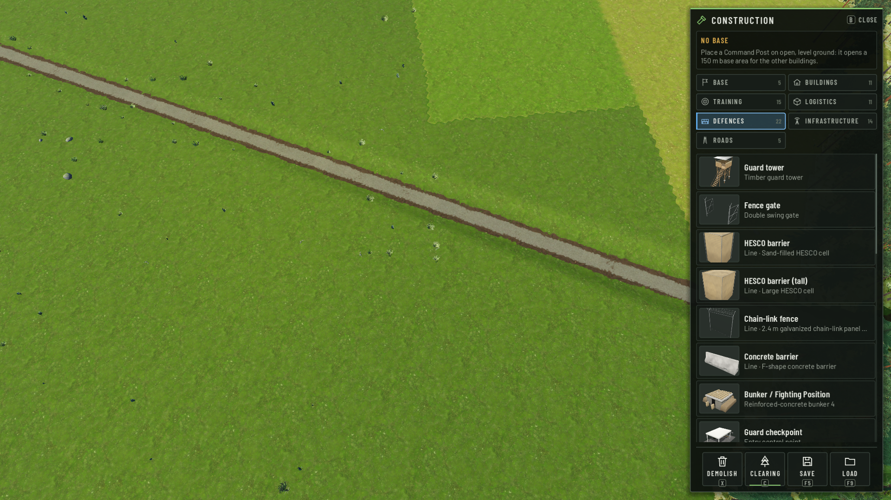

* **Menu (right):** header with B to close; base strip (no base → how to found one; with a base → name,
  buildings, soldiers / beds, parking bays, guard posts from `BaseSim.summary`); seven category tiles (Base
  = the five base buildings in build order, then the catalog categories with their counts); build cards in
  a scroll area; tools Demolish (X), Clearing (C, shows on / off), Save (F5), Load (F9).
* **Unavailable:** base facilities without a Command Post are disabled and say "Needs a Command Post"
  (the same rule `BaseSim` enforces).
* **Context panel (bottom):** only while placing or demolishing — thumbnail, name, VALID PLACEMENT or
  "Cannot build here" with the reason on its own red line, rotation, groundwork, clearing, and the keys for
  the tool (buildings: LMB / R / RMB-Esc; lines and roads: start / add / Enter / Bksp / Esc, module count,
  length, grade, cut / fill). The bottom text block no longer repeats it (F1 still shows the full help).
* `ConstructionController.toggle_clearing()` was extracted from the C key so the button uses the same path.

| Valid | Invalid (road) | Partly built base |
| --- | --- | --- |
| 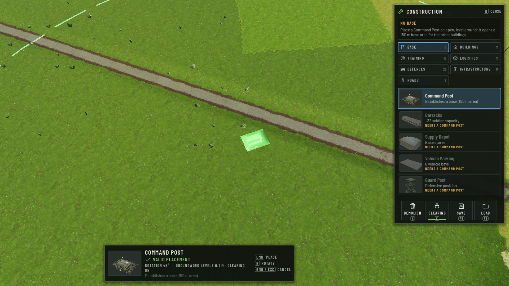 | 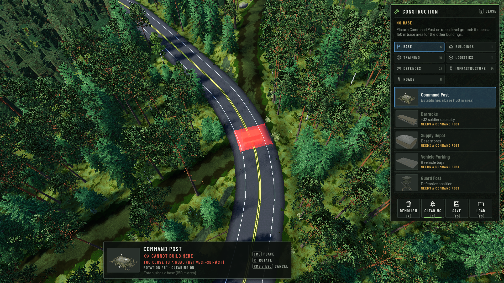 | 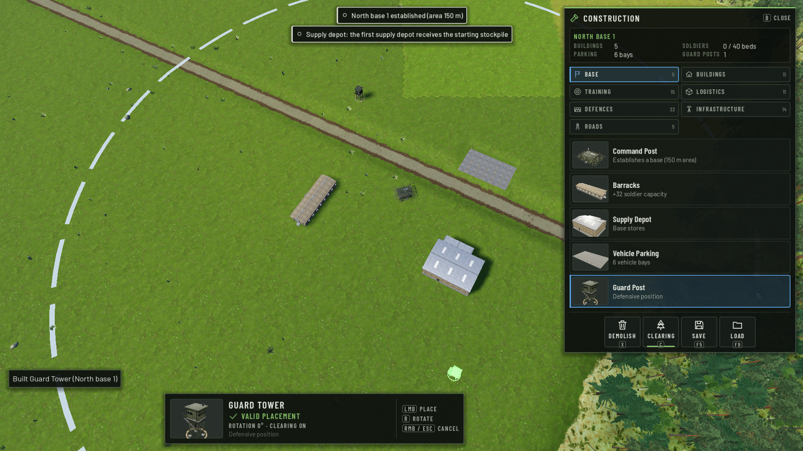 |

## 4. First person

| Normal | Squad + damage | Prompt |
| --- | --- | --- |
| 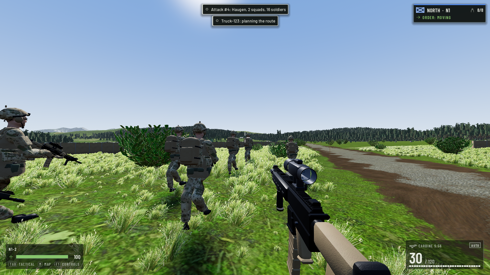 | 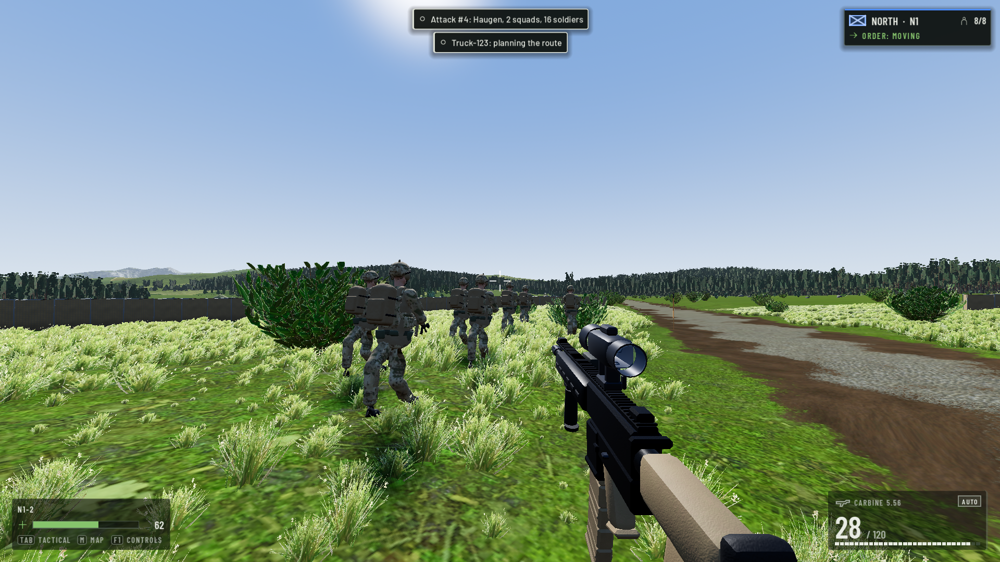 | 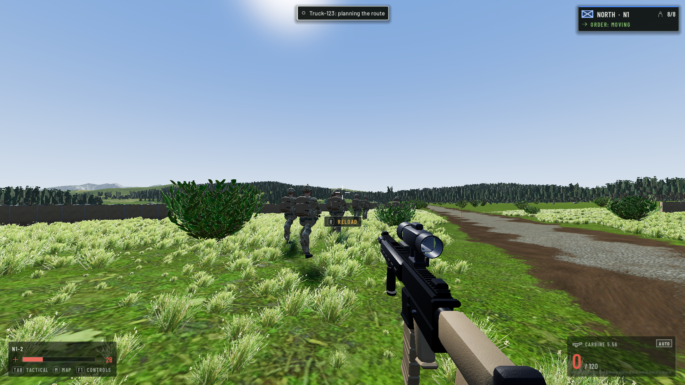 |

* Weapon bottom right, health bottom left (with suppressed / under fire when it applies and three quiet keys),
  squad card top right (side, callsign, alive / total, the squad's order in the roster's words, "You lead
  this squad" for the leader), crosshair unchanged.
* The "YOU ARE NORTH" badge is shown only while driving now; in first person the side is in the squad card.
* **Interaction prompts:** the game has no world-interaction system (no "press E" actions exist anywhere).
  The only contextual prompts first person has are the weapon's — reload when the magazine is low or empty,
  "No ammunition" — and these are what `FNPrompt` shows. `07_fps_interaction.png` shows the reload prompt
  with the magazine emptied and health lowered on the possessed soldier for the picture (test state, this
  run only). A real interaction prompt will need an interaction system first.

## 5. Strategic map

| Default | Squad selected |
| --- | --- |
| 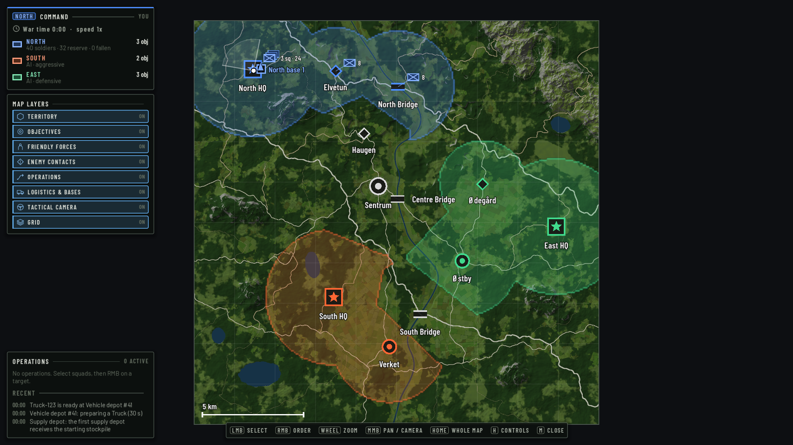 | 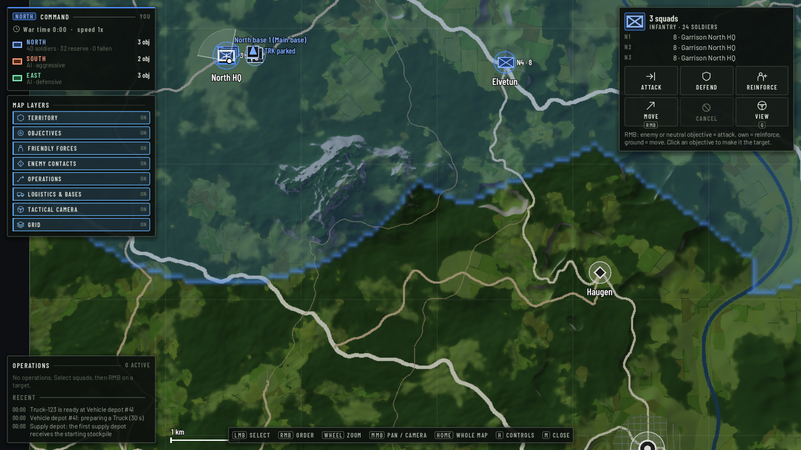 |
| **Base selected** | **Operation** |
| 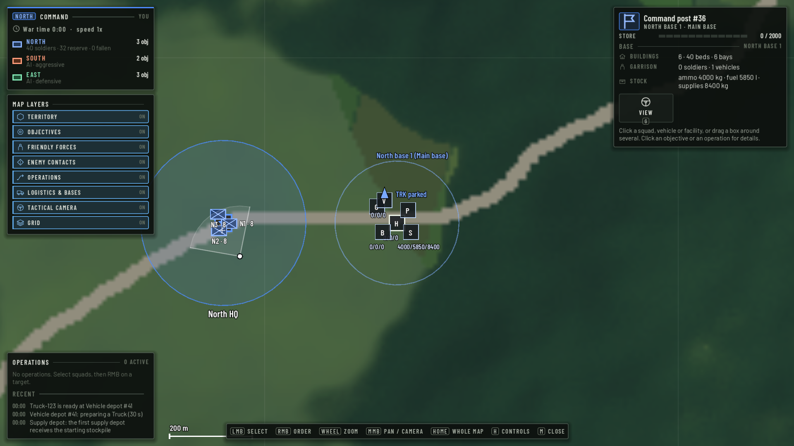 | 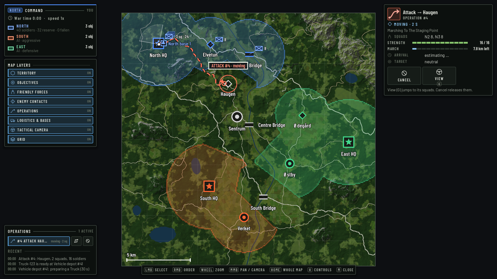 |

* The map is square and the window wide, so the panels lie over the empty sides: the map keeps its place
  and scale when the inspector opens (the old panel shrank the map). Coordinates, markers, grouping, orders
  and world data are unchanged; map labels use the kit font.
* **Command panel:** side, war time and speed, every faction's objectives (own: soldiers, reserve, fallen;
  AI: profile).
* **Map layers:** territory, objectives, friendly forces, enemy contacts, operations, logistics & bases,
  tactical camera, grid — switches for the existing draw passes (no new layer, nothing simulated).
* **Inspector** (only with a selection): squads (status, task, strength), objectives (owner, contested /
  threatened / quiet, capture, own troops, reported enemies), facilities and bases (store, buildings, garrison,
  stock, activities), vehicles (status, fuel, cargo, job), operations (phase, squads, strength, march
  progress, arrival, target, capture). Only the orders that apply are shown (Attack / Defend / Reinforce /
  Move with squads, Cancel, View G).
* **Operations + Recent:** rows with go-to and cancel, ended operations greyed for five minutes, the last
  three events; the permanent war log is gone (events still arrive as toasts in the HUD).
* **Help (H):** a kit panel in the middle of the map; the keys are a slim bar at the bottom.

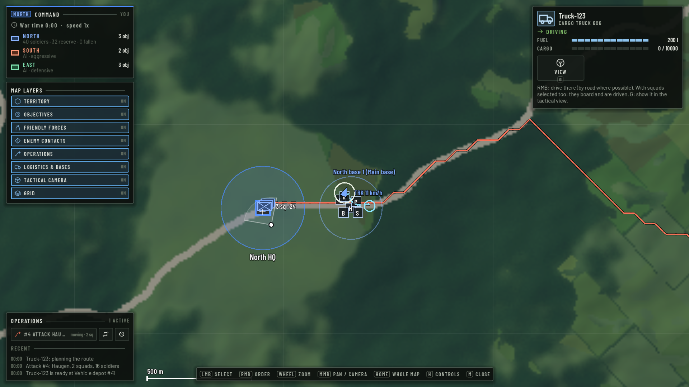

## 6. Vehicle and facility panels

| Vehicle | Facility (vehicle depot) |
| --- | --- |
| 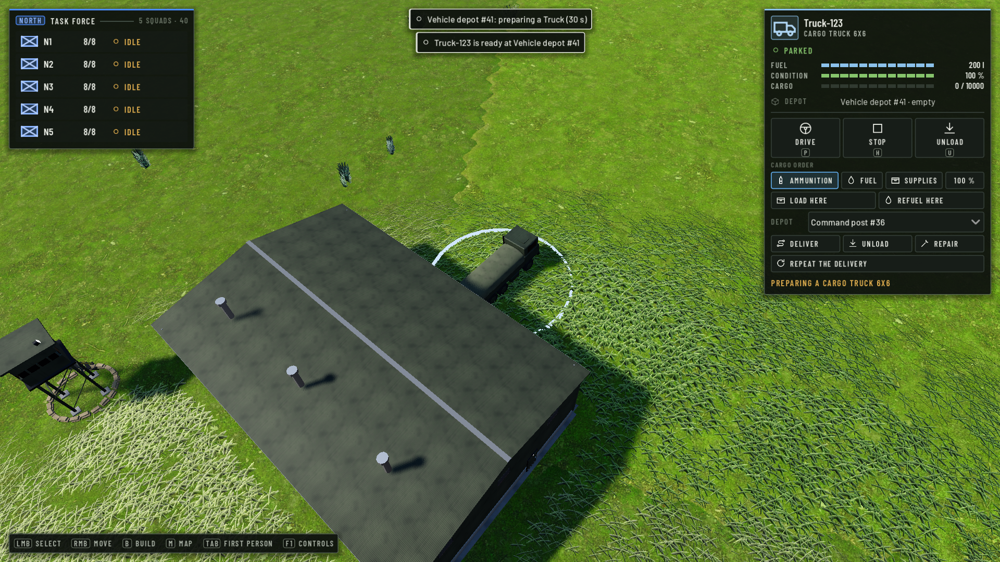 | 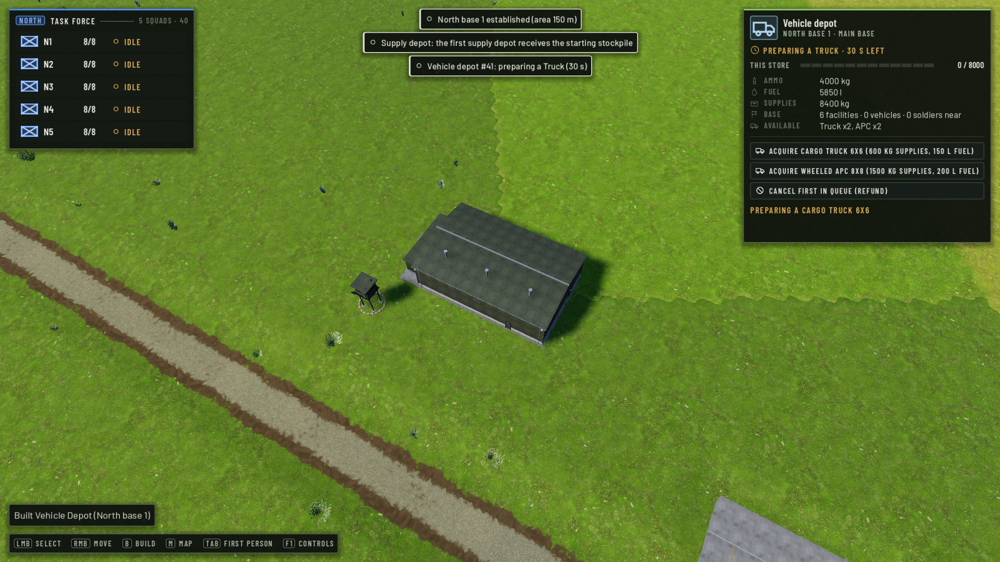 |

`LogisticsPanel` keeps every action and its data: vehicle — Drive (P), Stop (H), Unload (U), cancel job,
cargo item + share, load / refuel at the nearest depot, deliver / unload / repair at a chosen depot, repeat;
facility — recruit, acquire truck / APC, cancel queue, load / unload / refuel a selected vehicle, resupply
selected squads. Short uppercase labels carry the old wording as tooltip.

## 7. RTS markers and minor RTS changes

| Markers, one squad (near) | Three squads (far) |
| --- | --- |
| 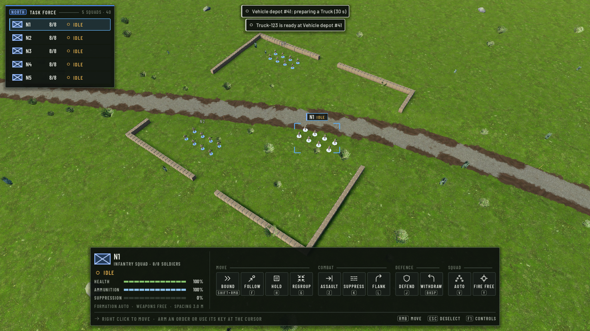 | 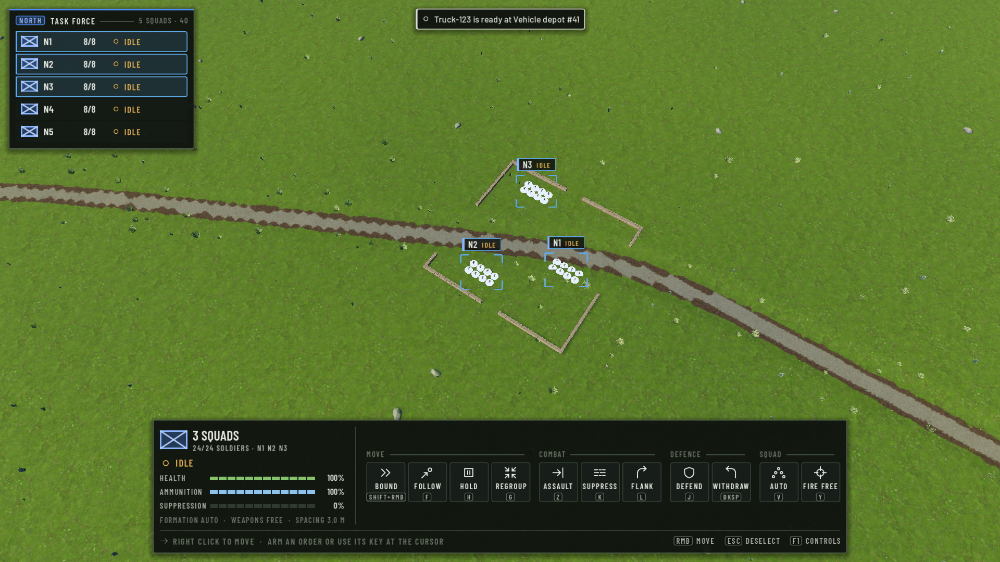 |

* Soldiers: a small flat dot instead of a ring (`UnitVisuals.style_ring(..., soldier = true)`), dim for
  unselected, bright for selected; it grows with distance only up to 7× (was 12× for a ring), so a squad's
  dots stay apart. Vehicles keep their footprint ring.
* Squads: corner brackets around a selected squad's soldiers with its tag on top; other own squads within
  900 m get a faint callsign; markers are hidden in first person and while driving.
* Selection logic and unit positions are unchanged.
* Command panel about 5 % narrower (button 45 px, summary 184 px); health < 30 % and suppression ≥ 60 % pulse
  and are framed; the RTS text box no longer repeats the vehicle line (the panel shows it) and only counts
  loose soldiers.

## 8. Concept image coverage

| Concept element | Status |
| --- | --- |
| RTS roster, selection panel, grouped commands, field tags | Phase 1, kept |
| Construction: category menu, building cards with images, placement box with keys, base info | implemented (images rendered from the game's models) |
| FPS: weapon block, health bar, squad / order card | implemented |
| FPS compass and objective marker / distance | **not implemented** — no compass or waypoint system exists |
| FPS armour bar, stance figure | **not implemented** — no armour or stance data |
| Strategic map: layer panel, base inspector, Set Rally Point / Create Operation buttons, tabs | layers and inspector implemented; operations through the existing Attack / Defend / Reinforce / Move; **no rally point** (does not exist); no tabbed inspector (one panel per selection type instead) |
| Portraits, morale bars | **not implemented** — no data |

## 9. Functional tests

`--ui01c2-test` (real game, real clicks / keys / wheel / drags through `Input.parse_input_event`):
**PASS**, 1920 × 1080. Checks: B opens / closes construction; only the command post without a base; category
tile shows its cards; card click selects the type and opens the context panel; valid spot → VALID PLACEMENT;
R ×3 rotates 45° and the panel shows it; road → invalid with the reason shown; base built through the real
input (command post, barracks, depot, parking, guard post); menu shows the base and unlocks buildings;
vehicle depot placed; Acquire clicked in the facility panel queues a truck; the truck is delivered; vehicle
panel shows it with three meters; selected squad's soldiers marked; soldier dots stop growing at distance;
map opens without inspector; layer tile switches the layer; wheel zooms, middle drag pans; squad click opens
the inspector; command post click selects the base facility; RMB on an objective orders an operation; the
operation row shows it; truck click on the map selects it; RMB gives it a drive order; M closes the map;
first-person HUD shows weapon / magazine / reserve / squad; firing updates the magazine; health follows the
unit; empty magazine shows the reload prompt; R reloads (progress, prompt gone); F1 shows the controls; Tab
returns to the RTS HUD.

Existing tests for the changed code (change-impact, not a full suite):

| Test | Why | Result |
| --- | --- | --- |
| `--ui01c-test --only checks,small` | RTS roster / command panel / markers / mode switches (Phase 1) | **PASS** (one check updated: the side is now in the FPS squad card, not the badge) |
| `--sandbox-test --only hud` | HUD text, badge, F1 / F3, first person | **PASS** |
| `--logistics-test --only scenario` | presses the logistics panel buttons by name | **PASS** after a test fix: its button search now matches the new uppercase labels / tooltips, and its "vehicle delivered" wait counts only the player's vehicles (the AI factions acquire vehicles too, which ended the wait before the truck was ready — the panel had queued both vehicles correctly) |
| `--base01-test --only views` | construction menu API (`_base_buttons`, `_base_info`), building through the real input | building, base menu and map checks pass; **one failure not caused by UI-01C**: "no first-person view of the base" — the test only possesses a soldier within 200 m of the site, and `_find_base_site` now picks a spot 420 m from North HQ (at BASE-01 a soldier stood 30 m away). Site choice and soldier positions are untouched by this work |

## 10. Known limitations

* No interaction system, compass, rally points, armour or morale exist; the corresponding concept elements
  are not shown (section 8).
* Thumbnails are static PNGs; they need re-rendering when an asset changes (`tools/ui/make_structure_thumbs.gd`).
* Clicking a group marker on the strategic map selects every squad in the group (existing behaviour, so
  `09_map_squad.png` shows three squads at North HQ).
* 1280 × 720 was checked in a test run (all checks passed, layout fits); per the product owner only the
  1920 × 1080 captures are delivered.

## 11. Branch and commits

`feature/ui-01c`, after Phase 1 (`c732643`). Phase 2 commits: `git log c732643..feature/ui-01c`
(UI kit extensions and thumbnails; HUD integration of construction, first person, map, vehicles and
markers; tests, screenshots and this report). Not merged, not pushed.
