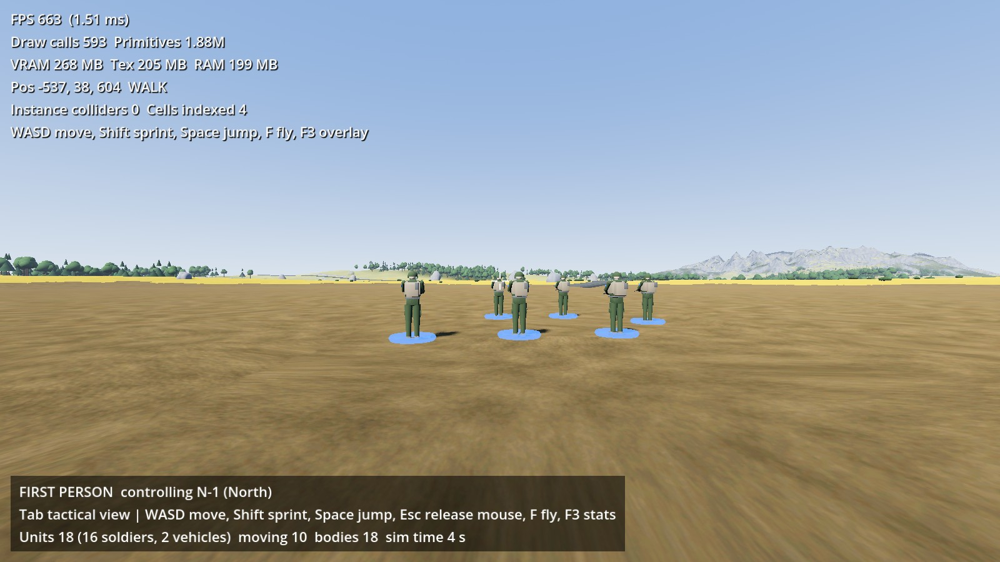
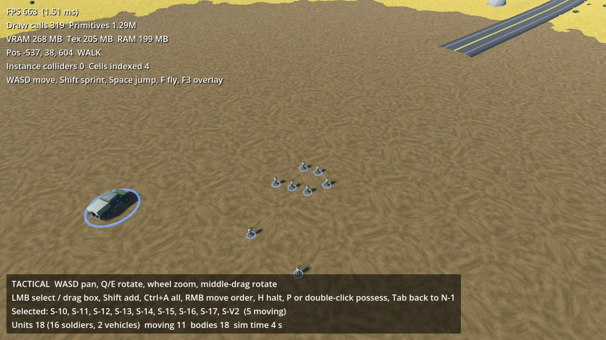
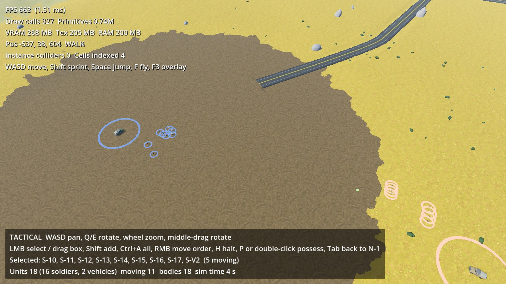
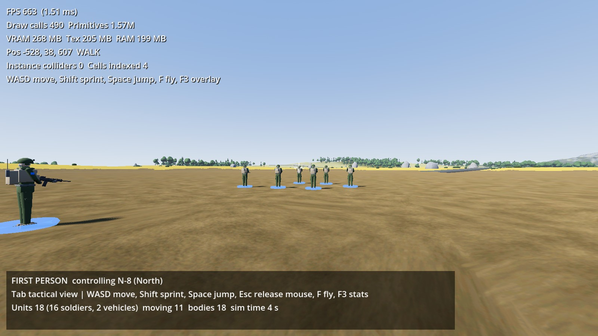

# WORLD-CORE-01 — Persistent World & FPS/RTS Control

**Project:** FRACTURED NATIONS
**Branch:** `feature/world-core-01` (from `feature/world-tech-02`, not merged into `main`)
**Engine:** Godot 4.7.2-stable, Forward+, Vulkan, Terrain3D 1.0.2, Jolt; Blender 5.2.2 LTS for assets
**Date:** 2026-10-19
**Test machine:** the WORLD-TECH-01 machine (i7-12700F, RTX 3070 8 GB, 16 GB RAM, Windows 11, 1600 × 900, VSync off)

Status tags as in the earlier reports: **[VERIFIED]** executed and observed in Godot, **[IMPLEMENTED]** exists in code but not exercised, **[ESTIMATE]** calculated.

## 1. Summary

The first playable prototype in which first-person and tactical control act on one persistent
world. A scene-independent `WorldState` holds every unit (id, faction, position, heading, health,
order, movement state); `WorldSim` advances it; soldier and vehicle bodies are the detailed
representation of those records and write their physics result back every tick. The player
possesses any soldier in first person with the WORLD-TECH-01 controller, presses **Tab** to leave
it to the simulation and command from a tactical camera (select, box-select, right-click move
orders), and possesses another soldier from there. Nothing is reset or duplicated by a switch:
the scripted check performs 12 switches across six different soldiers while six others walk under
orders and finds the same 18 units and 18 bodies, unchanged orders and continuous positions
**[VERIFIED]**. Two factions with 8 soldiers and one transport vehicle each stand on the base pad
of the 2 km world and navigate a runtime-baked navmesh (terrain + trees + vehicles) with RVO
avoidance. The soldier and the vehicle are original Blender models generated by project scripts
and imported as glTF, with faction colouring applied by material name in Godot **[VERIFIED]**.

## 2. What was implemented

```
scripts/core/
├─ unit_state.gd        UnitState: id, name, kind, faction, position, yaw, velocity, health, speed,
│                       order (NONE/MOVE + target), move_state (IDLE/MOVING/ARRIVED/BLOCKED),
│                       player_controlled, has_body; to_dict/from_dict
├─ world_state.gd       WorldState: units by id, add/remove, issue_move, issue_group_move (grid
│                       formation), halt, snapshot/restore, faction table, signals
├─ world_sim.gd         WorldSim (Node): ticks the state; registry id -> body; abstract step for
│                       units without a body (straight-line travel, terrain height)
└─ game_controller.gd   GameController: FPS <-> RTS switching, possession, camera handover
scripts/units/
├─ soldier_body.gd      SoldierBody extends FPSController: NavigationAgent3D path + RVO when not
│                       possessed, keyboard/mouse when possessed, state sync every physics tick
├─ vehicle_body.gd      VehicleBody (StaticBody3D): parked vehicle with a state record, navmesh footprint
└─ unit_visuals.gd      faction colouring by material name, selection rings scaled by camera distance
scripts/rts/
├─ rts_camera.gd        RTSCamera: focus/yaw/zoom rig, pan/rotate/zoom, pitch by zoom, terrain clearance
└─ rts_controller.gd    RTSController: click/box selection, right-click ground orders, possess, halt
scripts/world/area_navigation.gd   AreaNavigation (NavigationRegion3D): runtime bake of one area
scripts/game/core_demo.gd + scenes/game/core_demo.tscn   wraps scenes/world/test_2km.tscn, spawns units
scripts/ui/game_hud.gd            mode, controls, selection, unit counts, crosshair, drag box
scripts/debug/core_selftest.gd    --core-test scripted checks and screenshots
scenes/units/soldier.tscn, vehicle.tscn   bodies with the glTF models
assets/units/soldier.glb, vehicle_transport.glb (+ blender/*.blend sources, .gdignore)
tools/blender/fn_blender_lib.py, make_soldier.py, make_vehicle.py   asset generators
```

### 2.1 Persistent world state **[VERIFIED]**

- `WorldState` is a `RefCounted` with a dictionary of `UnitState` records. It knows nothing about
  nodes, cameras or rendering, and the headless parse check drives it without a scene: a unit
  ordered 30 m away by `issue_move` reaches its target through `WorldSim._abstract_step` alone.
- Commands are the only way in: `issue_move(id, target)`, `issue_group_move(ids, target, spacing)`
  (grid formation so a group does not fight over one square metre), `halt(id)`. Vehicles refuse
  move orders (driving is out of scope). `order_changed` / `unit_added` / `unit_removed` signals
  let views react.
- **Two tiers, one record.** `WorldSim` keeps `id -> body`. A unit with a body is moved by Godot
  physics and navigation and the body writes `position`, `yaw`, `velocity`, `move_state` and
  `player_controlled` back into its `UnitState` each physics tick. A unit without a body is moved
  by `WorldSim` directly (speed × dt toward the target, height from Terrain3D). This is the hook
  for distant-unit abstraction: dropping a body does not drop the unit. The self-test adds a
  bodiless soldier at runtime and watches it travel 9.0 m in 2 s and arrive.
- **Orders survive possession.** Possessing a soldier only flips `player_controlled`; the order
  stays in the record (the HUD shows "suspended") and the body re-applies it when control returns.
- `snapshot()` / `restore()` produce a plain dictionary of the whole state (save/load-ready; used
  for the consistency checks).

### 2.2 Soldier and vehicle bodies **[VERIFIED]**

- `SoldierBody` extends the unchanged WORLD-TECH-01 `FPSController` (the controller was written
  for this: input only while `player_controlled`). Possessed: the parent class reads keyboard and
  mouse. Not possessed: `_ai_step` sets `NavigationAgent3D.target_position` from the record, walks
  toward `get_next_path_position()` at `walk_speed`, turns toward the path, feeds the desired
  velocity into RVO avoidance and applies the safe velocity (one tick latency) with gravity and
  `move_and_slide()`; arrival within 1.3 m or at the end of the path ends the order
  (`ARRIVED`, or `BLOCKED` when the path ended more than 3 m from the target). While possessed
  the body still reports its velocity to the avoidance simulation so other soldiers avoid the
  player. The possessed body's mesh is switched to shadows-only so it does not block the camera.
- `VehicleBody` is a `StaticBody3D` with a box collider and a state record; it is selectable and
  carved out of the navmesh. Replacing it with a driving body later changes nothing in the state.
- 16 soldiers and 2 vehicles are spawned by `CoreDemo` on base site 0 of the 2 km world
  (North on the pad, South 150 m east). Terrain3D collision is switched to **FULL_GAME** for the
  demo so every unit has ground under it, not only the surroundings of the camera (dynamic
  collision follows one camera; see §6).

### 2.3 Navigation **[VERIFIED]**

`AreaNavigation.bake_area(center, 420 m, vehicles)` builds a `NavigationMeshSourceGeometryData3D`
from `Terrain3D.generate_nav_mesh_source_geometry()` (352,800 faces for the area), adds every
tree and rock from the WORLD-TECH-02 chunk cells in the area as projected obstructions (138, same
data as the colliders, collider radius + 0.2 m), the two vehicle footprints, and bakes with
`NavigationServer3D.bake_from_source_geometry_data` (cell 0.5 m, agent radius 0.5 m, slope 45°).
Result: 2,273 polygons in **0.58 s** at load. Agents use `NavigationAgent3D` with RVO avoidance
(radius 0.45 m, 8 m neighbour distance). Larger worlds bake more such areas around active units;
nothing is stored in the scene.

### 2.4 FPS ↔ RTS switching **[VERIFIED]**

`GameController.possess(id)` releases the previous soldier, sets `player_controlled` on the new
body, makes its head camera current, hands the camera to Terrain3D (`set_camera`), points the
tree-collider streamer and the diagnostics overlay at it. `enter_rts()` releases the soldier
(mouse becomes visible), frames the tactical camera on it with the current zoom and activates the
tactical controls. The vegetation streamer and the grass layer already follow "the current
camera", so FPS ↔ RTS reuses the WORLD-TECH-02 transition path (cells re-evaluated when the
observer moves, grass off above 90 m). Switching touches no unit position, no order and no id.

### 2.5 Tactical camera and controls **[VERIFIED]**

`RTSCamera` keeps a ground focus point, a yaw and a zoom (12–700 m). Pan speed scales with
zoom; pitch goes from 28° close up to 65° far out; the camera is kept 3 m above the terrain.
`RTSController` selects in screen space (nearest unit within 22 px, or a drag box), orders with a
physics ray against the terrain collision (Terrain3D's height-map ray march as fallback), shows a
green marker at the order point for 2.5 s, and requests possession on P / Enter / double-click.
Selection rings grow with camera distance so factions stay readable from altitude. Both factions
can be commanded in this prototype (`command_any_faction`), which keeps testing simple while there
is no combat.

### 2.6 Blender → Godot asset pipeline **[VERIFIED]**

- `tools/blender/fn_blender_lib.py` holds the conventions (metres, origin at the feet, model faces
  +Y in Blender which the glTF exporter maps to Godot's −Z forward, flat Principled materials,
  one joined mesh per asset, bevels applied on join, auto-smooth by angle) plus preview rendering
  (EEVEE, sun + sky) and GLB export. `make_soldier.py` and `make_vehicle.py` rebuild each asset
  from scratch; they were run in the user's interactive Blender through the MCP bridge, the
  previews were inspected, proportions corrected (brimmed helmet → ballistic helmet with ear
  covers, cube knees → knee spheres, height 1.94 → 1.90 m, wheels moved outward) and exported.
- **Soldier:** 5,096 triangles, 1.90 m, low-ready stance: ballistic helmet with NVG mount, plate
  carrier with pouches, assault pack and radio, carbine with optic and magazine, boots. Materials
  `Uniform`, `Vest`, `Skin`, `Gear`, `Weapon`, `Boots`, `Patch`.
- **Vehicle:** 3,696 triangles, 2.9 × 6.1 m, light tactical truck: crew cab, covered cargo bed,
  roof rack, bull bar, mirrors, antenna, spare wheel and jerry cans. Materials `Hull`, `Glass`,
  `Tire`, `Rim`, `Gear`, `Canvas`, `Light`, `Patch`.
- **Faction variants in Godot:** `UnitVisuals.apply_faction` overrides surfaces by material name:
  `Uniform`/`Hull` get the faction uniform colour (North olive, South khaki), `Patch` the faction
  colour (North blue, South orange). One GLB serves both factions.
- Godot imports the GLBs with its default scene importer (materials and names preserved,
  automatic LODs). `assets/units/blender/.gdignore` keeps the `.blend` sources out of Godot's
  importer (which would otherwise try to run Blender). Both scenes load and show the models in
  the FPS and RTS screenshots below.

## 3. Controls

| Key | First person |
|---|---|
| Mouse | Look (click to capture, Esc to release) |
| W A S D / Shift / Space | Move / sprint / jump |
| **Tab** | Tactical view (the soldier returns to the simulation and resumes its order) |
| F / F3 | Debug fly / performance overlay |

| Key | Tactical |
|---|---|
| W A S D (Shift faster) | Pan |
| Q / E, middle-mouse drag | Rotate |
| Mouse wheel | Zoom |
| Left click, drag box, Shift+click, Ctrl+A | Select, box select, add, all soldiers |
| Right click | Move order (formation) |
| H | Halt |
| P / Enter / double-click | Possess the selected soldier |
| **Tab** | Return to the last possessed soldier |

## 4. Validation — what was actually run

`scripts/debug/core_selftest.gd` drives the real scene through the real input actions
(Tab key and mouse clicks injected with `Input.parse_input_event`) and the state API, about 90 s
per run, and writes `benchmarks/raw/core_test.json`. Final run: **PASS, 0 failures, no script
errors in the log**. Values below are from that run (`benchmarks/wc01/core_test.json`,
`benchmarks/wc01/core_test.log`).

| Check | Result |
|---|---|
| Spawn: units / bodies, one body per unit, soldiers on the floor | 18 / 18, yes, 16 of 16 |
| Navigation bake | 352,800 terrain faces, 138 tree obstructions, 2 vehicle footprints → 2,273 polygons in 0.58 s |
| Start | FPS mode, soldier N-1 possessed, its camera current |
| Orders executed while the player is in FPS (6 North soldiers sent 70 m) | 6 of 6 progressed ≥ 5 m in 3 s, 6 with paths (example 79.8 → 66.3 m) |
| Tab → RTS through the input action | RTS camera current, released soldier not controlled in body and record, mouse visible |
| Click-select a South soldier, right-click the ground | selected [14]; order target error 0.0002 m |
| Box-select the South group | 9 of 9 units |
| 12 perspective switches (6 different soldiers possessed) | 18 units / 18 bodies throughout, orders preserved, each id has exactly one body |
| Largest position change across a switch | 0.08 m in the one physics tick of the switch = walking speed (an earlier run whose switch frame spanned 8 physics ticks showed 0.60 m, again exactly 8 ticks of walking): continuous movement, no teleport |
| Arrival of the 6 ordered soldiers | 6 of 6 ARRIVED after 14.5 s, 0.2–3.6 m from their formation points, 0.0 m drift in the following 2 s |
| Suspended order: order, possess, walk 6.4 m by keyboard, release | order kept while possessed; 40.7 m → 27.3 m from the target 3 s after release (resumed) |
| Bodiless unit (abstract tier) | moved 9.0 m in 2 s, ARRIVED at 0.0 m, `has_body` false |
| Frame time, FPS view, 180 frames | 1.5 ms avg, 2.4 ms p99, 580 draw calls |
| Frame time, tactical 140 m, 180 frames | 1.8 ms avg, 2.5 ms p99, 317 draw calls |

Findings fixed during validation (the first run failed them): the agent only (re)computes its path
inside `get_next_path_position()` / `is_navigation_finished()`, so checking the cached path first
left every soldier without a path; the project's `canvas_items` stretch mode means injected mouse
events must carry window pixels while `Camera3D.unproject_position` returns logical coordinates
(real mouse input was unaffected); a possessed soldier walked into its row neighbour in the
first version of the resume check.

### Screenshots (Godot 4.7.2, Vulkan, 1600 × 900)

| | |
|---|---|
|  First person as N-1, watching the six ordered soldiers walk north |  Tactical camera at 55 m on the same group |
|  Tactical overview of the base pad at 160 m |  After the switch sequence: possessing another soldier, orders still running |

## 5. Measured costs

| Item | Value |
|---|---|
| Navigation bake, 420 × 420 m, 1 m terrain, 0.5 m cells | 0.58 s at load, 2.3 k polygons |
| Physics + navigation per frame with 16 agents (RVO) and full terrain collision | 0.8 ms physics, 0.05 ms navigation |
| Frame time FPS / RTS 140 m | 1.5 / 1.8 ms (WORLD-TECH-02 world alone: 1.7 / 2.0 ms at comparable stations) |
| Soldier / vehicle model | 5.1 k / 3.7 k triangles, 177 / 148 KB GLB |
| Memory | no measurable change against WORLD-TECH-02 (the 2 km terrain dominates) |

## 6. Limitations

- **Terrain collision is full-map** for the demo (4 regions). On the 20 km world this would be
  100 regions of height-field shapes; the proper solution is dynamic collision around several
  observers (every active unit), or the abstract tier for units far from any camera. Terrain3D's
  dynamic collision today follows one camera only.
- **One navigation area.** The navmesh covers 420 m around the base site; soldiers ordered outside
  it stop at its edge (`BLOCKED`). Arrival precision is 1–3.6 m (cell size, agent radius erosion
  and RVO crowding near the goal), fine for "go there and hold" but not for precise positioning.
- **No animation, no combat, no health changes.** Soldiers slide; the rifle is static geometry.
  `health` exists in the record but nothing modifies it.
- **Vehicles are parked.** Selectable, carved from the navmesh, refuse orders.
- **Visuals are stylised low-poly** with flat colours: no textures, no LOD impostors (Godot's
  automatic mesh LODs only). The possessed soldier is rendered shadows-only, so there are no
  first-person arms or weapon yet.
- **Tactical camera** has no edge panning, no follow-unit mode, no zoom-to-cursor.
- **Both factions are commandable** from the tactical view (deliberate for testing).
- **Tested on one machine** with a scripted run; no human play session was observed in this
  session (the editor was not running), so feel and input ergonomics were not evaluated.

## 7. Recommended next steps

1. Multi-observer terrain collision and per-unit navigation areas (bake around active groups,
   unload behind them); move far units to the abstract tier automatically by distance to the
   nearest camera.
2. Save/load from `WorldState.snapshot()` (already a plain dictionary) including the terrain area
   the units stand in, and an order queue (move → hold → follow) instead of a single order.
3. Drivable vehicle body (same `UnitState`, new body) and mounting soldiers.
4. First-person arms/weapon view and simple locomotion animation; a combat loop that modifies
   `health` through the state only.
5. Faction ownership and command restrictions (player faction only), unit groups and a 2D map
   view reading the same `WorldState`.
6. Asset pipeline: textures/decals and a second LOD authored in Blender, more props (barriers,
   crates, tents) from the same script library, and a Blender headless (`--background`) run of the
   generators in CI.
