# WORLD-TECH-01 — Large World Technology Prototype

**Project:** FRACTURED NATIONS
**Branch:** `feature/world-tech-01` (not merged into `main`)
**Engine:** Godot 4.7.2-stable (official), Forward+, Jolt Physics
**Default renderer:** **Vulkan**, switched from D3D12 in commit `eabb282` on the evidence in §6
**Date:** 2026-10-19

Status tags:

- **[VERIFIED]** — executed in Godot on the test machine and observed (log, JSON, screenshot).
- **[IMPLEMENTED]** — exists in code or data, not exercised interactively.
- **[RESEARCH]** — from documentation, release notes or source reading only.
- **[ESTIMATE]** — derived by calculation from measured values.

## Test machine

| | |
|---|---|
| CPU | Intel Core i7-12700F (12 cores / 20 threads) |
| GPU | NVIDIA GeForce RTX 3070, 8 GB, driver 32.0.16.1692 |
| RAM | 16 GB (about 6 GB free during tests) |
| OS | Windows 11 Home 10.0.22631 |
| Renderers | D3D12 12_0 (project default before `eabb282`) and Vulkan 1.4.351 |
| Window | 1600 × 900, VSync off, default Forward+ settings, directional shadows (350 m) |

---

## 1. Project setup and Git

| Item | Result |
|---|---|
| Local project | `C:\Users\Hafnor\Desktop\Game Dev\fractured-nations` (existing project, preserved) |
| Godot | 4.7.2-stable. The executable sits next to the project folder |
| Content before this work | `project.godot` (Forward+, Jolt, D3D12), `icon.svg`, Godot AI addon 4.3.0, no scenes |
| Git before this work | Not initialized |
| Remote | `origin` → `https://github.com/Soulbap/Fractured-Nations.git` (was empty) |
| Baseline | `80c494a chore: initialize Fractured Nations Godot project`, pushed to `origin/main` **[VERIFIED]** |
| Feature branch | `feature/world-tech-01`, pushed **[VERIFIED]** |
| Ignored | `.godot/`, build output, Godot AI update cache, Windows DLL-swap leftovers, `override.cfg`, generated scale/tile/real/edit-test worlds, raw benchmark JSON |

Two files appeared in `docs/` during the work and were **not committed**. The owner decides what happens to them:
`FRACTURED_NATIONS_komplett_spilldesign_arkitektur_v03 (1).docx` and
`Fractured Nations Terrain Reference Map.png`.

---

## 2. Dependencies

| Dependency | Version | License | Decision |
|---|---|---|---|
| [Terrain3D](https://github.com/TokisanGames/Terrain3D/releases/tag/v1.0.2-stable) | **1.0.2-stable** | MIT | **Installed.** Prebuilt GDExtension, Godot 4.4–4.7. 1.1.0-rc1 (2026-10-17) was not used because it is a release candidate. |
| [Godot Road Generator](https://github.com/TheDuckCow/godot-road-generator/releases/tag/0.9.5) | **0.9.5** | MIT | **Installed.** GDScript, Godot 4.4+, includes a Terrain3D connector with undo/redo. |
| [Foliage3D](https://github.com/caphindsight/Foliage3D) | `master` @ `caa793f`, no releases | MIT | **Not installed.** Source only; needs the GD++ compiler and a C++ toolchain, neither of which is installed. |
| Jolt Physics | built into Godot 4.7 | MIT | Used. |
| [ProtonScatter](https://github.com/HungryProton/scatter) | main (4.2.0), last tag 4.0 (2023) | MIT | Not installed **[RESEARCH]**. A candidate for non-terrain props later. |
| [Phantom Camera](https://github.com/ramokz/phantom-camera) | v0.11.0.3 | MIT | Not installed **[RESEARCH]**. A candidate for the RTS camera rig. |
| [Cyclops Level Builder](https://github.com/blackears/cyclopsLevelBuilder) | v1.5.1 (Godot 4.7) | MIT | Not installed **[RESEARCH]**. For base blockouts. |
| [Simple Asset Placer](https://github.com/IIFabixn/simple-asset-placer) | 3.1.0 (Asset Library listing) | MIT | Not installed **[RESEARCH]**. The repo was not inspected. |

Changes to vendored addons: only the Windows and Linux x86_64 binaries of Terrain3D are kept,
and Road Generator's `.afdesign` source file was removed. No addon code was modified.

---

## 3. What was built

```
scenes/world/test_2km.tscn
├─ WorldEnvironment, Sun
├─ Terrain3D                     worlds/test_2km/terrain/*.res, terrain_assets.tres
├─ Roads/RoadManager/RoadNetwork RoadPoints + 3 RoadIntersections
├─ Roads/Terrain3DRoadConnector  flattens terrain under roads (undoable)
├─ WorldBuilder (@tool)          WorldConfig → regenerate terrain / roads / vegetation
├─ Player (FPSController)
├─ InstanceColliderStreamer      colliders for instanced trees/rocks near the player
└─ WorldDiagnostics              F3 overlay, --benchmark, --screenshots, --fps-test
```

- **`WorldConfig`**: all dimensions and features are inspector properties (size, vertex
  spacing, region size, seed, relief, mountain area, valley, fields, base sites, roads,
  vegetation densities and extents). Features use normalized coordinates, so a layout scales
  to any map size. The world convention is +X east, +Z south, +Y up, 1 unit = 1 m, with the map
  centered on the origin, and it is shared by the FPS, RTS and 2D views.
- **`WorldTerrainGenerator`**: height and control images, multithreaded, imported once into
  Terrain3D. It is not a terrain engine.
- **`WorldBuilder`**: editor buttons for regenerating the terrain (it backs up the data
  directory first), rebuilding roads with flattening, rescattering vegetation and saving.
  `tools/build_world.gd` is the same pipeline, headless.

**01A Terrain [VERIFIED].** 2048 × 2048 m, 4 regions of 1024², 1 m spacing: rolling hills,
a valley, a steep ridge area, open fields, three flat base pads, and four ground textures
(grass/rock via the autoshader, painted dirt and dry grass).

**01B Roads [VERIFIED].** A 2 km main road (1+1 lanes) and three branch roads to the base
sites, with three T-intersections, curves and grades. The terrain is flattened under all
roads by the connector.

**01C Vegetation [VERIFIED].** Placed with the Terrain3D instancer: 14k conifers, 16k
broadleaf trees, 6.4k bushes, 1.3k rocks and 430k grass cards on 2 km, with LODs and fades.
Instances have no collision in Terrain3D 1.0, so `InstanceColliderStreamer` builds pooled
capsule and sphere colliders within 40 m of the player from the stored instance data,
including instances painted by hand.

**01D FPS controller [VERIFIED].** Mouse look, walk 4.5 m/s, sprint 7.5 m/s, jump, gravity,
a 46° slope limit with floor snapping, and debug fly. Movement is driven by intent, so a
future soldier-possession or AI layer can drive the same body.

---

## 4. Integration findings

1. **Terrain3D asset ids must match their slots.** Assets created in code without setting `id`
   scramble the texture array.
2. **The autoshader in 1.0** shows the *overlay* texture on flat ground and the *base* texture
   on slopes.
3. **Terrain texture formats must be identical.** Using a terrain texture in a normal 3D
   material triggers a "Detect 3D" reimport, which breaks the array. All terrain textures are
   now imported explicitly as VRAM compressed with mipmaps.
4. **Instance transforms are region-local**, stored per region as
   `{mesh: {cell: [transforms, colors, modified]}}`.
5. **Instancer cells are 32 × 32 vertices.** At 1 m spacing a cell is 32 m; at 2 m it is
   64 m. Each (cell, mesh, LOD) becomes one `MultiMeshInstance3D` (see §6.2).
6. **Road Generator:** connect RoadPoints only after the container's deferred setup.
   "Invalid cross-container connection" warnings appear while chains are half-connected
   and disappear when the scene is loaded. The connector **skips the first road update after a
   scene load** by design, and its refresh runs in `_physics_process`.
7. **Saving Terrain3D resources:** save the assets and material as `.tres` and let the
   in-memory resources take over the path; otherwise packing embeds copies.
8. **Instancer CPU cost scales with region count.** Adding 430k grass instances takes 0.9 s
   with 64 regions and 57–60 s with 225–400 regions (`tools/tile_world.gd` timings).

---

## 5. Testing — what was actually run

| # | Check | How | Result |
|---|---|---|---|
| 1 | Project opens | Owner's editor session; timed editor launches; editor on Vulkan | **Pass** |
| 2 | Terrain3D loads | ClassDB check, every game run | **Pass** (1.0.2) |
| 3 | Terrain edit and save | **In the editor** through Terrain3D's own `Terrain3DEditor` (the brush code path): +2.17 m sculpt, exact undo and redo, scene save, reopened in a new process with the height persisted | **Pass** |
| 4 | Roads created and edited | Built from code; **in the editor** a RoadPoint was moved twice as undoable actions, the connector re-flattened the terrain (+1.5 m), and two undos restored the point **and** the terrain exactly; persisted after reopen | **Pass** |
| 5 | Vegetation renders | Screenshots, instance counts | **Pass** |
| 6 | FPS controller | `--fps-test` on 2 km (D3D12) and on 20 km real and tiled (Vulkan) | **Pass** |
| 7 | Collision | Landing, slopes, road surface, instanced tree trunk | **Pass** |
| 8 | Close/reopen without losing work | Reopen check after the editor edit; every benchmark is a fresh load | **Pass** |
| 9 | Git ignores generated files | `git status` after all runs | **Pass** |
| 10 | Only intentional changes on the branch | Diff reviewed before each commit | **Pass** |

Evidence: `benchmarks/editor_checks/` and `benchmarks/fast_suite/logs/`.

**FPS self-test, real measured values** (`benchmarks/fast_suite/logs/vulkan_fps_*.log`):

| Check | 2 km (D3D12) | 20 km real, 2 m spacing (Vulkan) | 20 km tiled, 1 m (Vulkan) |
|---|---|---|---|
| Landing on road (feet − terrain) | 0.25 m, on floor (road surface) | 0.25 m, on floor | 0.25 m, on floor |
| Walk speed | 4.29 m/s | 4.27 m/s | 4.29 m/s |
| Sprint speed (uphill stretch) | 6.47 m/s | 7.21 m/s | 6.47 m/s |
| Jump apex | 1.22 m | 1.22 m | 1.22 m |
| 15–17° slope | climbs at 4.1 m/s | climbs at 4.2 m/s | climbs at 4.1 m/s |
| 70° slope | slides down (−2.6 m) | — (no slope > 50° found) | slides down |
| Walk into instanced tree | stopped 0.69 m from trunk | stopped 0.70 m | stopped 0.69 m |
| Walk at far corner (10.2 km from origin on 20 km) | — | 4.31 m/s, on floor 100% | 4.32 m/s, on floor 100% |
| Process exit | clean | exit 0, no leak warnings | exit 0, no leak warnings |

**Editor stability incident [VERIFIED, cause unconfirmed]:** after a programmatic
`scene_open(force_reload=true)` through the Godot AI MCP, the next scripted sculpt crashed the
editor (signal 11, official build without symbols). The likely cause is a stale terrain
reference in the Terrain3D editor plugin after the reload. Normal selection-driven editing in
a fresh editor session did not crash. See `benchmarks/editor_checks/editor_run1_crash.log`.

---

## 6. Vegetation Scalability & Large-World Findings

### 6.1 Original failure and how it was reproduced

The first long benchmark suite (`benchmarks/original_suite/`) built a 4 × 4 km world with the
same vegetation density as the 2 km test world (1.80M grass, 121k trees). On **D3D12**:

- After load: 6,376 MB of video memory (Godot monitor) and 1,604 draw calls.
- Within seconds: `Cannot create uniform set because there's not enough room in the RESOURCES
  descriptor heap` — **32,452** times in 15 minutes, followed by **~700k** "Uniforms were never
  supplied" draw errors. Large parts of the scene were not rendered.
- The route benchmark never finished. It was stopped after 15 minutes, and no result JSON exists.
- The 8 km step of that suite was never run. The suite was replaced by the fast workflow
  (§8) with the owner's approval.

Reproduction: `tools/tile_world.gd --name=tile_4km --regions=4` (1.72M grass, 121k trees, same
density), then `tools/bench_world.gd --scene=res://scenes/world/tile_4km.tscn` with
`--rendering-driver d3d12`. It reproduces the failure in about 30 s.

### 6.2 Root cause: evidence versus hypothesis

| Claim | Status | Evidence |
|---|---|---|
| Terrain3D 1.0 creates one MultiMesh per (32-vertex cell, mesh, LOD) | **Verified** | The `MultiMeshInstance3D` count equals Σ cells × LODs exactly: 23,276 = 23,276 on 2 km (`bench_real_2km.json`, `instances` vs `resources`) |
| D3D12 costs ~62 KB VRAM per MultiMesh, Vulkan ~1–2 KB | **Verified (measured)** | 2 km: (1,750 − 296 MB) / 23,276 = 62.5 KB on D3D12 vs (303 − 270 MB) / 23,276 = 1.4 KB on Vulkan. 4 km trees: (3,643 − 436) / 51,162 = 62.7 KB on D3D12. The per-MultiMesh overhead is constant regardless of instance count (430k grass in 3,985 MultiMeshes costs less VRAM than 38k trees in 19,291) |
| The D3D12 failure is descriptor-heap exhaustion (65,536 resource descriptors) | **Verified** | The same scene renders with 0 errors when `max_resource_descriptors=262144` (`bench_tile_4km_heap262k.json`). Failing: 77k and 93k MultiMeshes. Passing: 51k |
| The larger heap fixes the error but not the scaling | **Verified** | With the 4× heap: 0 errors, but still 6,373 MB VRAM and 7.9 ms at the FPS station |
| The primary limit is GPU-side per-object overhead in the D3D12 backend, not instance count or CPU vegetation logic | **Verified** for this hardware | Vulkan renders the same 93k-MultiMesh scene with 874 MB peak dedicated GPU memory and 4.4 ms at the FPS station |
| The underlying scaling concern remains on Vulkan | **Verified** | Frame time still rises with MultiMesh count on Vulkan: 2.2 ms (23k) → 4.4 ms (93k) at the FPS station, and 3.8 ms at the RTS 600 m station. CPU-side render cost per visible MultiMesh is the next limit |
| ~65% fewer MultiMeshes with 1 LOD instead of 3 | **Verified** | 4 km trees: 51,162 → 17,054 MultiMeshes, 3,643 → 1,496 MB (D3D12) |

**Immediate failure versus the underlying concern.** The immediate failure is D3D12-specific:
descriptor-heap exhaustion plus ~62 KB per MultiMesh. Switching to Vulkan removes it.
The underlying concern is architectural. Terrain3D 1.0 multiplies objects by cells × mesh
types × LODs, and stored instances grow with map area, so even on Vulkan the cost rises with
the number of cells that hold vegetation. Full-map stored vegetation at 20 km would be about
100 × the 2 km cell count (~2.3M MultiMeshes) **[ESTIMATE]**, which is not viable on any backend.

### 6.3 20 km D3D12 crash: verified from the log and source

- Log (`benchmarks/fast_suite/logs/d3d12_tile_20km.log`):
  `FATAL: Condition "p_resource->states_ptr->subresource_states.size() > BarrierRequest::MAX_SUBRESOURCES" is true`,
  then `Program crashed with signal 4`, exit code `0xC000001D`. Reproduced twice.
- Source (`drivers/d3d12/rendering_device_driver_d3d12.h`, tag 4.7.2-stable, line 228):
  `static const uint32_t MAX_SUBRESOURCES = 4096;`, checked with `CRASH_COND` in the `.cpp`
  (line 702).
- Measured texture arrays (`terrain_map_arrays` in the bench JSON): height and control maps
  have 1 mip level, the **color map has 11** (1024² full chain). The color array therefore
  has layers × 11 subresources.
- Bracket test: **361 regions = 3,971 subresources → loads on D3D12**; **400 regions = 4,400
  → crashes**. The practical D3D12 ceiling is 372 regions of 1024² **[ESTIMATE from the limit]**.
- Vulkan loads, renders, navigates and exits cleanly at 400 regions.

### 6.4 D3D12 versus Vulkan: equivalent configurations

Identical scenes, scenarios, stations, window size and binary. Every run wrapped by
`tools/measure_run.ps1`, which reads peak values from the Windows "GPU Process Memory"
counters (backend-independent). Frame times are ms per frame (average, p99 in brackets) at
the FPS ground station. Full table: `benchmarks/fast_suite/validation_tables.md`.

| Map (scenario "full") | Regions | MultiMeshes | D3D12 frame / GPU peak | Vulkan frame / GPU peak |
|---|---|---|---|---|
| real 2 km | 4 | 23,276 | 4.1 (5.1) ms / 1,789 MB | **2.2 (2.6) ms / 631 MB** |
| tiled 4 km (full-map grass) | 16 | 93,160 | **fails** (descriptors) / 6,290 MB | 4.4 (5.1) ms / 874 MB |
| tiled 15 km (2 km veg window) | 225 | 23,276 | 4.9 (5.4) ms / 4,728 MB | 2.2 (2.9) ms / 3,375 MB |
| tiled 20 km at 1 m | 400 | 23,276 | **crash at load** / 6,985 MB before crash | 2.4 (3.2) ms / 5,707 MB |
| real 20 km at 2 m | 100 | 8,165 | 1.5 (1.7) ms / 2,229 MB | 1.4 (1.8) ms / 1,695 MB |

| Run (Vulkan) | Wall time | Peak RAM (working set) | Peak GPU dedicated | Peak GPU shared |
|---|---|---|---|---|
| real 2 km, 4 scenarios | 14.7 s | 1,249 MB | 631 MB | 231 MB |
| tiled 15 km, 4 scenarios | 19.6 s | 4,195 MB | 3,375 MB | 231 MB |
| tiled 20 km, 4 scenarios | 24.4 s | 6,527 MB | 5,707 MB | 231 MB |
| real 20 km, 4 scenarios | 17.2 s | 2,373 MB | 1,695 MB | 213 MB |
| real 20 km, FPS self-test | 24.5 s | 2,433 MB | 1,718 MB | 213 MB |

### 6.5 Large worlds: 15 × 15 and 20 × 20 km

Two kinds of maps were tested, and they are labelled clearly:

- **Synthetic tiled maps** (`tools/tile_world.gd`): the real 2 km region data is mirror-tiled
  so every edge matches. They validate Terrain3D data scaling, rendering and region counts at
  1 m spacing. They are **not representative terrain** and do **not** validate world
  generation.
- **Realistic 20 km** (`tools/build_world.gd --size=20480 --spacing=2`): the full pipeline
  (generator, 20 km road network with 523 nodes, flattening, vegetation in a central 2 km
  window).

| Layer (Vulkan, FPS ground / RTS 600 m / strategic) | tiled 15 km | tiled 20 km (1 m) | real 20 km (2 m) |
|---|---|---|---|
| 1. Terrain only | 1.4 / 1.8 / 1.4 ms | 1.4 / 1.8 / 1.2 ms | 1.3 / 1.9 / 1.6 ms |
| 2. Terrain + roads | 1.2 / 1.8 / 1.4 ms | 1.2 / 1.9 / 1.2 ms | 1.3 / 1.9 / 1.6 ms |
| 3. + representative vegetation (2 km window) | 2.2 / 3.6 / 1.4 ms | 2.4 / 3.7 / 1.2 ms | 1.4 / 2.2 / 1.6 ms |
| 3b. trees + camera-local particle grass | 2.3 / 3.8 / 1.8 ms | 2.3 / 3.8 / 1.6 ms | 1.5 / 2.4 / 2.1 ms |
| Camera jumps (8 spots, worst frame) | 9.7 ms | 9.9 ms | 12.5 ms |

| Item | Result |
|---|---|
| Region memory | **13.3 MB per 1024² region** resident on the GPU (height 4 MB + control 4 MB + color 5.3 MB with mips; measured array sizes). 225 regions = 3.0 GB, 400 = 5.3 GB (Godot texture memory 5,484 MB), 100 = 1.33 GB |
| RAM | The same data is also held in RAM: tiled 20 km peaks at 6.5 GB working set, real 20 km at 2.4 GB |
| Loading | Instantiate + 5 frames: 4.9 s (real 20 km), 10.8 s (tiled 20 km), 1.2 s (2 km). No streaming stalls, because everything is resident (jump test worst frame ≤ 15 ms everywhere) |
| Saving | 100 regions saved in 5.8 s; 400 regions in 10.9 s (headless) |
| Build time (real 20 km) | 506 s total: heightmap 359 s (10240², GDScript on 20 threads), roads + flattening 48 s, vegetation 86 s, save 6 s |
| Disk | real 20 km 383 MB; tiled 20 km at 1 m 1.4 GB |
| Collision, physics | FPS test passes at the 20 km corners; Terrain3D dynamic collision follows the player |
| Coordinate precision | Map centered on the origin, so the maximum distance is ~10.2 km (20 km) and float32 spacing there is ~1 mm **[ESTIMATE, IEEE 754]**. Walking and collision at 10.2 km behave the same as at the center. Origin shifting or double precision are **not needed** at this size |
| Region boundaries | No cracks or seams seen in the screenshots at FPS or RTS heights. Mirror seams on the tiled maps are continuous by construction |
| Reopen | Every run reopens the saved scene. Exit code 0 on Vulkan for all 20 km runs |
| Editor | The editor opens the realistic 20 km scene on Vulkan. Detailed editor responsiveness at 20 km was **not measured** |

**Is 20 × 20 km at 1 m practical?** Technically yes on Vulkan (5.7 GB GPU, 6.5 GB RAM, 2.4
ms), but **not practical as a target**. Terrain maps alone use ~70% of an 8 GB card before any
units, buildings, effects or vegetation, and the same data sits in RAM. At **2 m spacing**
the full 20 km map costs 1.33 GB VRAM, 2.4 GB RAM and 383 MB on disk, at the same frame
times. **Recommendation: 2 m terrain resolution for 20 km reference maps** (Arma 3's Altis
uses about 7.5 m), with local detail where infantry fights. Detail should come from meshes,
decals and props at bases, towns and roads, or from smaller high-resolution maps where
needed. 1 m spacing is practical up to about 10–12 km on 8 GB GPUs **[ESTIMATE]**.

### 6.6 Terrain3D streaming options (installed version 1.0.2)

| Option | Status | Finding |
|---|---|---|
| Built-in region streaming | **Not available** **[RESEARCH]** | All regions of the data directory are loaded and kept resident in RAM and VRAM (measured: GPU memory scales linearly at 13.3 MB per region). Streaming regions in and out of a fixed window is a stated *future* goal of the Terrain3D author |
| Manual load/unload via API (`Terrain3DData.load_region`, `remove_regionl`) | Available, **measured too slow for runtime** | Removing and reloading one region stalls the main thread for 197–224 ms with 100 regions and 428–1,907 ms with 225 regions. It rebuilds the full texture arrays and caused a temporary 1.9 GB shared-GPU spike (`vulkan_churn_*.log`) |
| Coarser vertex spacing | Available, **verified** | Quarter the memory per km² at 2 m. Whole 20 km map resident at 1.33 GB |
| Smaller region size | Available, not measured | Does not reduce total resident memory |
| Terrain LOD (clipmap) | Built in | Handles rendering detail, **not** memory or streaming of gameplay objects |

**Smallest viable approach:** keep terrain fully resident at 2 m spacing (no streaming needed
at 20 km), and stream *gameplay objects and vegetation* through our own lightweight
region/cell logic, independent of Terrain3D regions. Re-evaluate Terrain3D streaming when a
stable release offers it. No custom terrain streaming was implemented.

### 6.7 Vegetation strategies compared

| Strategy | Tested on | Result |
|---|---|---|
| A. Full-map stored vegetation (Terrain3D instancer) | 2 km ✔, 4 km ✘ (D3D12) / ✔ (Vulkan, 4.4 ms), 8 km trees ✘ (D3D12, 205k MultiMeshes) | Object count grows with area × mesh types × LODs. Not scalable to 20 km |
| B. Larger D3D12 descriptor heap (`max_resource_descriptors` 65,536 → 262,144 via temporary `override.cfg`) | 4 km | Removes the errors; VRAM unchanged (6.4 GB). It is a workaround, not a fix. Untested on other GPUs and drivers. Not applied permanently |
| C. Camera-local GPU particle grass (Terrain3D's `extras/particle_example`, radius ~60 m, 0.5 m spacing, 57,600 particles) | 2/4/15/20 km | Cost independent of map size: 2.3 ms vs 2.2 ms for stored grass at 2 km (Vulkan); no per-blade storage; no stalls in the jump test (≤ 12.9 ms). **Issues found:** grass grows through roads and base pads (it only knows the terrain, see screenshot `tile_15km_particles_fps_center.jpg`), and it keeps simulating around the camera's XZ even at RTS altitude (+0.3–0.5 ms at the strategic station) |
| D. Trees separate from grass, fewer LODs | 4/8 km | 1 LOD instead of 3 cuts MultiMeshes and VRAM by about two-thirds. 8 km of stored trees still fails on D3D12 (68k MultiMeshes) |

**Preferred:** **C for grass** (camera-local GPU particles), once it has a mask for roads and
base pads and an altitude cutoff. **Trees and other gameplay-relevant vegetation stay stored
instances**, limited to area cells near the active cameras, with 1–2 LODs and an impostor or
terrain-color representation in the far field.

### 6.8 FPS, RTS and strategic map

| Situation | Observation |
|---|---|
| FPS near the ground | Vegetation dominates frame time (2.2 ms with vegetation vs 1.1–1.4 ms without, Vulkan 2 km) |
| RTS rising to 600 m | Many more vegetation cells in view: 3.6–3.8 ms with vegetation vs 1.8 ms without. This is where per-cell object count hurts most. Distant trees need impostors or a terrain-color representation |
| Fast camera movement / switching units | Teleporting between 8 points across 20 km: worst frame 9.7–12.9 ms. No stalls, because all terrain is resident and grass follows the camera |
| Strategic overview of the whole map (3D camera at ~14–25 km altitude) | Renders, but shows only fog (`vulkan_real_20km_full_strategic.jpg`). **The strategic map should be a 2D view generated from world data** (height, roads, forest masks, units), not the 3D scene from far above |

### 6.9 Recommended architecture

1. **Renderer:** Vulkan (done, `eabb282`). Vulkan is Godot 4.7.2's default on Windows; the project previously overrode it with D3D12. The override is now removed entirely, which is the form the editor normalizes to. Keep D3D12 as fallback only.
2. **Terrain:** Terrain3D, 2 m spacing for 20 km maps, fully resident (~1.3 GB VRAM). Local
   detail through meshes and decals.
3. **Near field (0–80 m):** camera-local GPU particle grass with a road/base mask and an
   altitude cutoff. Stored bushes and trees with collision streaming (existing
   `InstanceColliderStreamer`).
4. **Mid field (80–600 m):** stored trees with 1–2 LODs, only in cells around active cameras.
5. **Far field:** impostors or a forest tint in the Terrain3D color map, so forests read
   without geometry.
6. **Strategic map:** a 2D renderer reading world data, not the 3D scene.
7. **Persistent vegetation state** (felled trees, cover, concealment): stored as compact data
   per world cell, separate from the visual instances. Visual layers are derived from it.
   No scene node per tree.

---

## 7. Known limitations and failed experiments

- The original route benchmark at 4 km never completed (D3D12 failure). It was preserved as evidence.
- The first fast-suite run hit timeouts. Two causes: abort checks ran only between stations,
  and logs piped through the console wrapper throttled the process to about 120 KB/s of error
  output. Both are fixed (per-frame abort, GUI binary with `--log-file`).
- Removing grass in-process with `update_mmis(true)` rebuilt all MultiMeshes and *doubled* VRAM
  (11.2 GB). Scenarios that need different stored vegetation now use separate data or processes.
- One editor crash after a programmatic force-reload (§5). Cause not confirmed.
- Foliage3D was not evaluated: it needs a compiler toolchain.
- The particle grass example needs masking before use (roads, base pads).
- Vegetation and textures are placeholders (procedural trees, CC0 ground textures).
- The 15/20 km vegetation load is a bounded 2 km window. Full-map vegetation at those sizes
  was deliberately not attempted (§6.2 estimate).
- Editor responsiveness at 20 km was not measured beyond opening the scene.
- Measured on one machine and one GPU vendor only.

## 8. Benchmark methodology and comparability

| Suite | Method | Comparable with |
|---|---|---|
| Original (`benchmarks/original_suite`, `WorldDiagnostics --benchmark`) | Flies routes: 1.5 km road at 40 m/s, map perimeter at size/16 m/s; one process per measurement; D3D12 | Only with itself. Kept as an **optional regression test** |
| Fast (`tools/bench_world.gd`, `benchmarks/fast_suite`) | Fixed stations (60-frame warm-up, 180-frame window), layer scenarios in one process, jump test, per-frame auto-abort, OS memory via `tools/measure_run.ps1` | All fast-suite runs with each other. **Not** numerically comparable with the route suite |

The routine run is the whole validation matrix (12 runs) in about **6 minutes**, against about
90 minutes estimated for the original suite.

## 9. Remaining technical risks

1. **Object-count scaling on Vulkan.** Lower than D3D12, but frame time still grows with
   visible MultiMeshes, especially in RTS views.
2. **No terrain streaming in Terrain3D 1.0.2.** Maps beyond ~20 km at 2 m, or high-resolution
   maps, will hit memory limits.
3. **Vulkan only measured on NVIDIA/Windows.** AMD, Intel and laptop GPUs are untested.
   The D3D12 fallback inherits the limits above.
4. **Editor stability** under programmatic or bulk operations (one unexplained crash).
5. **Road Generator** behaviour at network scale: the 20 km network has 523 nodes and builds in
   48 s headless. Interactive editing performance of long networks was not measured.
6. **Instancer CPU cost** grows with region count (57–60 s to add instances with 225–400
   regions), which affects tools and any runtime vegetation changes.

## 10. Recommendations for WORLD-TECH-02

1. Implement the vegetation architecture in §6.9 minimally: particle grass with a road/base
   mask and altitude cutoff, trees in camera-near cells with 1–2 LODs, and a forest tint in the
   color map.
2. Set the 20 km reference map to 2 m spacing and define the local-detail approach for bases
   and towns.
3. Build a first 2D strategic map from world data (heights, roads, forest mask).
4. Prototype the RTS camera (consider Phantom Camera) and measure with the fast suite.
5. Test Vulkan on at least one AMD or Intel GPU.
6. Re-evaluate Terrain3D 1.1 stable when released (streaming, instancer changes).

---

## Screenshots (actual Godot 4.7.2 runs)

2 km test world (D3D12, 1600 × 900):

| | |
|---|---|
| 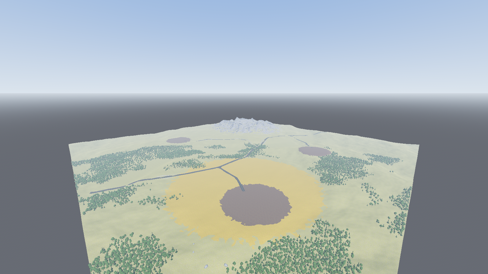 | 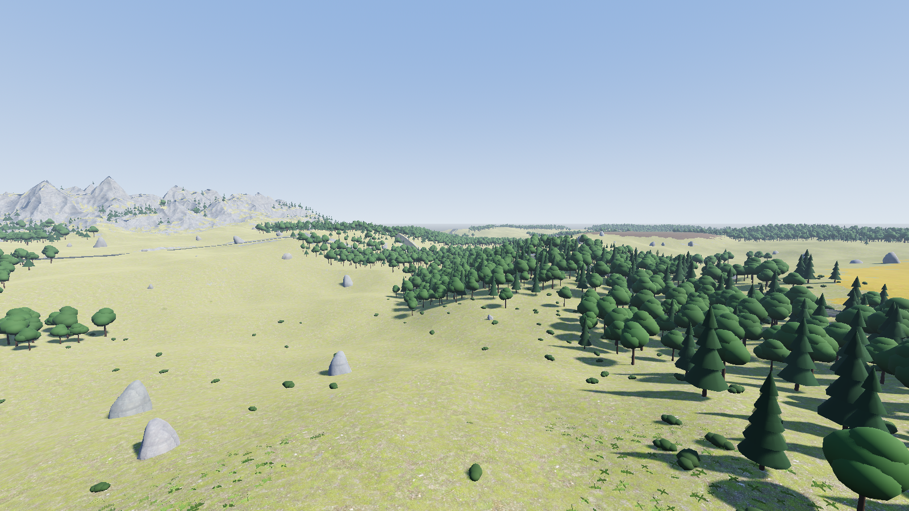 |
| 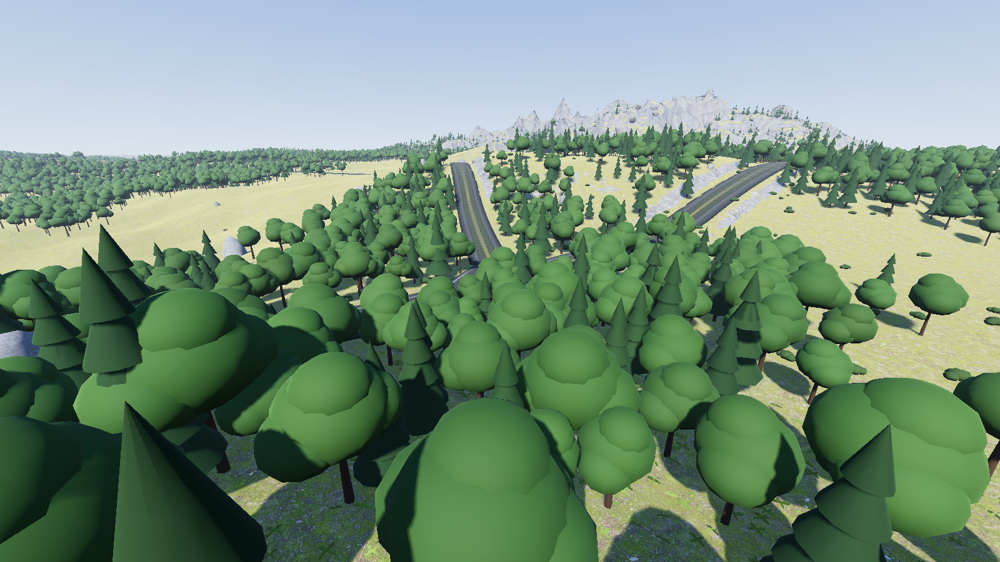 | 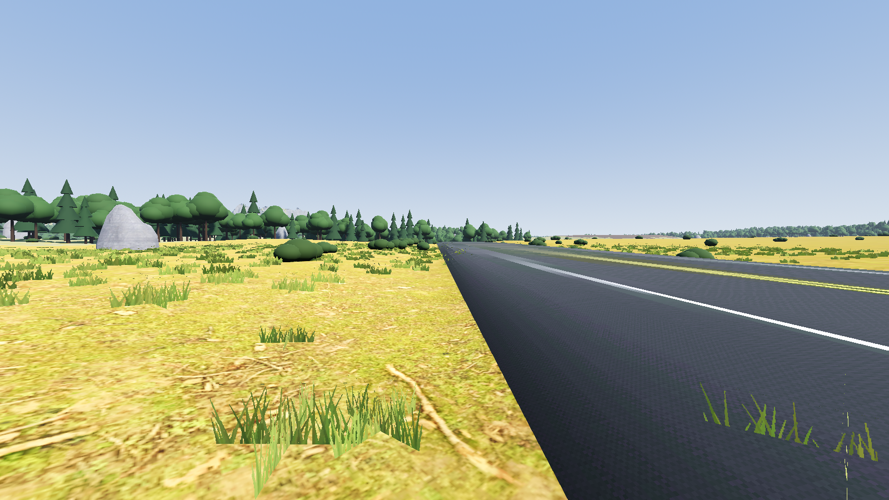 |
| 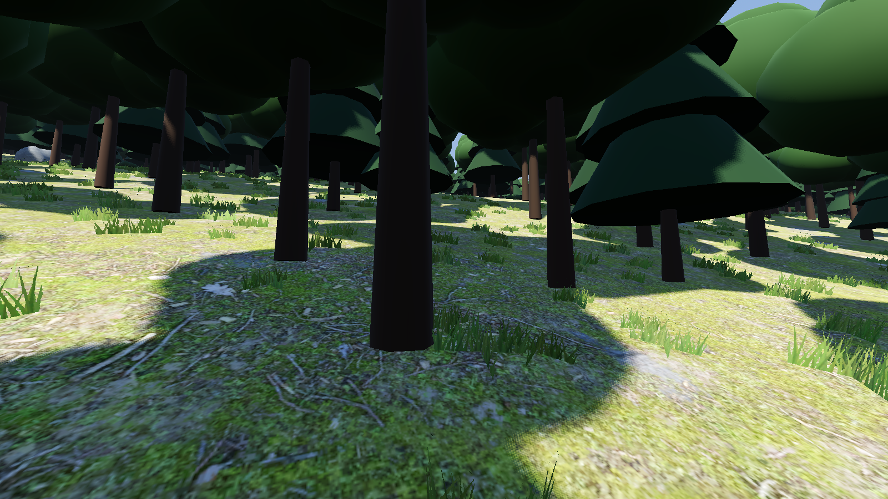 | 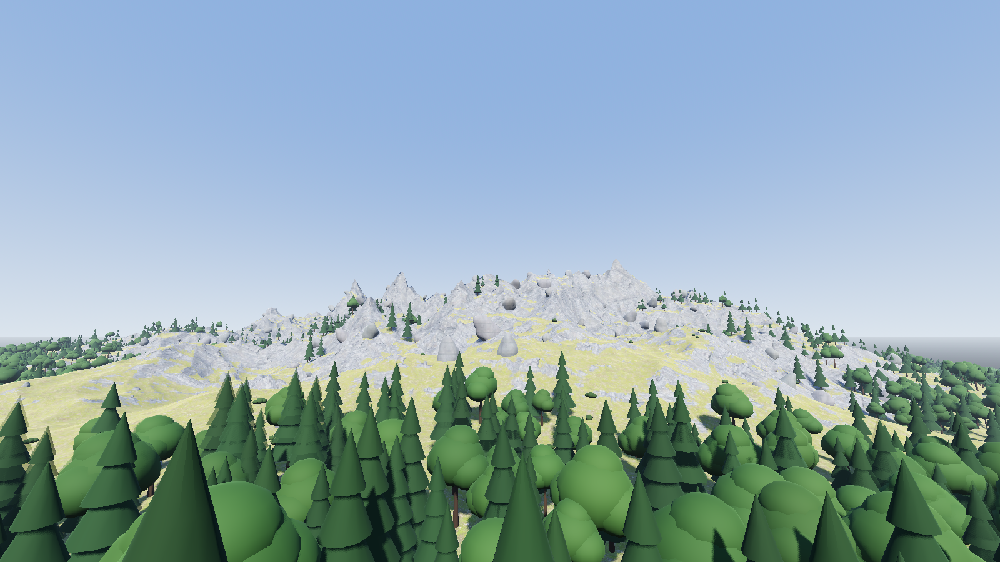 |

Realistic 20 km (Vulkan, downscaled to 1280 px):

| | |
|---|---|
| 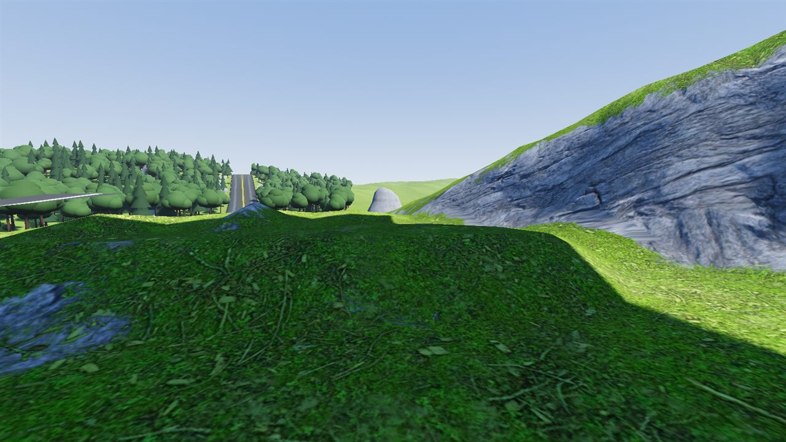 FPS, map center | 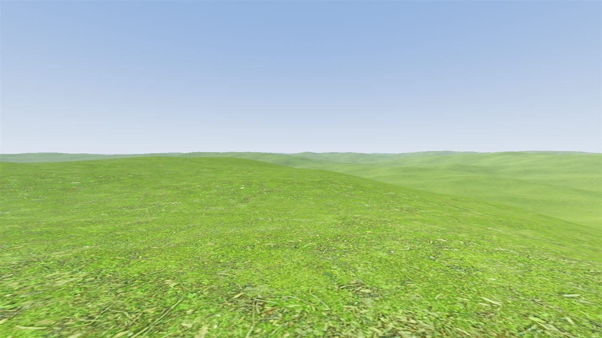 FPS, 10 km from origin |
| 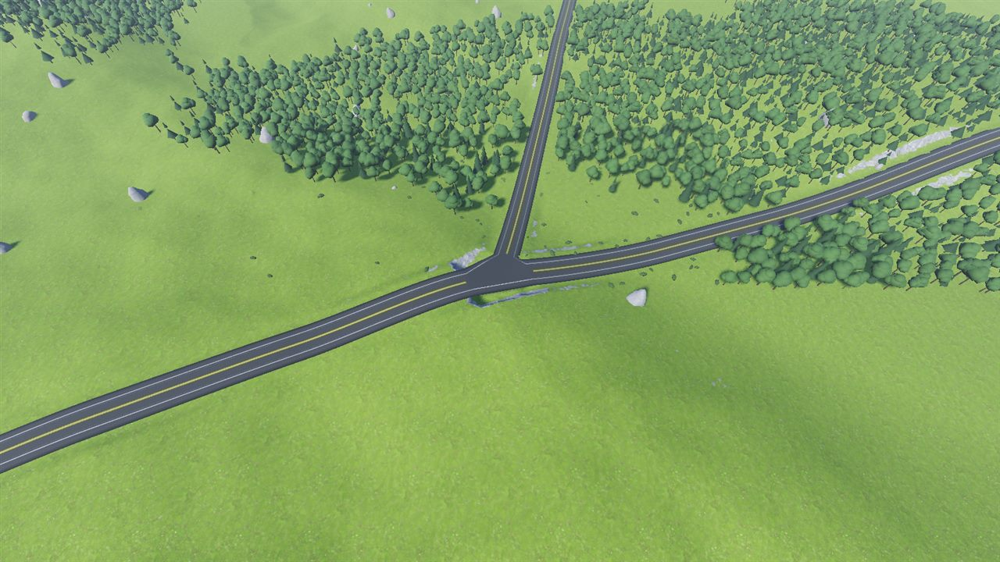 RTS 150 m | 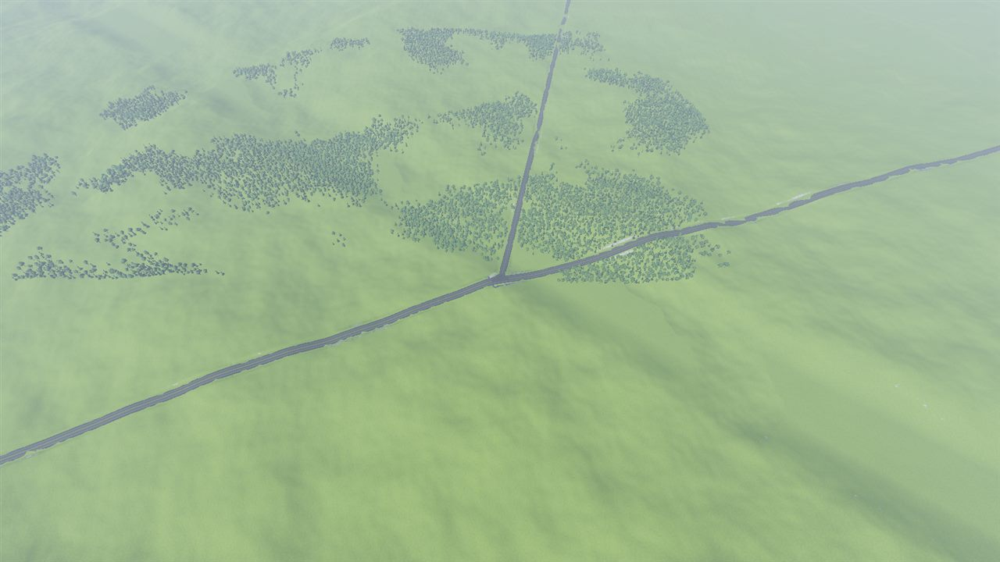 RTS 600 m |
|  3D strategic altitude: fog only | 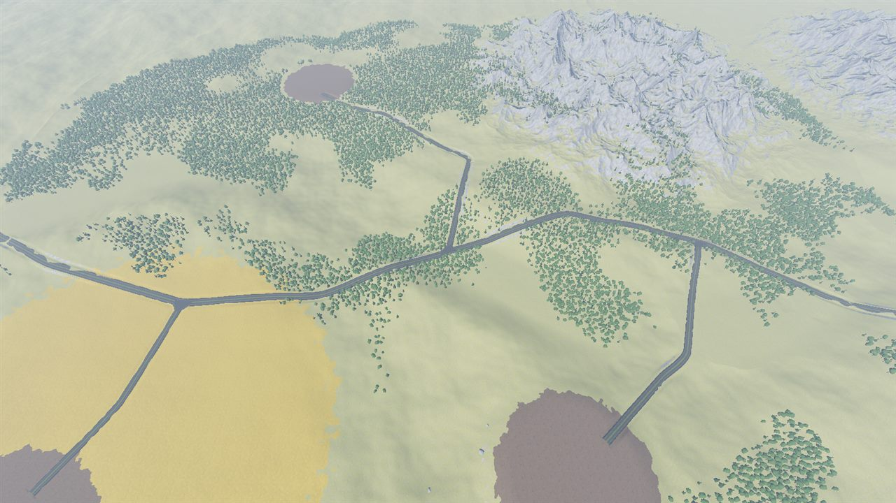 Tiled 20 km (synthetic), RTS 600 m |
| 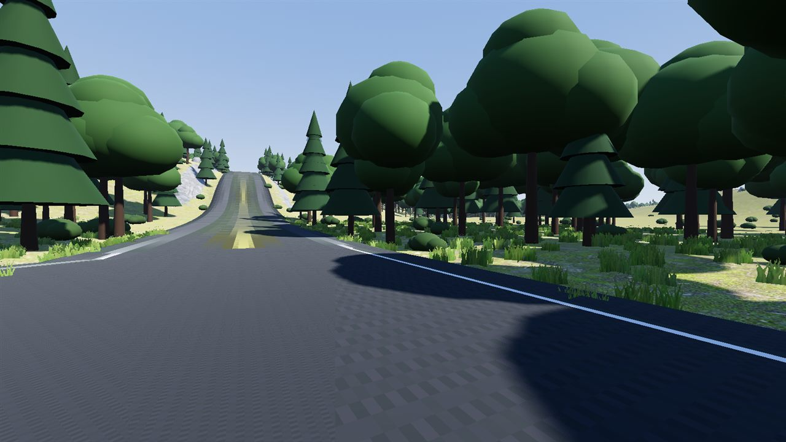 Stored grass cards | 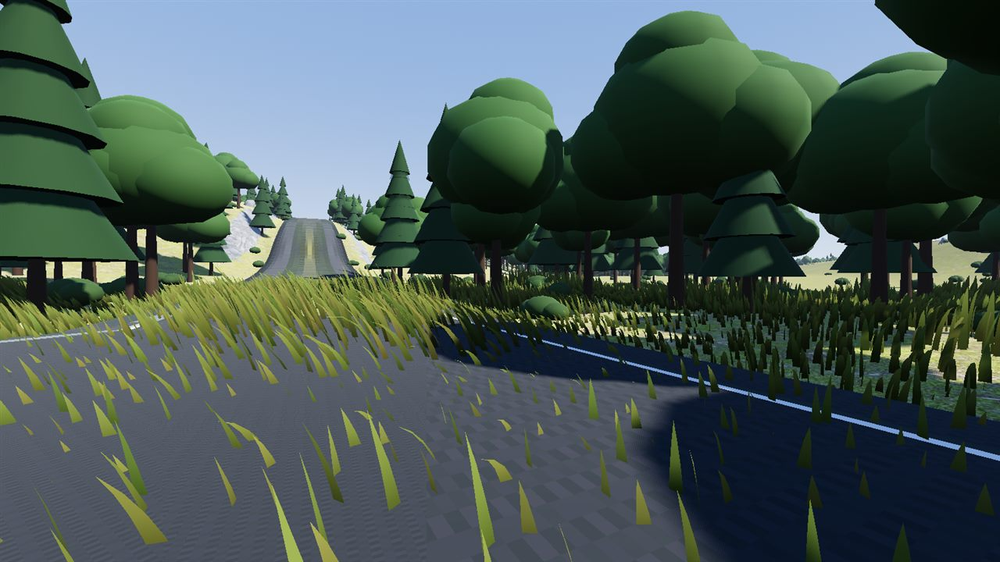 Camera-local particle grass: grows onto the road (needs mask) |
