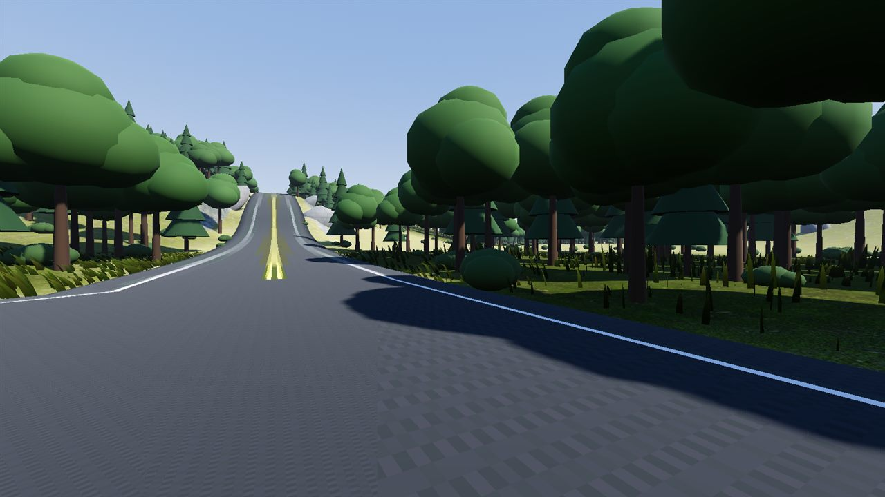
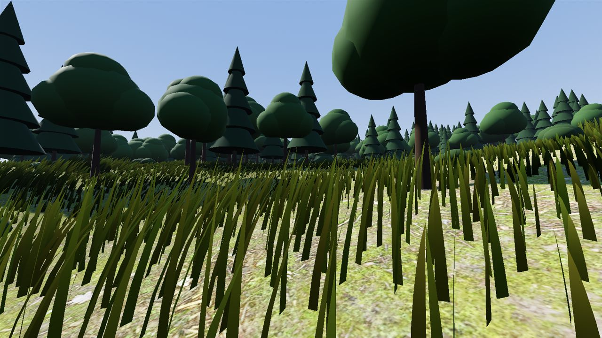
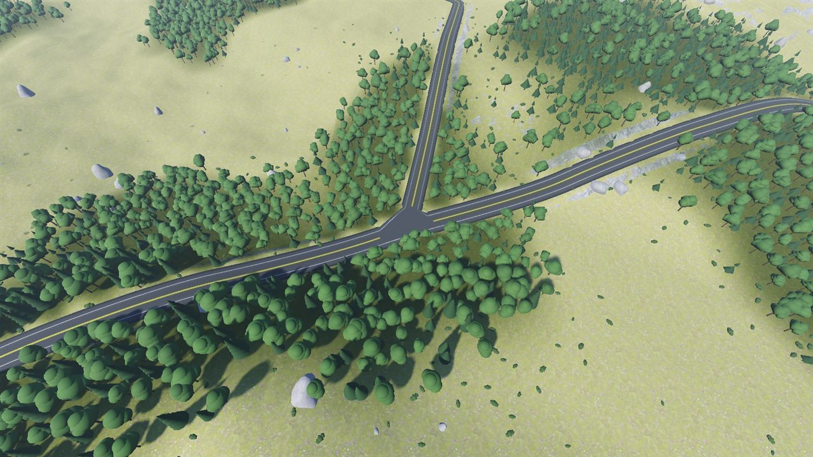
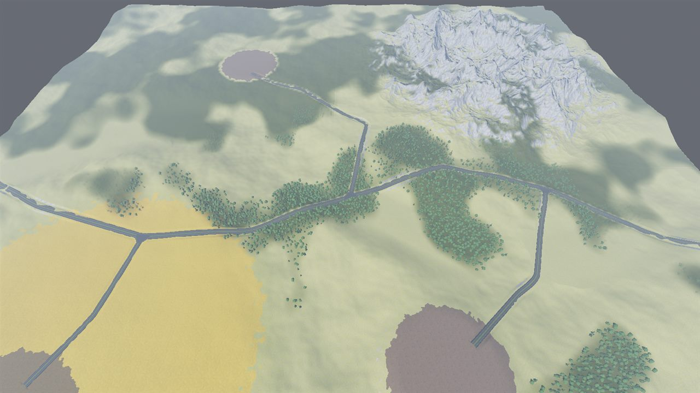
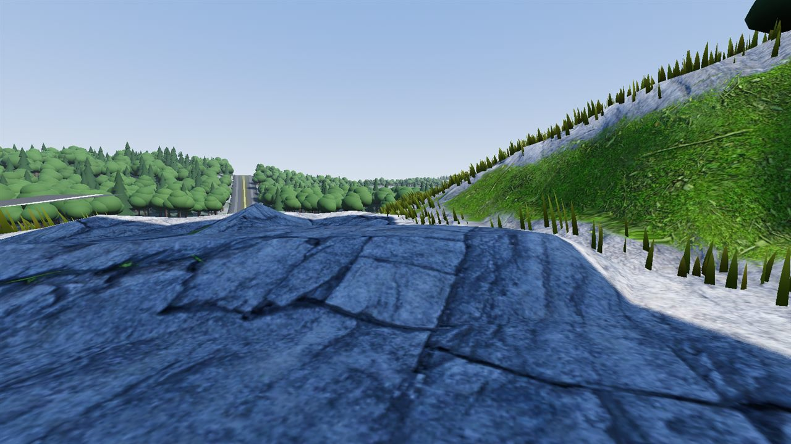
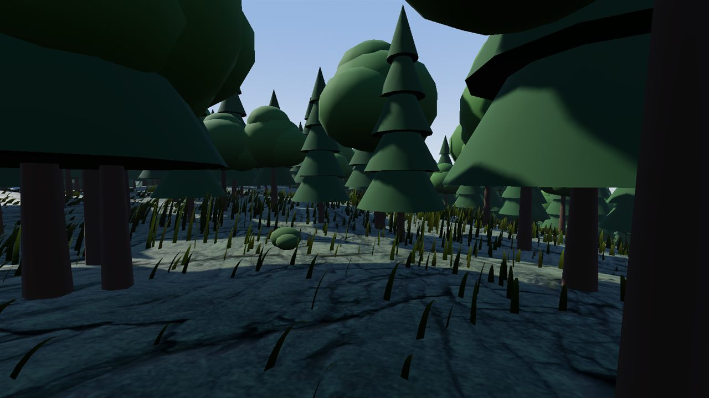
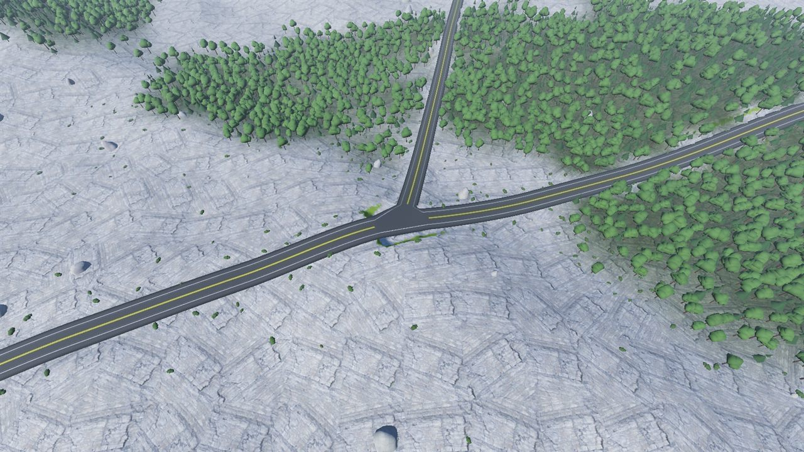
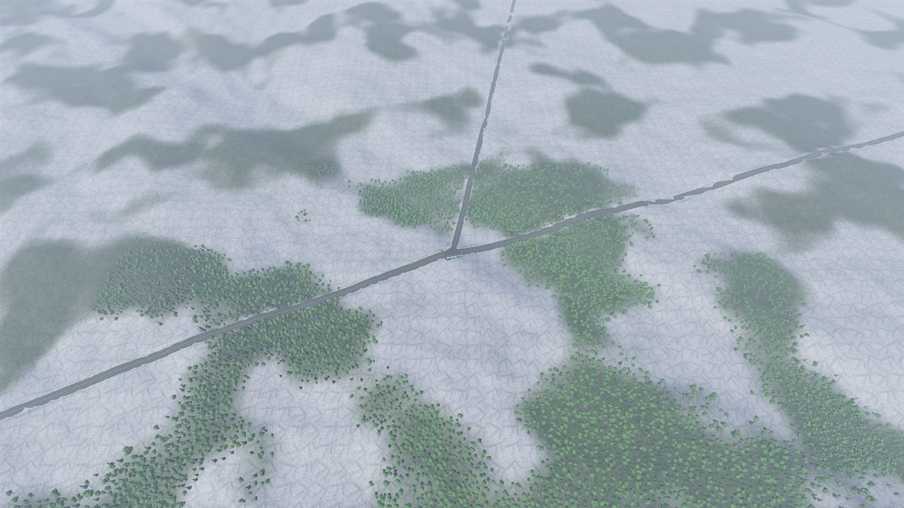
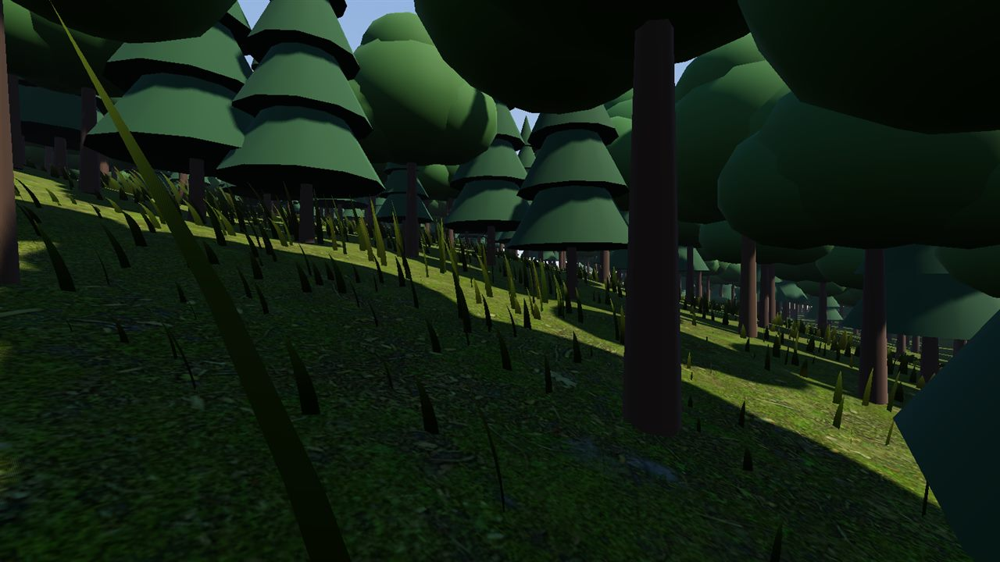
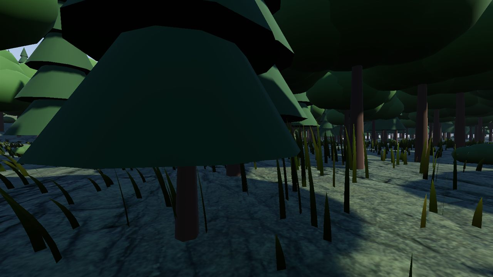

# WORLD-TECH-02 — Scalable Vegetation

**Project:** FRACTURED NATIONS
**Branch:** `feature/world-tech-02` (from `feature/world-tech-01`, not merged into `main`)
**Engine:** Godot 4.7.2-stable, Forward+, Vulkan, Terrain3D 1.0.2, Jolt
**Date:** 2026-10-19
**Test machine:** the WORLD-TECH-01 machine (i7-12700F, RTX 3070 8 GB, 16 GB RAM, Windows 11, 1600 × 900, VSync off)

Status tags as in WORLD-TECH-01: **[VERIFIED]** executed and observed, **[IMPLEMENTED]** exists in code but not exercised interactively, **[ESTIMATE]** calculated.

## 1. Summary

Vegetation no longer lives in Terrain3D's instancer. Trees, bushes and rocks are stored as compact
per-cell data in chunk files and activated as MultiMeshes only around the active camera; grass is
camera-local GPU particles with a road/base exclusion mask and an altitude cutoff; forests at RTS
distance are a tint baked into the Terrain3D color map. The 20 km world now carries **3.9 million
stored trees, bushes and rocks over the whole map** (WORLD-TECH-01 had a 2 km window) and renders
with **~530 MultiMeshes at ground level** instead of the 23,276 (2 km) / 8,165 (20 km window)
full-map MultiMeshes before, at lower frame times and lower memory. All targeted checks pass on
both worlds **[VERIFIED]**.

## 2. What was implemented

```
scripts/vegetation/
├─ vegetation_chunk.gd     VegetationChunk: 1024 m chunk → { 128 m cell → { mesh id → PackedFloat32Array } }
│                          16 floats per instance (MultiMesh 3D transform rows + RGBA color)
├─ vegetation_mesh_def.gd  VegetationMeshDef: scene, near_range, max_range, fade, shadows, collider shape
├─ vegetation_library.gd   VegetationLibrary: the mesh types of a world (assets/vegetation/vegetation_library.tres)
├─ vegetation_streamer.gd  VegetationStreamer (@tool): camera-local cell activation, threaded chunk loading,
│                          2 LODs, nearest-first activation budget, collider query API
├─ vegetation_mask.gd      VegetationMask: world-aligned L8 exclusion image (roads + margins, base pads)
└─ grass_layer.gd          GrassLayer (@tool): camera-local GPU particle grass with mask + altitude cutoff
shaders/vegetation/        grass_particles.gdshader (placement), grass_blade.gdshader (surface)
scenes/vegetation/grass_layer.tscn, assets/vegetation/grass_*_material.tres
scripts/world/world_builder.gd   scatter → chunks + mask + forest tint; "Bake painted instances" button
scripts/world/instance_collider_streamer.gd   colliders now read chunk cells
tools/rebuild_vegetation.gd, tools/test_vegetation.gd, tools/bench_world.gd (new scenarios, switch test)
worlds/<name>/vegetation/  veg_<x>_<z>.res chunks + mask.res
```

### 2.1 Grass — camera-local GPU particles **[VERIFIED]**

- Derived from Terrain3D's `extras/particle_example` (MIT), copied into the project so it can be
  changed. A 5 × 5 grid of `GPUParticles3D` (24 m cells, 0.5 m spacing, **57,600 particles**, ±60 m)
  follows the current camera; the particle shader reads the Terrain3D height, control and color
  maps directly. Nothing is stored per blade, so cost is independent of map size.
- **Exclusion mask.** `VegetationMask` is an L8 image aligned to the world (2 m texels on 2 km,
  5 m texels on 20 km, capped at 4096² = 16 MB). `WorldBuilder.build_mask()` rasterizes every road
  polyline with its real width (lanes + shoulders from the RoadPoints, + 1 m margin, 2.5 m soft
  edge) and the base pads. The particle shader culls blades where the mask is > 0.5 (dithered), and
  additionally on hand-painted dirt (`excluded_texture_id`) and thins grass under the baked forest
  tint (`forest_thinning`). Future excluded surfaces (buildings, trenches) are painted into the
  same mask.
- **Altitude cutoff.** The layer measures the camera height above the terrain each physics tick and
  switches the particles off above `max_camera_height` = 90 m (12 m hysteresis), so RTS views do
  not simulate or draw grass.
- Terrain3D map parameters are pushed once and on `maps_changed`, not every frame.

### 2.2 Trees and bushes — cell-based activation **[VERIFIED]**

- **Storage.** `WorldBuilder.scatter_vegetation()` scatters trees, bushes and rocks per 128 m cell
  with an RNG seeded from `hash(world_seed, cell)`, so any cell can be regenerated alone and the
  output does not depend on thread scheduling. Cells run on the `WorkerThreadPool` (reading Terrain3D
  heights and normals concurrently worked without issues). Instances go into `VegetationChunk`
  resources (1024 m chunks) saved under `worlds/<name>/vegetation/`. The stored Terrain3D instances
  of the world are removed, so Terrain3D builds **no MultiMeshes for the map at load**.
- **Activation.** `VegetationStreamer` follows the current viewport camera (editor camera in the
  editor) plus optional extra observers. Chunks around the observers load on a background thread
  (`ResourceLoader.load_threaded_request`) and unload beyond range + 600 m. For every loaded cell
  within a mesh type's `max_range` it creates one `MultiMeshInstance3D` per (cell, mesh type) by
  assigning the stored buffer directly (`MultiMesh.buffer`, no per-instance calls). Cells out of
  range are freed immediately; new ones are created nearest first, at most 24 per frame.
- **LODs.** Two: the full mesh inside `near_range` (160 m trees, 90 m bushes, 120 m rocks) and the
  cheapest LOD of the asset beyond, switched by swapping `MultiMesh.mesh` (no re-upload, 15 %
  hysteresis). Only the near LOD casts shadows. Each MMI fades out at `max_range` (trees 900 m,
  rocks 500 m, bushes 320 m) with `VISIBILITY_RANGE_FADE_SELF`.
- **Colliders.** `InstanceColliderStreamer` indexes the chunk cells around the player through the
  streamer and builds the same pooled capsule/sphere shapes as before.
- **Editor.** Terrain3D's instancer brush still works; the `WorldBuilder` button **Bake painted
  instances into cells** moves painted instances into the chunk files and clears them from the
  regions. The streamer previews cells in the editor viewport **[IMPLEMENTED]** (editor not opened
  in this session, see §6).

### 2.3 Distant forests — color map tint **[VERIFIED]**

`WorldBuilder.bake_forest_tint()` writes forest density (the same function the scatter uses),
attenuated by slope and the exclusion mask, plus a warm tint on the dry fields, into every
region's Terrain3D color map at 1/8 vertex resolution (cubic upscale, mipmaps). The terrain shader
multiplies its albedo by this map, so forests read as darker green patches at any distance, the
grass particles inherit the tint, and hand painting with Terrain3D's color brush remains possible
afterwards (regenerating overwrites it). Baking the 100 regions of the 20 km map takes 17 s.

### 2.4 Camera transitions **[VERIFIED]**

Jumps and FPS ↔ RTS switches are handled by the same path as normal movement: the desired cell set
is recomputed when an observer moved more than 8 m (or a chunk arrived), old cells are freed in
that frame, new cells arrive over the following frames nearest first. Chunk loads never block the
main thread except for the collider streamer, which asks for the chunk under the player
synchronously (first index 6–32 ms, once per cell).

## 3. Validation — what was actually run

`benchmarks/wt02_suite/run_wt02.sh` (about 4 minutes): `tools/test_vegetation.gd` on both worlds,
the fast station benchmark (identical stations, warm-up and measurement windows as WORLD-TECH-01) on
Vulkan for both worlds and once on D3D12, and the FPS self-test on both worlds. Evidence:
`benchmarks/wt02_suite/run1/`, `benchmarks/raw/*.json`, `docs/screenshots/bench_v2_*`,
`docs/screenshots/vegtest_*`.

### 3.1 Targeted checks (`tools/test_vegetation.gd`) — all PASS on both worlds

| Check | 2 km (test_2km) | 20 km, full-map vegetation (real_20km) |
|---|---|---|
| Mask on road centerlines (3 samples per segment) | 285 / 285 excluded | 3,105 / 3,105 excluded |
| Mask on open ground ≥ 15 m from roads, outside pads (400 random) | 400 / 400 clear | 400 / 400 clear |
| Mask on base pads (3 points per pad) | 9 / 9 excluded | 9 / 9 excluded |
| Excluded fraction of the map | 4.8 % | 0.17 % |
| Trees inside road clearance (9 m) / on base pads | 0 / 0 of 30,097 | 0 / 0 of 307,495 checked (cap) |
| Trees standing on the grass mask | 0 | 6 of 307,495 (5 m texel rounding at pad edges) |
| Per-cell scatter repeated twice / equals stored file | identical / identical | identical / identical |
| Stored instances (chunks) | 37,839 (4) | **3,892,157 (400)** |
| Active at FPS station: MMIs / cells / instances | 512 / 189 / 23,630 | 524 / 195 / 25,482 |
| Settle after arriving at the station (warm) | 24 frames, 39 ms, worst frame 2.4 ms | 23 frames, 58 ms, worst frame 17.3 ms (chunk reload) |
| Cold start at the first station | worst frame 20.6 ms | worst frame 30.3 ms |
| Jump to the far corner | 3 frames, worst 4.2 ms, no out-of-range cells left | 23 frames, worst 17.6 ms, none left |
| 6 FPS ↔ RTS 600 m round trips | worst frame 11.6 ms, settle ≤ 17 frames | worst 13.8 ms, settle ≤ 23 frames |
| 180 frames at 1 m/frame (60 m/s at 60 fps) | worst frame 4.3 ms | worst frame 4.3 ms |
| Grass active at 1.8 / 60 / 120 / 600 / 70 / 1.8 m above ground | on on **off off** on on | on on **off off** on on |
| Colliders built from chunk data next to a tree | 29 shapes, 2 cells indexed | 74 shapes, 2 cells indexed |

Settle = frames until the streamer's queue is empty; each frame activates at most 24 (cell, mesh)
pairs. Worst-frame numbers are wall time per frame with VSync off.

### 3.2 Station benchmark — comparison with WORLD-TECH-01

Same `tools/bench_world.gd` stations (FPS center on the main road, FPS far corner, RTS 150 m, RTS
600 m, strategic), 60 warm-up + 180 measured frames, ms per frame (average, p99 in brackets).
WORLD-TECH-01 rows are the Vulkan rows of `benchmarks/fast_suite/validation_tables.md`.

| Run / scenario | FPS center ms (p99) | FPS far corner | RTS 150 m | RTS 600 m | Strategic | Jump max ms | Switch max ms / settle frames | Active MMIs at FPS | MMIs in scene | VRAM MB (Godot) |
|---|---|---|---|---|---|---|---|---|---|---|
| **2 km, WT-01 full** (stored Terrain3D grass + trees, Vulkan) | 2.2 (2.6) | 2.4 (2.9) | 2.0 (2.5) | 3.8 (4.9) | 1.4 (1.4) | 11.6 | — | — | 23276 | 303 |
| 2 km, WT-01 particles (stored trees + example grass) | 2.3 (2.7) | 3.0 (29.8) | 2.2 (2.5) | 3.8 (4.7) | 1.8 (2.0) | 11.2 | — | — | 19291 | 288 |
| **2 km, WT-02 full** (streamed trees + masked grass) | 1.7 (2.3) | 1.7 (2.3) | 2.0 (2.8) | 2.0 (2.6) | 1.4 (2.1) | 9.5 | 12.3 / 15 | 512 | 528 | 250 |
| 2 km, WT-02 trees (grass off) | 1.5 (2.2) | 1.6 (2.2) | 2.0 (2.8) | 2.0 (2.7) | 1.4 (2.0) | 10.3 | 9.3 / 15 | 512 | 192 | 250 |
| 2 km, WT-02 grass (streamer off) | 1.3 (1.7) | 1.4 (2.3) | 2.0 (2.6) | 1.8 (2.6) | 1.4 (2.1) | 8.7 | 8.8 / 3 | 0 | 0 | 249 |
| 2 km, WT-02 roads (no vegetation) | 1.2 (1.6) | 1.3 (2.0) | 2.0 (2.9) | 1.7 (2.0) | 1.4 (1.4) | 8.2 | 8.8 / 3 | 0 | 0 | 249 |
| 2 km, WT-01 roads (no vegetation) | 1.1 (1.3) | 1.2 (1.3) | 2.0 (2.1) | 1.7 (1.7) | 1.4 (1.4) | 8.3 | — | — | 0 | 270 |
| **20 km, WT-01 full** (2 km vegetation window) | 1.4 (1.8) | 1.4 (1.8) | 2.0 (2.6) | 2.2 (2.5) | 1.6 (2.0) | 12.5 | — | — | 8165 | 1596 |
| **20 km, WT-02 full** (3.9 M instances, whole map) | 1.8 (2.3) | 2.1 (2.4) | 2.0 (2.4) | 2.3 (2.9) | 1.7 (2.2) | 13.2 | 16.3 / 23 | 524 | 550 | 1556 |
| 20 km, WT-02 trees (grass off) | 1.7 (2.3) | 1.9 (2.6) | 2.0 (2.9) | 2.3 (3.1) | 1.7 (2.7) | 14.3 | 17.1 / 23 | 524 | 247 | 1556 |
| 20 km, WT-02 grass (streamer off) | 1.6 (2.7) | 1.6 (2.6) | 2.0 (3.0) | 2.0 (2.9) | 1.7 (2.6) | 12.7 | 12.6 / 3 | 0 | 0 | 1555 |
| 20 km, WT-02 roads (no vegetation) | 1.4 (2.4) | 1.5 (2.5) | 2.0 (3.1) | 2.0 (2.9) | 1.7 (2.6) | 13.4 | 12.6 / 3 | 0 | 0 | 1555 |
| 20 km, WT-01 roads (no vegetation) | 1.3 (1.6) | 1.4 (1.8) | 1.9 (2.2) | 1.9 (2.2) | 1.6 (2.0) | 12.0 | — | — | 0 | 1558 |
| 20 km, WT-02 full on **D3D12** (sanity run) | 1.9 (2.7) | 2.1 (2.9) | 1.8 (2.7) | 2.1 (2.9) | 1.5 (2.7) | 15.3 | 19.4 / 23 | 524 | 550 | 1707 |

Scenarios: *full* = streamed trees/bushes/rocks + particle grass; *trees* = grass off; *grass* =
streamer off; *roads* = no vegetation. "MMIs in scene" counts `MultiMeshInstance3D` nodes when the
scenario starts (for WT-02 this depends on where the camera stood at that moment; "Active MMIs at
FPS" is the steady-state count at the FPS center station). The switch test alternates the FPS center
and the RTS 600 m station 12 times; "settle frames" is how long the streamer needed to activate all
cells after a switch (24 activations per frame).

Reading the table:

- **2 km:** WT-02 *full* is faster than WT-01 *full* at every station (FPS 1.7 vs 2.2 ms, RTS 600 m
  2.0 vs 3.8 ms) with 528 instead of 23,276 MultiMeshes and 250 instead of 303 MB VRAM. The grass
  layer costs about 0.2–0.4 ms at ground level and nothing above 90 m.
- **20 km:** WT-01 held a 2 km vegetation window; WT-02 holds the whole map (3.9 M instances) at the
  same station costs within 0.1–0.4 ms. Ground level is 0.4 ms slower than the WT-01 window (1.8 vs
  1.4 ms) because the near LOD now reaches 160 m instead of Terrain3D's 60 m and the particle grass
  replaces the stored cards; `near_range` is the knob if that matters. RTS 150 m is unchanged, RTS
  600 m is 2.3 vs 2.2 ms with only 247 MultiMeshes active, and the strategic view no longer carries
  any vegetation objects.
- **Transitions:** worst frames during jumps are 9.5–13 ms (WT-01: 11.6–12.5 ms); FPS ↔ RTS switches
  12–17 ms worst, settled within 15–23 frames. No stalls, no render errors.
- **D3D12 sanity run:** the 20 km map with whole-map vegetation renders on D3D12 with 0 errors
  (WT-01: descriptor-heap exhaustion from 77k MultiMeshes, crash at 400 regions). The per-MultiMesh
  cost no longer scales with the map; D3D12 remains a fallback only.

Process-level peaks (`tools/measure_run.ps1`, Windows GPU process memory counters, whole run with
all five scenarios):

| Run (all scenarios in one process) | Wall s | Exit | Peak RAM (working set) MB | Peak GPU dedicated MB | Peak GPU shared MB |
|---|---|---|---|---|---|
| 2 km, WT-01 (`vulkan_real_2km`) | 14.7 | 0 | 1,249 | 631 | 231 |
| 2 km, WT-02 (`v2_vulkan_real_2km`, 5 scenarios + shots) | 22.1 | 0 | **754** | 617 | 141 |
| 20 km, WT-01 (`vulkan_real_20km`) | 17.2 | 0 | 2,373 | 1,695 | 213 |
| 20 km, WT-02 (`v2_vulkan_real_20km`, 5 scenarios + shots) | 29.4 | 0 | **2,057** | 1,695 | 143 |
| 20 km, WT-02 D3D12 (`v2_d3d12_real_20km`, full only) | 12.3 | 0 | 1,937 | 1,781 | 71 |
| 20 km, WT-01 FPS self-test | 24.5 | 0 | 2,433 | 1,718 | 213 |
| 20 km, WT-02 FPS self-test | 24.5 | 0 | 2,105 | 1,744 | 143 |

The 20 km numbers are dominated by the resident terrain (1.33 GB of maps); the vegetation data for
the whole map adds about 5 MB of RAM for the 4–9 loaded chunks and under 10 MB of VRAM for the
active MultiMeshes and the 16 MB mask. Loading the 20 km scene (instantiate + 5 frames) went from
4.9 s to 5.2 s, because Terrain3D no longer builds 8,165 MultiMeshes but the color maps now carry
real data.

### 3.3 FPS self-test with streamed colliders **[VERIFIED]**

`--fps-test` (scripted controller checks from WORLD-TECH-01, now against colliders built from the
chunk data). Values are the raw measurements; the tree check was made robust against sliding around
the trunk on slopes (it records the closest approach).

| Check | 2 km (WT-02) | 20 km, whole-map vegetation (WT-02) | 20 km (WT-01, for reference) |
|---|---|---|---|
| Landing on the road (feet − terrain) | 0.25 m, on floor | 0.25 m, on floor | 0.25 m, on floor |
| Walk / sprint speed | 4.29 / 6.47 m/s | 3.59 (uphill) / 6.90 m/s | 4.27 / 7.21 m/s |
| Jump apex | 1.22 m | 1.22 m | 1.22 m |
| 15–17° slope | climbs at 4.13 m/s | climbs at 4.15 m/s | climbs at 4.2 m/s |
| 70° slope | slides down (−2.6 m) | — (none found near spawn) | — |
| Walk into a streamed tree | stopped 0.84 m from the trunk (30 colliders active) | closest approach 0.80 m, slid around the trunk (70 colliders active) | stopped 0.70 m |
| Walk at the far corner (10.2 km from origin) | 4.30 m/s, on floor 100 % | 4.31 m/s, on floor 100 % | 4.31 m/s, on floor 100 % |
| Process exit | exit 0, no leak warnings | exit 0, no leak warnings | exit 0 |


## 4. Screenshots (actual Godot 4.7.2 runs, Vulkan, 1600 × 900)

| | |
|---|---|
|  2 km, FPS on the main road: no grass on the road, trees kept 9 m off |  2 km, FPS in open ground (particle grass, near LOD trees) |
|  2 km, RTS 150 m: streamed cells, grass off above 90 m |  2 km, RTS 600 m: far LOD trees to 900 m, forest tint beyond |
|  20 km, FPS center (3.9 M stored instances on the map) |  20 km, FPS 10 km from the origin |
|  20 km, RTS 150 m |  20 km, RTS 600 m: forests continue as tint to the horizon |
|  2 km, inside a forest after the 60 m/s run: grass thinned and tinted under the canopy |  20 km, same check |

## 5. Measured costs of the data path

| Item | 2 km | 20 km, whole map |
|---|---|---|
| Scatter (threaded, 20 threads) | 256 cells, 0.95 s | 25,600 cells, 85 s |
| Mask build | 16 ms (1024², 2 m) | 29 ms (4096², 5 m) |
| Forest tint bake | 4 regions, 0.36 s | 100 regions, 16.7 s |
| Chunk files on disk | 4 files, 2.3 MB | 400 files, 240 MB (62 bytes per instance) |
| Mask on disk | 1.0 MB | 16.0 MB |
| Terrain region files | 40 MB → 20 MB (stored instances removed) | 383 MB → 505 MB (non-default color maps) |
| Chunks resident at runtime | all 4 | 4–9 (observer ± 980 m + 600 m margin) |

## 6. Limitations

- **Placeholder look.** Trees, bushes and the grass blade are still procedural placeholders; the far
  LOD pops at `near_range` (no cross-fade between LODs, only a fade at `max_range`). Real assets
  with authored LOD1/impostors will change ranges and costs.
- **Grass draws to ±60 m** and the blades grow wider with distance (inherited from the example).
  Beyond 60 m the ground relies on the terrain textures and the tint. Density, draw distance and
  look were not tuned beyond "believable at ground level".
- **Forest tint is baked, not live.** Regenerating vegetation overwrites hand-painted color. Felled
  forests will need the tint regenerated per cell (the bake is per region today).
- **Mask resolution** is 5 m texels on the 20 km map; the test found 6 of 307k trees on the mask's
  soft edge at base pads. Roads narrower than ~6 m would need a finer mask or a vector test.
- **Cold start.** The first activation of each mesh type costs a frame of 20–30 ms (shader
  pipelines, first uploads). A loading-screen warm-up would hide it.
- **Chunk reload spikes.** Returning to an area whose chunks were unloaded costs a 17 ms frame on
  the 20 km map (decode of a ~0.6 MB resource plus the cell re-evaluation in that frame). The
  600 m keep margin makes this rare during normal movement.
- **Terrain3D painted instances** are not visible to the streamer or the colliders until baked.
- **Editor preview** of the streamer was not exercised in this session (no editor was connected);
  it uses the same code path with the editor camera.
- The vegetation data does not yet carry persistent state (felled, burnt, cover values); it has the
  cell layout for it. One observer is used in practice (the current camera); multiple observers
  are supported but not measured.
- Measured on one machine and one GPU vendor only; D3D12 only as a one-scenario sanity run.

## 7. Recommended next steps

1. Authored vegetation assets with a real LOD1/impostor, then retune `near_range`/`max_range` and
   consider merging far-LOD cells (e.g. 256 m) to cut MMIs further in RTS views.
2. Persistent vegetation state per cell (felled trees, cover/concealment) stored next to the chunk
   data, with the streamer rebuilding only the touched cell's MultiMesh.
3. Per-cell forest tint and mask updates so runtime changes (deforestation, new buildings) reach
   the far field and the grass without a full bake.
4. A loading-screen warm-up (activate one cell of each mesh type once) and a background decode of
   chunks ahead of fast RTS pans.
5. 2D strategic map from world data (heights, roads, forest mask) — the forest density function
   and the mask already exist as data.
6. Measure on an AMD or Intel GPU; try the D3D12 fallback with the full scenario matrix.
