# WORLD-TERRAIN-01 — Reference-Based World Generation

**Project:** FRACTURED NATIONS
**Branch:** `feature/world-terrain-01` (worktree `../fractured-nations-terrain01`, based on `feature/world-core-02`; not merged)
**Engine:** Godot 4.7.2-stable, Forward+, Vulkan, Terrain3D 1.0.2, Road Generator 0.9.5, Jolt
**Asset tools:** Blender 5.2 (bpy, background mode); numpy + OpenImageIO from Blender's bundled Python
**Test machine:** i7-12700F, RTX 3070 8 GB, 16 GB RAM, Windows 11, 1600 × 900, VSync off (same as WORLD-TECH-01/02)
**Date:** 2026-10-20

Status tags as in the earlier reports: **[VERIFIED]** executed and observed (log, JSON,
screenshot), **[IMPLEMENTED]** exists but not exercised, **[ESTIMATE]** calculated.

## 1. Summary

A new, alternative 20 × 20 km world, `worlds/ref_20km`, is generated from the project's
reference map (`docs/terrain01/reference_map_03.png`, "Referansekart 03"). The existing
20 km worlds are untouched.

- **Geography.** The reference was traced into a layout file (river, 4 lakes, NE massif with passes,
  5 rocky hills, 5 farmland zones, 26 settlements, 8 plateaus, 33 roads). A numpy generator
  (`tools/terrain_ref/generate.py`) turns it into a coherent elevation model with drainage, lake
  basins, graded roads, bridges, culverts, field patchwork, forests and wetland. It does not
  read the picture's brightness as height. Same seed and layout give the same world.
- **Pipeline.** The existing pipeline is reused: `WorldConfig` → `WorldBuilder` (a
  `ReferenceWorldBuilder` subclass) → Terrain3D import, Road Generator roads, the WORLD-TECH-02
  vegetation chunks/streamer/grass, and the WORLD-CORE FPS/RTS scene
  (`scenes/game/world_ref_20km.tscn`). Shared files changed are `tools/build_world.gd` (builder hook,
  4 lines) and `tools/test_vegetation.gd` (2 small hooks), plus README and `.gitignore`.
- **Assets.** 25 environment assets were made with the Blender pipeline: 6 trees, 3 understorey plants,
  6 rocks and deadwood, 4 bridge and drainage pieces, and 6 rural props. They come with their own
  bark, foliage and ground textures, LODs, impostors, Godot shaders and a vegetation library.
  Each was iterated on preview renders and in Godot.
- **Iteration.** The top-down comparison against the reference ran through 11 iterations
  (5 numpy previews, 6 Godot top-down mosaics), with FPS/RTS screenshots from 17 stations.
- **Measured** [VERIFIED]:
  - land: 59 % usable (≤ 8°, not water), 91 % vehicle-passable, 1.55 % water, 64 % forest;
  - sites: 388 non-overlapping 400 m sites and ~11,900 FOB-size sites;
  - roads: one connected network with ≥ 2 independent routes between every pair of the six regions.
  - Frame times (Vulkan, RTX 3070): FPS 9.6 ms, RTS 150 m 2.5 ms, RTS 600 m 2.9 ms; VRAM 1.6 GB.
  - Vegetation checks, FPS self-test and the WORLD-CORE large-world test all pass on the new world.
  - The first performance measurement (30.8 ms at ground level) was traced to shadow fill-rate of the
    new tree cards and fixed (§10).

## 2. Parallel development

- Created worktree `../fractured-nations-terrain01` on new branch `feature/world-terrain-01`
  from `feature/world-core-02` (`ba5a952`). All work happened there. The other instance's
  working directory (`fractured-nations`, branch `feature/world-base-01`) was only read from: the
  reference image, which is untracked there, was **copied** to `docs/terrain01/reference_map_03.png`.
- Nothing under `scripts/core`, `scripts/player`, `scripts/rts`, `scripts/units`, `scripts/game`
  or `scripts/vegetation` was modified. New world code lives in `scripts/world/reference_*.gd`;
  everything else is new files (`tools/terrain_ref/`, `tools/blender/env/`, `assets/environment/`,
  `shaders/environment/`, `shaders/world/`, `docs/terrain01/`, `benchmarks/terrain01/`).
- Shared files touched, all small and additive: `tools/build_world.gd` (uses `config.create_builder()`
  when the config provides one, calls `builder.build_extras()`), `tools/test_vegetation.gd` (skips the
  base-pad check and calls `prepare_scatter()` for reference worlds), `README.md`, `.gitignore`.

## 3. Reading the reference

The reference is an AI-style satellite illustration with a 2 km grid, insets (height, zones,
roads) and photo strips. The main map is the authority; the insets contradict it in places
(the height inset puts the river elsewhere) and were only used for intent: massif in the NE, river
lowland in the middle, *ca. -50 to 1200 m*, *6 operation areas*.

Positions were measured on the main map with the tick marks (x 47 → 912 px = 0 → 20 km,
y 980 → 92 px = 0 → 20 km) on 2× crops of each quadrant, then written as km coordinates into
`tools/terrain_ref/layout_ref03.json` (origin south-west, y north; Godot X = x·1000 − 10000,
Z = 10000 − y·1000).

| Feature | Reference | Implementation |
|---|---|---|
| River | N→S through the middle, meandering from (7.7, 20) to (9.8, 0), wide in the picture | 26 traced points, Chaikin-smoothed meanders, 42→70 m wide, water 148→54 m, 3.2 m channel, banks and floodplain |
| Lakes | NE (18.1, 14.9), W-central (5.9, 7.9), SW large (3.2, 2.5) with island, SW small (1.2, 4.4) | 4 lakes with noisy shorelines, closed rims, depth 8–18 m, levels taken from the surrounding terrain (517, 276, 262, 261 m); 3.8 km² |
| Mountains | Bare grey massif in the NE quadrant (x 15–20, y 15–20) | Ridge axis NW–SE across the corner, peak ~1,215 m, two pass saddles, treeline 640–830 m, rock above it |
| Rocky hills | NW (4.6, 15.6), W (2.1, 10.6), SW (2.8, 6.4), E (17.5, 6.0), S (15.9, 2.5) | 5 rocky hill zones: domed hills (+260–300 m) with ridged detail and rock outcrops |
| Farmland | River lowland S of the town, E plain (13–17, 9–13), around villages | 5 farmland zones + field parcels near every settlement and on low gentle ground; 16 % fields |
| Forest | Dominant, a mosaic with many clearings | 59–64 % forest (density > 0.4) in a multi-scale mosaic, natural clearings, hedgerows |
| Towns | Central town (9.1, 11.8), East town (13.3, 8.1), ~24 villages, industrial site | 26 settlements: 2 towns with street grids, 23 villages with side streets, 1 industrial site; 1,609 buildings |
| Military base (east) | Airfield (16.7–19.0, 12.5–14.0) | **Not built** (the brief forbids prebuilt bases); a 2.7 × 1 km flat open plateau ("Flyslette øst") on the same spot |
| Roads | Two trunk roads (W→SE, N→E) crossing the middle, secondary roads radiating from the towns, dense local roads | 2 primary + 8 secondary roads as Road Generator meshes (144 km), 13 local roads + 10 forest tracks graded and painted (132 km), 35 km of town streets |

## 4. Geographic design

### 4.1 Regions (approximately six areas for independent faction development)

The regions are the Voronoi cells of six centres. They are not marked in the world; they are
used for the statistics in §8.

| Region | Character | Area |
|---|---|---|
| Nordvest-skogen (NW forest) | Forested hills, the NW rocky ridge, farms to the north, village chain along Rv1 | 71.5 km² |
| Nordfjellet (NE mountain) | Bare massif, Fjellvatnet, two passes, forested lower slopes | 51.6 km² |
| Sentraldalen (central valley) | River lowland, central town, fields, river bridges | 65.0 km² |
| Innsjø-vest (west lakes) | Three lakes, rocky knolls, forest, the Storvatnet basin | 91.0 km² |
| Sørøst-åsene (SE hills) | Rolling forest hills, two rocky hills, fields around Østby/Sletta | 75.8 km² |
| Øst-sletta (east plain) | Open farmland plain and the large flat plateau of the reference's airfield | 45.1 km² |

### 4.2 Design rules

- **Playable relief before drama.** Regional slope toward the river, rolling hills (about 1.6 km
  wavelength, ±100 m), rough terrain only in the rocky zones and on the massif.
- **Drainage makes sense.** Priority-flood and D8 flow accumulation on a 39 m grid carve stream
  valleys in proportion to their catchment, so every valley drains to the river, a lake or the map
  edge. Lake rims are closed. The river falls monotonically.
- **Usable flat ground everywhere.** Eight plateaus (natural "moer", 0.8–2.7 km) and all
  settlements are flattened toward least-squares planes with a slope of at most 2.5–4 %. Many more
  flat sites occur naturally (§9).
- **No single chokepoint.** The river is crossed by 5 bridges spread over 12 km. Each region pair
  is connected by at least 2 edge-disjoint road routes (§9). The massif has two passes.
- **Limited water.** 1.55 % of the map, and no lake blocks a corridor.

## 5. Generation method

```
layout_ref03.json ──► generate.py (numpy, ~9 min) ──► worlds/ref_20km/source/
   river, lakes, zones,        macro relief 2048² → drainage 512² → lakes        height.r32   10240² float (1.953 m)
   settlements, plateaus,      → cover/fields → A* roads + grading + streets      control.r32  Terrain3D texture ids/blends
   road waypoints, seed        → full res 10240² in 256-row strips                color.rgba8  colour map (forest, crops, heath)
                                                                                  vegetation.png, info.png, roads.json,
                                                                                  water.json, sites.json, world_config.tres
            ──► Godot tools/build_world.gd + ReferenceWorldBuilder (~4 min) ──► worlds/ref_20km/{terrain,vegetation,water}
                Terrain3D import · Road Generator network · water meshes · bridges/culverts · vegetation cells
```

One command does it all: `bash tools/terrain_ref/build_ref_world.sh [--assets] [--shots]`
(about 14 minutes without asset regeneration, measured).

### 5.1 Dimensions

Exactly **20,000 × 20,000 m**: 10 × 10 Terrain3D regions of 1024² vertices at **1.953125 m**
spacing (the 2 m recommendation of WORLD-TECH-01, rounded so that whole regions add up to
exactly 20 km instead of 20.48 km). Memory and vertex count are the same as the 2 m real_20km
world.

### 5.2 Relief (macro grid 2048², 9.77 m)

1. River distance and level: distance to the smoothed river on the 512 grid (upsampled); water level linear
   along the river, blurred so the Voronoi seams between river segments do not crease the valley sides.
2. Regional surface: level + valley rise (170 m · (1 − e^(−d/2.4 km))) + north rise (110 m) + large noise (±55 m).
3. Hilliness field: 0.7 by default, ≈0.1 in farmland, 1 in rocky zones, damped on the floodplain. It drives
   domain-warped fBm hills (195 m amplitude).
4. Rocky hills: smooth domes with squared ridged noise. Massif: profile along the ridge axis × ridged noise,
   two pass saddles (×0.4).
5. Settlements and plateaus: blended toward a fitted plane with clamped slope.
6. Lakes: noisy elliptical shoreline; level = 30th percentile of the shore ring; rim raised 0.7 m + 6 % fading out,
   basin carved below the level.
7. Drainage: priority-flood with a small smooth perturbation (no straight D8 lines on flats), accumulation, carve depth
   2.8·√A − 0.8 m (≤ 16 m), monotone downstream, multi-scale blur for valley width; lakes, sites and the river are protected.

### 5.3 Roads

- A\* on the 512 grid (16-neighbour) between consecutive waypoints. Cost: length · (1 + k·grade²) plus
  a steep-grade penalty, a river-crossing penalty, no lakes, and a **repulsion from earlier roads**,
  except within 250 m of the segment's own waypoints. An earlier variant that rewarded following
  existing roads produced kilometres of parallel duplicates (measured with `check_roads.py`: up to 1.3 km per road pair).
- Chaikin smoothing with waypoints pinned exactly, so shared waypoints become exact junctions.
  Then: resampling every ~10 m, straight crossings over the river, a moving-average height
  profile, and a max-grade clamp (7 % primary, 9 % secondary, 11 % local, 14 % track). Bridge
  decks sit at least 6.5 m above the water.
- Town street grids (95 m blocks, aligned with the mean road direction modulo 90°) and village side streets.
- **Culverts** where a road crosses a drainage line of ≥ 0.4 km² on a fill: 201 crossings.
- At full resolution, roads cut and fill the terrain (embankment fall-off grows with the height
  difference), and the control map paints asphalt streets, gravel tracks and dirt verges.
- **In Godot**, primary and secondary roads become Road Generator networks. One finding mattered a lot:
  Road Generator re-validates the whole container whenever a RoadPoint enters the tree, which is
  O(n²). With ~4,300 RoadPoints in one container the build took **more than 10 minutes** and every
  scene load would pay the same. The network is therefore split into **111 containers** (pieces
  between junctions, ≤ 48 RoadPoints each, joined across containers; one container per junction
  with arm RoadPoints and a `RoadIntersection`). It now assembles in **11 s, plus 3 s for segments**,
  with 0 failed links **[VERIFIED]**. The Terrain3D connector flattens under the meshes as before.

### 5.4 Surface, vegetation and water

- **Control map** (explicit, autoshader off): meadow, rock (slope and rockiness, blended), dirt, field/heath,
  forest floor, gravel, bog, asphalt. The last four are new procedural textures (`make_terrain_textures.py`).
- **Colour map** at vertex resolution: crop patchwork, canopy-mottled forest tint (reads as crowns where no
  trees are drawn), alpine heath, bog.
- **Vegetation maps** (2048²): forest density, pine/birch share (the rest spruce), wetness, rockiness, field,
  settlement, water. `ReferenceWorldBuilder._scatter_cell_task` uses them to pick species (pine on dry/rocky/high
  ground, spruce in moist lowland, birch at edges, on wet ground and toward the treeline), understorey (juniper,
  willow, fern), deadwood (logs, stumps) and rocks (erratics, stone clusters, outcrops on rocky slopes).
  The output goes into the unchanged WORLD-TECH-02 chunk format. Deterministic per cell (verified, §11).
- **Buildings and road furniture** are planned once (houses, barns and sheds facing their street,
  mailboxes, snow poles every 50/75 m, skigard fences near farms) and written into the same cells.
  They stream like trees.
- **Grass**: the unchanged `GrassLayer` with a per-world tuft mesh and texture. Under the canopy the
  same particles render dwarf shrubs (blueberry/lingonberry), chosen by the colour-map tint.
- **Water**: river ribbon in 2 km pieces and lake polygons with a depth-faded water shader
  (`shaders/world/water.gdshader`).

## 6. Visual comparison and iterations

Every iteration was judged on a side-by-side image: the reference frame (left) next to the
generated world (right), 2 km grid, north up. Iterations 1–5 compare numpy previews of the macro
grid. From iteration 6 on, the right side is an **actual Godot orthographic capture** of the full map:
8 × 8 tiles of 2.5 km at 1024 px each (8192 px mosaic, 2.44 m/px), downscaled. Iterations 7–11
include streamed vegetation (impostors with a top card) and buildings (`tools/terrain_ref/capture.gd`).

| It. | Image | Observed difference | Change |
|---|---|---|---|
| 1 | `iterations/it01_macro_compare.jpg` | Layout right, but no relief, forest everywhere (80 %), massif 1,486 m | Hills ×1.7, forest bias, massif peak 880 → 600 |
| 2 | `it02` | Straight crease lines across the map; rocky hills read as crumpled blobs | Smoothed river level and line (Voronoi seams); rocky zones as warped domes |
| 3 | `it03` | Drainage carving made cliff steps; lake rims made rings | Gentler, wider valley carving; fading lake rim; noise on flats against straight D8 lines |
| 4 | `it04` | Forest 30 %, 69 % of the land < 5° (too flat), striped fields | Hills 165 m / 1.6 km; field parcels per block with their own orientation |
| 5 | `it05` | Forest mosaic too coarse, massif too narrow | Small-scale forest noise, wider massif axis, steeper rocky hills |
| 6 | `it06_godot_topdown_compare.jpg` | First Godot top-down: forests only a faint tint (map pale yellow-green), lakes black, no towns, crops orange | Canopy-green forest tint, muted meadow and crops, more spruce, brighter water |
| 7 | `it07` | Tone right; towns a gravel-speckled disc with ~10 houses; massif forested; fields still orange | Town street grids with ~1,600 buildings along the streets, lower treeline, wider river |
| 8 | `it08` | Massif rock and town grids visible; grid rotated 45° to the roads; dark rounded corners and a light column in RTS skies | Grid orientation from road directions modulo 90°; the Terrain3D NOISE world background (cause of the column and corners) removed |
| 9 | `it09` | Corners clean, massif matches; RTS haze too strong; bridge deck turned sideways | Lower fog for this world, local-axis bridge scaling, canopy mottling |
| 10 | `it10` | Road zig-zags across the river next to a straight bridge | Road paths straightened over every river crossing, span ends pinned as RoadPoints |
| 11 | `it11_godot_topdown_compare.jpg` | Final state | — |

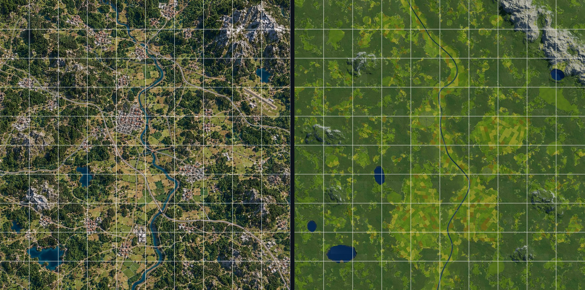

**What matches the reference:**
- the river course and its meander positions;
- the four lakes, and the bare NE massif with a lake at its foot;
- the five rocky hills;
- the open farmland belt along the river and the east plain;
- the town and village positions;
- the trunk-road pattern (W→SE and N→E, crossing near the centre);
- the forest/open mosaic (59 % forest by area).

**What differs, on purpose or still:**
- **Scale exaggeration in the picture.** The reference draws the river about 150–200 m wide and towns
  about 1 km across with large blocks. The world uses a 42–70 m river and Nordic town sizes.
- **Relief reads flatter from straight above.** The picture's dramatic hill shading implies slopes the
  playability targets avoid (§9). The top-down capture is lit by a sun 32° above the north-west horizon.
- **No airfield.** Prebuilt bases are out of scope; the plateau is there.
- **Roads are true width** (7–10 m paved), so at 2.4 m/px they are thin lines; the picture draws them as broad bands.

## 7. Ground-level and RTS views

Stations were chosen from the world data by `tools/terrain_ref/make_shots.py`:
- **Ground (FPS):** the densest pine forest, the densest spruce forest, birch/wetland, a forest edge, a
  rocky hill, two villages, a river bridge, a lake shore and the massif pass.
- **RTS:** 150 m (town, bridge, forest road), 600 m (centre, massif, lakes) and 1,500 m.

All are in `docs/terrain01/shots/` (actual Godot captures, 1600 × 900).

| | |
|---|---|
| 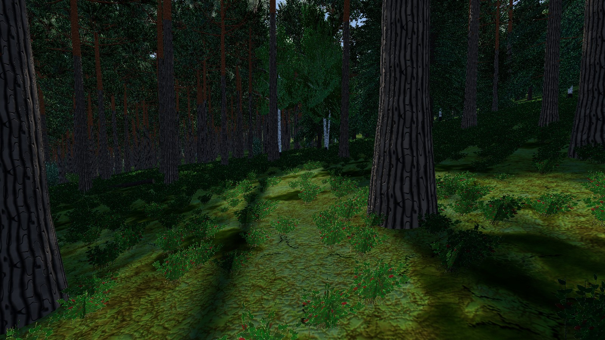 Pine forest: tall stems, orange upper bark, dwarf-shrub floor | 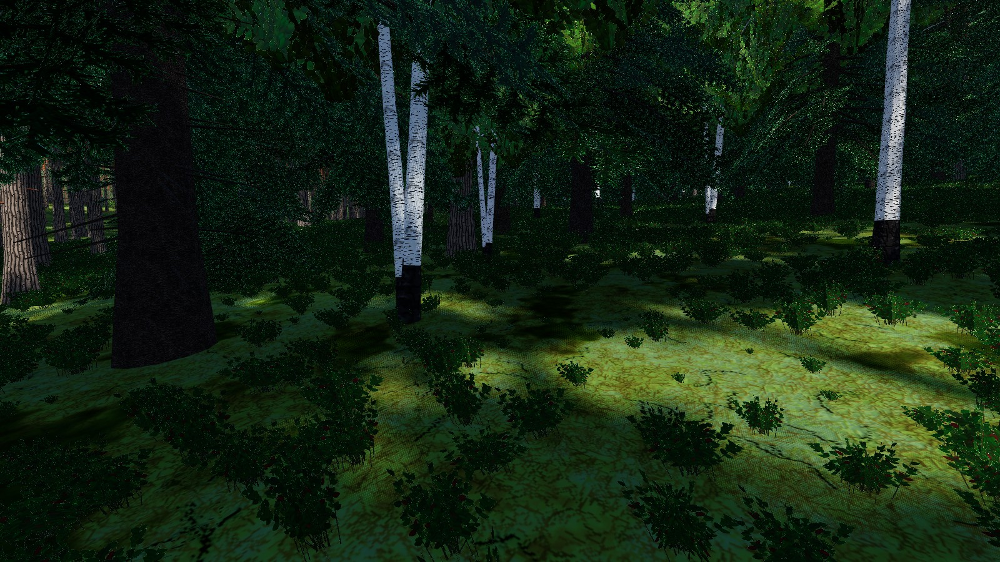 Spruce/birch stand |
| 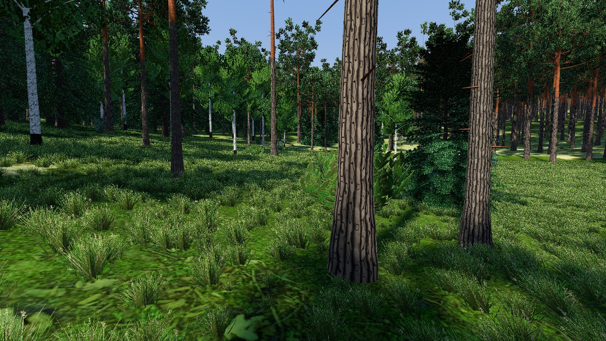 Forest edge, meadow tufts | 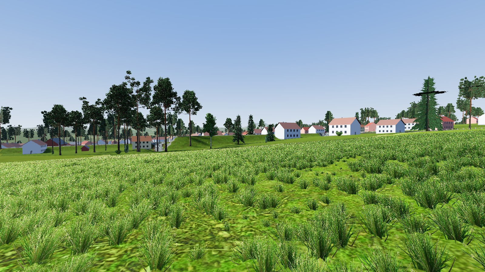 Field edge towards Østby |
| 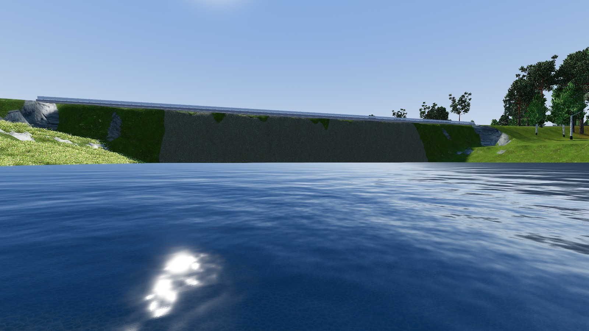 County-road bridge with piers | 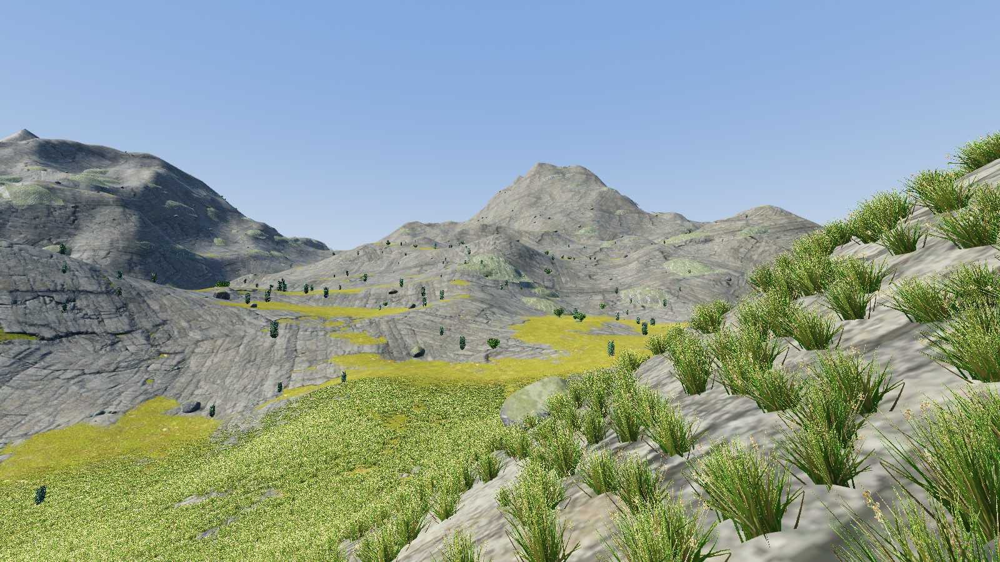 Massif pass: bare rock above the treeline |
| 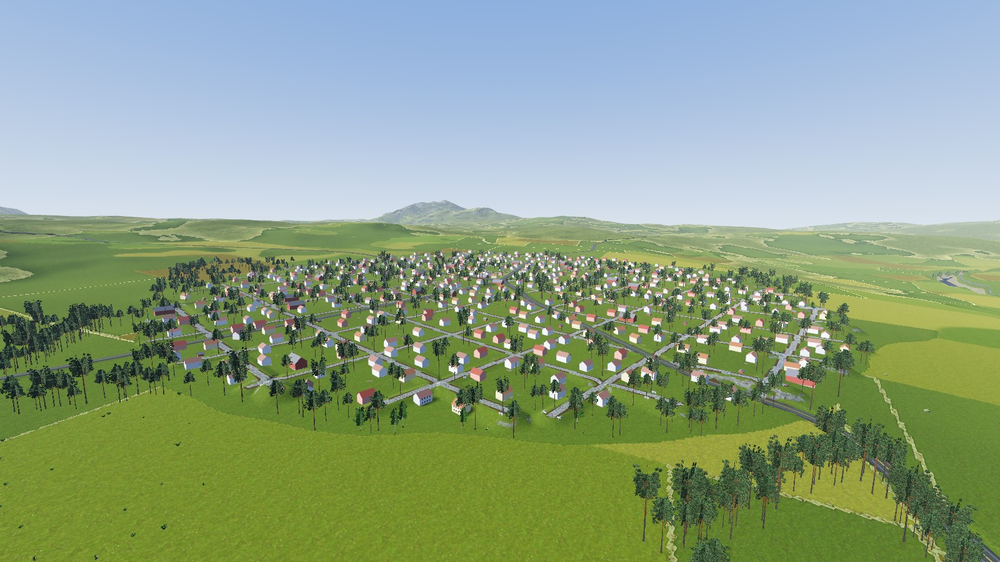 RTS 150 m: central town, street grid | 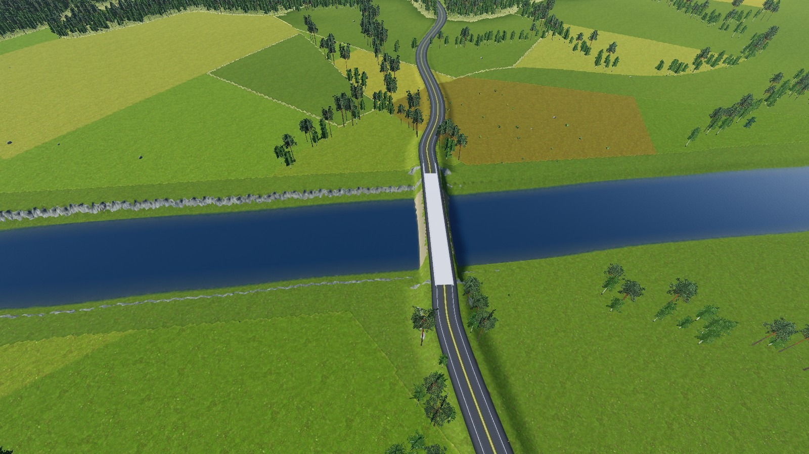 RTS 150 m: bridge, fields, hedgerows |
| 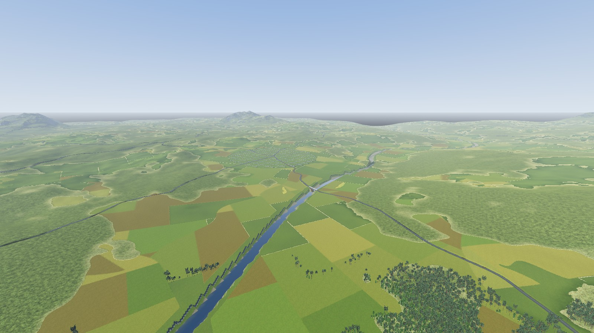 RTS 600 m: river valley | 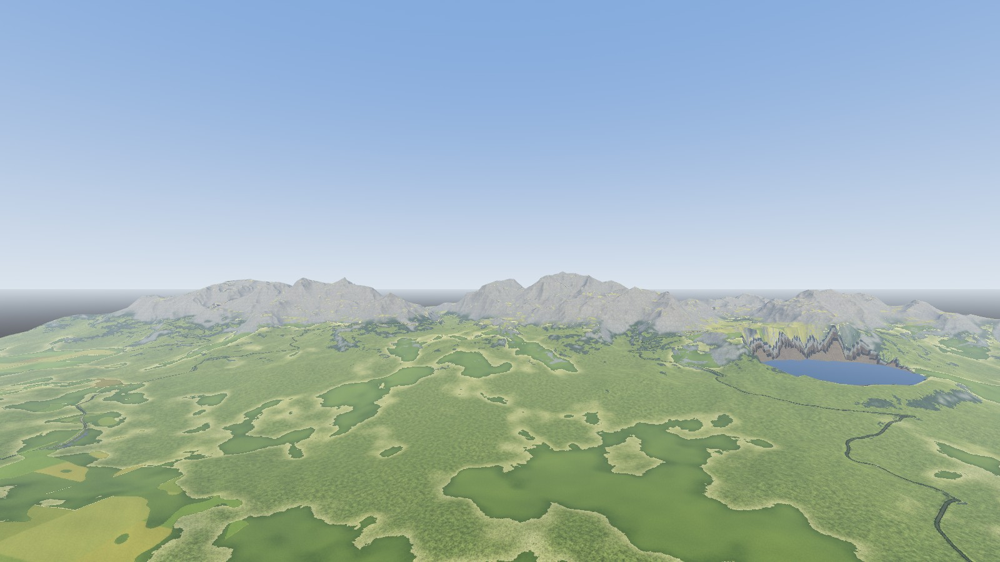 RTS 600 m: massif and Fjellvatnet |

Compared with the photo references (§8.1), pine and spruce stands, birch groups, erratic boulders, red
barns and white houses all read as Scandinavian at ground level. The weakest parts are:
- grass and dwarf shrubs are cards: convincing at walking distance, flat when looked straight down;
- the forest floor between the tufts is a texture, not ground plants;
- the town is a regular grid of three building types, with no yards, fences or garden detail.

## 8. Environment assets (Blender → Godot)

### 8.1 References

The photographic references are listed with URLs and observations in
[docs/terrain01/REFERENCES.md](terrain01/REFERENCES.md). They come from Wikimedia Commons and were
viewed in the browser, not downloaded:
- Scots pine and Norway spruce stands in Sweden and Norway;
- birch in Norway;
- glacial erratics in Finnish Lapland;
- Norwegian farm barns;
- county-road bridges and gravel forest roads.

Botanical facts (bark zones, crown forms) come from the EU forest atlas, Bean's Trees and Shrubs and
the Woodland Trust.

### 8.2 Pipeline

```
tools/blender/env/make_env_textures.py  bark (pine lower/upper, spruce, birch, birch base), foliage cards
                                        (pine tuft, spruce spray, birch twig, juniper, willow, fern), grass tuft,
                                        dwarf shrub, wood end grain  -> assets/environment/textures
tools/blender/env/make_trees.py         pine A/B, spruce A/B, birch A/B, juniper, shrub, fern
tools/blender/env/make_rocks.py         boulder A/B, stones, outcrop, fallen log, stump
tools/blender/env/make_structures.py    bridge module, pier, timber bridge, culvert, house, barn, shed,
                                        snow pole, mailbox, skigard fence
        -> assets/environment/blender/*.blend, assets/environment/glb/*.glb, docs/terrain01/blender_previews/*.jpg
tools/terrain_ref/import_env_assets.gd  GLB -> LOD scenes (assets/environment/scenes) with project materials:
                                        bark/foliage shaders with shared wind, triplanar rock + lichen + moss
tools/terrain_ref/make_nordic_library.gd -> assets/environment/nordic_library.tres (VegetationLibrary)
tools/terrain_ref/asset_lineup.gd       in-Godot line-up renders (docs/terrain01/godot_assets)
```

Trees are built from parameters with bmesh:
- tapered stems (parallel-transport frames, root flare, two bark zones);
- whorled or golden-angle branches;
- crossed alpha cards with baked vertex AO, whose custom split normals are bent outward so crowns
  shade like a volume.

LOD1 is three crossed impostor cards plus a horizontal top card for RTS views, rendered from LOD0 with
Blender's flat-lit Workbench.

| Asset | LOD0 tris | LOD1 tris | Near / max range | Notes |
|---|---|---|---|---|
| Pine A / Pine B (old, umbrella) | 4,206 / 3,336 | 8 | 90 / 1000 m | 20 m / 24 m |
| Spruce A / Spruce B (young) | 5,810 / 4,070 | 8 | 85 / 950, 70 / 650 m | 19 m / 7.5 m |
| Birch A / Birch B (3-stem) | 1,724 / 3,432 | 8 | 110 / 900, 100 / 850 m | 16 m / 13 m |
| Juniper, willow shrub, fern | 58, 46, 44 | 24, 20, 20 | 60 / 260, 60 / 300, 30 / 110 m | |
| Boulder A/B, stones, outcrop | 1,280, 480, 2,240 | 80, 120, 216 | 140 / 650, 45 / 180, 200 / 1000 m | Triplanar rock + lichen + moss shader |
| Fallen log, stump | 246, 150 | 36, 28 | 60 / 220, 40 / 160 m | |
| Bridge module (12 m), pier, timber bridge (6 m), culvert | 252, 24, 384, 328 | 84, 24, 156, 68 | scene nodes | Modules repeated and scaled along each crossing |
| House, barn (with ramp), shed | 502, 364, 166 | 34 | 250 / 1800, 120 / 900 m | Instance tint gives white/yellow/red/grey houses |
| Snow pole, mailbox, skigard section | 24, 24, 162 | 24, 24, 102 | 30–40 / 120–220 m | |

### 8.3 Visual iterations (representative assets)

- **Pine (tree).**
  1. Iteration 1 (`blender_previews/sheet_pine_a_it1.jpg`): the silhouette matched the stand pines, but
     the needles were too blue and bright, the crown too sparse and puffy, and the upper-bark orange too
     saturated.
  2. Iteration 2 (`sheet_pine_a_it2`): denser and darker crown, bark split moved higher.
  3. First in-Godot check: blown-out white blobs (rock materials saved while the rock shader failed to
     compile), near-black lower bark, dark grass fins. Fixed by lighter bark, re-imported materials, and
     grass tufts instead of ribbons.
  4. Performance (§10) forced 3× less card area. The final pine was re-checked in the line-up and in the
     forest shots (`iterations/perf_trees_check.jpg`).
- **Boulder (rock).**
  1. Iteration 1 (`sheet_boulder_a_it1`): read as a pitted potato.
  2. Iteration 2: good fracture faces, but soap-smooth.
  3. Iteration 3 (`sheet_boulder_it3`): rounded glacial block with facets.
  4. In Godot the first import was pure white (shader sampler-hint error). After the fix the triplanar
     rock, lichen and moss read correctly (`godot_assets/boulder_a.jpg`).
- **Infrastructure (bridge, culvert, barn).**
  - Culvert: oversized blocks hiding the pipe → dry-stone headwall around a corrugated pipe.
  - Barn ramp: floating plank → sloped ramp.
  - Bridge, three in-game iterations: global-axis scaling sheared the deck into a vertical slab; then a
    straight deck with a zig-zagging road on top; finally a straight road over a straight deck with piers
    (`shots/fps_river_bridge.jpg`, `shots/rts_150m_bridge.jpg`).
- **Other assets.**
  - Spruce and birch were too see-through in iteration 1 (fishbone spruce, tufty birch) and densified in
    iteration 2 (`sheet_trees_it1/it2`).
  - The fern went from a palm-like V to an arching rosette.
  - Textures took two passes: fern dots → pinnae, sparse juniper → dense, cracked-mud pine bark → vertical plates.

## 9. Playability measurements

Measured with `tools/terrain_ref/analyze.py` on the data actually imported into Terrain3D
(heights averaged to 7.8 m cells; `worlds/ref_20km/source/playability.json`, map
`playability_map.png`). **[VERIFIED]**

### 9.1 Whole map

| Quantity | Value |
|---|---|
| Size | 20,000 × 20,000 m (400 km²), heights 51–1,214 m, mean 324 m |
| Slope share 0–3 / 3–5 / 5–8 / 8–12 / 12–15 / 15–20 / 20–25 / 25–30 / 30–35 / 35–45 / > 45° | 17.1 / 19.0 / 24.1 / 20.5 / 7.4 / 4.5 / 2.0 / 1.5 / 1.2 / 1.7 / 1.0 % (mean 8.8°) |
| Usable land (≤ 8°, not water) | **236 km² (59 %)**, of it open (forest density < 0.3) 95 km² |
| Vehicle-passable (≤ 20°, not water) / infantry (≤ 35°) | 91.3 % / 95.9 % |
| Water | 6.2 km² (1.55 %): 4 lakes 3.76 km², river ~2.4 km² |
| Forest (density > 0.4) | 63.9 % (59 % on the 9.8 m macro grid); fields 16 % |
| Large base sites: 400 × 400 m squares with ≥ 92 % usable land, non-overlapping | **388** |
| Small sites (FOB): 100 × 100 m squares with ≥ 95 % usable land, non-overlapping | **11,888** |
| Roads | 311 km: primary 52.6, secondary 91.2, local 70.2, forest tracks 61.9, town streets 35.3 |
| Road network (without town streets) | **1 connected component**, 54 nodes, 63 edges; 24 graph bridges, all of them dead-end spurs (map edges, villages, the mountain pass) |
| Alternative routes | **≥ 2 edge-disjoint road routes between every pair of regions** (3 between the central valley and the west lakes) |
| River crossings | 5 road bridges spread over 12 km of river; 201 culverts under road fills |

### 9.2 Regions

| Region | Area km² | Mean / max height m | Mean slope | Usable | Open usable km² | Forest | Water | Large / small sites | Roads km |
|---|---|---|---|---|---|---|---|---|---|
| Nordvest-skogen | 71.5 | 395 / 816 | 8.4° | 57.8 % | 13.2 | 71.9 % | 0.45 % | 40 / 1,856 | 46 |
| Nordfjellet | 51.6 | 557 / 1,214 | 16.8° | 32.7 % | 5.3 | 60.3 % | 1.15 % | 15 / 684 | 30 |
| Sentraldalen | 65.0 | 234 / 407 | 6.7° | 67.2 % | 21.2 | 56.8 % | 1.95 % | 101 / 2,525 | 48 |
| Innsjø-vest | 91.0 | 284 / 750 | 8.1° | 59.3 % | 18.9 | 68.1 % | 3.49 % | 62 / 2,527 | 48 |
| Sørøst-åsene | 75.8 | 231 / 623 | 8.0° | 64.1 % | 20.4 | 64.4 % | 1.12 % | 99 / 2,537 | 38 |
| Øst-sletta | 45.1 | 311 / 425 | 6.3° | 70.1 % | 16.0 | 56.7 % | 0 % | 71 / 1,759 | 34 |

Six distinct regions, each with dozens of large flat sites, thousands of FOB sites, its own
roads and at least two routes to every other region. The mountain region is the deliberate
exception in character (33 % usable). It still has 15 large sites (lake shore, pass plateau, lower
slopes) and two passes.

Forest cover is high (57–72 % per region, close to the reference). Open usable land is
5–21 km² per region, and forest roads plus tracks reach most of the forest. **Movement**
**[VERIFIED by the FPS self-test, §11]:**
- walking on a 17° slope at 4.1 m/s;
- jump and landing as before;
- walking 10 km from the origin at 4.3 m/s, on the floor 100 % of the time.

## 10. Performance

Same fast workflow and stations as WORLD-TECH-01/02 (`tools/bench_world.gd`: 60 warm-up and
180 measured frames per station, layer scenarios, jump and FPS↔RTS switch tests). Each run is
wrapped by `tools/measure_run.ps1`. The runner is `benchmarks/terrain01/run_terrain01.sh`, about
2 minutes. Vulkan, 1600 × 900. Results: `benchmarks/terrain01/final/`. **[VERIFIED]**

| World / scenario | FPS centre | FPS far corner | RTS 150 m | RTS 600 m | Strategic | Jump max | Switch max | VRAM (Godot) |
|---|---|---|---|---|---|---|---|---|
| real_20km WT-02 full (procedural placeholders) | 1.8 (2.3) | 2.1 (2.4) | 2.0 (2.4) | 2.3 (2.9) | 1.7 (2.2) | 13.2 | 16.3 | 1,556 MB |
| **ref_20km full, first measurement** (`run1`) | 30.8 (32.4) | 25.8 (27.4) | 2.5 (2.7) | 2.9 (3.1) | 3.7 (4.9) | 51.7 | 47.0 | 1,631 MB |
| **ref_20km full, final** | **9.6 (10.1)** | **8.6 (9.2)** | **2.5 (2.8)** | **2.9 (3.2)** | **3.5 (4.4)** | 22.9 | 26.2 | 1,606 MB |
| ref_20km trees (grass off), final | 9.4 (9.9) | 8.3 (9.1) | 2.5 (2.6) | 2.9 (3.2) | 3.5 (4.4) | 22.5 | 26.0 | 1,607 MB |
| ref_20km roads only, final | 1.3 (1.6) | 2.8 (3.3) | 1.7 (1.9) | 1.8 (1.9) | 3.5 (4.0) | 15.4 | 13.4 | 1,605 MB |

Frame time in ms, average (p99). Process peaks of the final run: 2.5 GB RAM (working set),
1.96 GB dedicated GPU memory, 0 render, script or shader errors.

**What the first measurement found and how it was fixed.** A per-mesh-type GPU probe
(`tools/terrain_ref/probe_perf.gd`) located the cost at the ground station. It hides each
vegetation type in turn and reads the viewport's measured GPU time.
- **Where the time went:** pines and spruces accounted for 26 of 30 ms. Turning sun shadows off
  dropped it to 3–7 ms.
- **Ruled out:** neither the tree near-LOD range nor the impostor range changed the number.
- **Cause:** shadow-map **fill-rate**. The first tree versions had about 2,000 alpha cards per pine
  (card area ~20× the crown surface), and these overlap many times in each of the four shadow cascades.
- **Fixes:**
  1. About 3× less card area per conifer (fewer, larger cards): 30.0 → 19.3 → 9.3 ms GPU.
  2. A 2048 instead of 4096 directional shadow atlas for this world only (set at runtime by
     `ReferenceWorldBuilder`): about −40 % shadow cost.

The trees were re-checked visually after the reduction (`iterations/perf_trees_check.jpg`).

**Versus the WT-02 baseline.** Ground level is about 5× more expensive than the WT-02 placeholders
(opaque low-poly cones). That is the price of alpha-card foliage with shadows; it still runs at
about 100 fps on an RTX 3070. RTS and strategic views are within 0.5–1.8 ms of WT-02. VRAM is
unchanged (terrain-dominated). The architecture limits are unchanged: no full-map collision, no
full-map navigation, vegetation streamed per 128 m cell (~1,000 MultiMeshes at the ground
station, 543 at RTS 600 m).

| Build step | Time |
|---|---|
| Geography (`generate.py`, numpy, single process) | ~9 min |
| Blender assets (all 25, with previews and impostors) | ~2.5 min |
| Godot import + LOD scenes + library | ~1 min |
| World build: terrain import 5 s, roads + flattening 25 s, vegetation scatter 3 min, save 6 s | 3.7 min |
| Scene load (instantiate + 5 frames, bench "loaded") | 10.5 s (WT-02 20 km: 5.2 s) |
| Disk: source maps 1.3 GB, terrain regions 607 MB, vegetation chunks 458 MB (ignored by git) | |
| Stored instances | 7.2 M (trees 5.8 M, understorey 0.8 M, deadwood 0.4 M, rocks 0.2 M, buildings/props 10 k) |

## 11. Compatibility checks on the new world

| Check | Result |
|---|---|
| `tools/test_vegetation.gd` (mask, clearance, determinism, streamer, grass cutoff, colliders) | **PASS**: 95,295/95,295 road samples masked, 400/400 open samples clear, 0 trees inside the 5 m clearance (312,201 checked), stored cell = re-scattered cell, 0 out-of-range cells after a jump, grass off at 120/600 m, 89 tree colliders built from chunks. Worst frames: steady 17 ms, jump 41 ms, FPS↔RTS switch 23 ms, 1 m/frame move 15 ms. (The first run failed the 50 ms switch limit at 52.5 ms; it passed after the tree fix.) |
| FPS self-test (`--fps-test` on `ref_20km.tscn`) | **PASS**: landing 0.25 m on the road, walk 4.30 m/s, sprint 7.0 m/s, 17° slope climbed at 4.1 m/s, jump apex 1.22 m, far corner (9,960, 9,951) walked at 4.30 m/s on the floor 100 % |
| WORLD-CORE large-world test (`scenes/game/world_ref_20km.tscn -- --large-test`) | **PASS**: 26 soldiers + 3 vehicles at the three demo plateaus (12–17 km apart), RTS box-select and order (0.0 m error), jump to site B (navmesh 1,139 polygons in 243 ms), possession and walking at B, abstract units keep executing at A, FPS jump to C with a 1.23 m arrival error, all 26 soldiers cycled, identities kept, tier change in transit at 150.8 / 119.9 m; frame at site A 1.86 ms, 855 draw calls. Screenshots: `docs/terrain01/core/` |

`base_sites` in the world config are only the demo spawn points of the CORE scene (three natural
plateaus). Nothing is flattened or built for them, and the grass mask has no pads.

## 12. Reproducibility and files

- `tools/terrain_ref/layout_ref03.json`: the geography (seed 3031, all features, road waypoints and classes).
- `tools/terrain_ref/generate.py` (+ `fn_noise.py`): the generator. Deterministic: PCG64-seeded noise
  permutations and fixed processing order.
- `tools/terrain_ref/build_ref_world.sh`: the whole build. `capture.gd` takes the top-down mosaic and the
  shots; `compare.py` makes the side-by-side; `analyze.py` the playability measurements; `check_roads.py`
  reports overlaps and crossings; `make_shots.py` picks the stations; `probe_perf.gd` does GPU attribution;
  `asset_lineup.gd` renders the asset line-up; `pack_evidence.py` packs the images.
- `scripts/world/reference_world_config.gd`, `reference_terrain_generator.gd`, `reference_world_builder.gd`:
  the Godot side.
- `assets/environment/`: textures, `blender/*.blend`, `glb/*.glb`, LOD `scenes/`, `meshes/`, `materials/`,
  `water/`, `nordic_library.tres`. `assets/terrain/textures/`: forest floor, gravel, bog and asphalt.
- `docs/terrain01/`:
  - `reference_map_03.png`, `REFERENCES.md`;
  - `iterations/`: comparison sheets 1–11 and check sheets;
  - `shots/`: final FPS/RTS shots and the top-down mosaic;
  - `blender_previews/`: one sheet per asset plus the iteration sheets;
  - `godot_assets/`: in-engine line-up;
  - `bench/`, `core/`: benchmark and CORE test screenshots.

## 13. Known limitations

- **Generated data is not committed** (1.5 GB, same convention as `real_20km`); the world must be built
  once (~14 min). The game scene `scenes/game/world_ref_20km.tscn` references the generated world scene.
- **Ground-level cost** is ~9 ms GPU on an RTX 3070 (§10). On weaker GPUs, fewer or smaller tree cards, a
  shorter shadow distance for foliage, or a third LOD (simplified 3D crown between 40 and 150 m) will be needed.
  The streamer supports two LODs; a third would be a streamer change.
- **Map edge**: there is no terrain beyond 20 km, so high RTS views (≥ 1,500 m) see the edge as a grey band
  on the horizon. Terrain3D's NOISE world background hid it but produced a sky column and dark corners
  (iteration 8) and was removed.
- **Wetland**: the bog texture and shrubs exist, but the final wetness threshold produces almost no bog
  areas (0.0 % of the macro grid). The reference legend shows some.
- **Towns** are regular grids with three building types, no yards, fences or garden structure. The
  industrial site is an ordinary village. There is no airfield (out of scope by the brief).
- **Pine B** (old umbrella pine) looks sparse after the card reduction. Grass and dwarf shrubs are
  alpha cards and look flat seen straight from above.
- **Relief** is deliberately gentler than the reference picture suggests (59 % ≤ 8°). From straight above
  the world looks flatter than the illustration.
- **Settlement buildings** have sphere colliders only, from the library (`collider` = sphere 4–5 m), the same
  simple-collider approach as trees; there are no interiors.
- **Snow poles and fences** are stored per cell like vegetation; they are not yet part of any gameplay data.
- Measured on one machine and GPU (RTX 3070, Vulkan). The scene load (10.5 s) is twice WT-02's, from 114 road
  containers and more vegetation types; not profiled further.
- Visual checks are screenshots and renders; nobody walked or drove the world interactively in this session.

## 14. Recommended next steps

1. A third tree LOD (simplified 3D crown) and a shadow-proxy mesh per tree, to bring ground-level cost toward
   the WT-02 range without losing the crowns.
2. A terrain apron beyond the map edge (low-resolution regions or a skirt mesh) for high RTS views.
3. Settlement detail: yards, fences, a few more building types (apartment blocks for the central town,
   industrial sheds), garden vegetation, street furniture.
4. Wetland pass (bogs on flat wet ground, birch/willow fringes) and small streams as water meshes for the
   larger catchments.
5. Integration with WORLD-BASE-01 (base construction on the 388 large and ~12k small sites).
